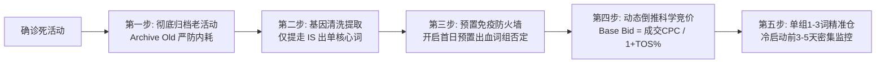

# 分析框架（产品匹配优先）

不要把“ACOS 高 = 否定、ACOS 低 = 加码”当主规则。广告要服务三件事，优先级是：

1. **相关搜索上的转化**（喂 Listing 搜索权重）
2. **自然流量 / 小类 BSR**
3. ACOS 作为成本约束，不是目的

不要把上述机制称为“A9”或“亚马逊最新官方算法”。亚马逊没有对外公布可引用的最新公式。对用户说明：这是可观察的工作假设——相关 query 转化好、错品点击少、核心大词出单稳，自然位和小类才更容易往前。

## 1. 产品画像

从 Listing/属性表抽出，写进报告开头：

- 品类与**小类 BSR 节点**（权重落在这个节点，不是大类）
- 形态与规格：有线 vs 无线、材质、容量、尺寸/兼容型号、家用 vs 商用…
- 真实核心功能 / 明确没有或不兼容的功能
- 价格、评分、评分数（决定商品页对比能不能赢）
- 日均销量走势、广告单占比、可售天数、库龄

然后列两张表（适用于任何品类与商品）：

- **IS**：应该花钱并追求 TOS 的 query 家族（本品的核心形态、主功能、目标人群）
- **IS NOT**：即使用户搜索量高、甚至偶然出单，也要坚决否定或暂停（错品类、不兼容型号、做不到的功能）

**多品类示例参考**：
- **3C数码配件（如 iPhone 16 磁吸手机壳）**：IS = magnetic case for iphone 16 / slim clear case；IS NOT = iphone 15 / wallet case / screen protector / otterbox。
- **家居小家电（如便携搅拌机）**：IS = portable blender / personal smoothie maker / usb rechargeable；IS NOT = commercial blender / food processor / glass pitcher / ninja。
- **运动户外（如 32oz 不锈钢保温水杯）**：IS = 32oz insulated water bottle / stainless steel flask；IS NOT = plastic bottle / 1 gallon jug / stanley tumbler with straw。

## 2. 意图桶

把每条搜索词、关键词分进：

| 桶 | 处理 |
|---|---|
| 核心相关 | 独立精准，抬有效 TOS 竞价 |
| 品牌 | 单独品牌仓，允许较高 TOS |
| 功能卖点（静音、大容量、定时） | 出精准，中等 TOS |
| 相邻能转（标题覆盖但不是小类主粮） | 保留低预算，不扩、不冲 TOS |
| 错品 / 本品做不到 | 否定或暂停，即使 ACOS 低 |
| 竞品品牌词 | 默认否；个别高转化再单独评估 |
| ASIN 对比 | 只留价格或功能能赢的竞品页 |

“相邻能转”常见于：刀片机打 espresso、吸尘器打蒸汽拖把同义词、配件打整机。能出单，但会把 Listing 推到错误人群，差评风险更高，对目标小类的自然流量帮助有限。

## 2.1 强相关功能词保护原则（禁止因短期数据差而误伤核心词）

理解产品功能点是广告诊断的第一前提。
强相关词（与产品核心卖点、关键参数、主要用途直接相关的词，如便携研磨机的 timer、conical burr、espresso grinder）：
- **深层原因剖析**：强相关词在报表中如果花费较高但出单差，**绝大多数时候并不是词本身错误，而是没有打到转化点上**：
  1. **位置跑偏**：展示和点击大多流失在转化极低的商品页（PP）或搜索其余位（ROS），没有抢到真正促成购买决断的搜索结果顶部（TOS）；
  2. **Listing 承接不足**：Listing 主图、五点没有在首屏突出买家搜索该功能词时所期望的视觉证据；
  3. **活动结构混乱**：混杂在宽泛或受众活动中，竞价被稀释，缺少针对性出价。
- **保护铁律**：
  - **严禁全仓否定**：强相关词一旦被否定，将直接斩断该 Listing 在该维度的自然搜索收录与关键词加权；
  - **整改方向**：原活动降低基础竞价以止血控费，开辟独立精准仓以可控预算测试 TOS 溢价与转化，同时排查页面首屏卖点呼应。

## 2.2 竞品功能与竞争力对标决策树（打不过时的降竞价 vs 否定）

投放竞品 ASIN 或触发竞品流量时，必须先对标双方的产品功能、声量壁垒与价格梯队，严禁仅凭短期亏损一刀切否定：
- **第一步：多维对标**：
  1. **价格带**：我品价格 vs 竞品售价；
  2. **声量壁垒**：我品评价数/星级 vs 竞品（是否有 3-5 倍以上的断层评价壁垒或知名大牌认知）；
  3. **功能点/规格对标**：我品在档位数量、功率、材质、便携性、智能化等具体功能点上是否存在平替或优势。
- **第二步：分流决策**：
  - **Case A（存在评价/品牌压倒性壁垒，打不过）**：竞品评分数是我们的数倍（如数千上万条 vs 我品数百条），且星级平齐或更高，或者知名大牌压制。我品在竞品详情页被无情比下。**决策：果断否定/暂停该 ASIN 投放，止血保预算**。
  - **Case B（价格相当或竞品更贵，我品具备功能点优势/平替价值）**：竞品价格与我品相当或竞品更贵，我品功能点不输甚至更强（如档位更多、材质更优），但当前 ACOS 偏高。原因多是基础竞价过高或 PP 溢价虚高导致实际 CPC 昂贵。**决策：严禁盲目否定！降低基础竞价 25-35% 或削减 PP 溢价，转为低成本防守/捡漏收割，保留低成本转化机会**。
  - **Case C（错形态/错品类竞品）**：竞品虽同在同类目但为非本品形态（如手动磨豆机或刀片机），买家需求本质不匹配。**决策：坚决否定**。

## 2.3 ABA 搜索量与排名梯队体系（大词看位置与竞争，长尾看转化）

通过领星 API 接入的亚马逊官方 ABA 搜索频率排名（`searchrank`），构建精细化分层策略：
- **MEGA_HEAD（全美 Top 5K 超级大词）**：全类目顶流词。竞争极其惨烈，顶部 CPC 极高。如果给的竞价低或没有位置溢价，展示必然被挤压到页面底部或第二页以后，点击多为逛街无效流量。**决策：绝不能盲目否定！如果要打，必须开独立精准仓控制顶部预算；如果不想争，压低基础竞价在其余位低成本捡漏**。
- **CORE_HEAD（Top 30K 头部主粮词）**：类目核心大词。搜索量大、相关性强。若表现差，先看 TOS 占有率与 CPC，通过调价与词流隔离优化，绝不一刀切否定。
- **MID_TAIL（Top 150K 腰部特征词）**：精准功能词、使用场景词。转化主力。
- **LONG_TAIL（Top 150K 外或无排名）**：长尾精准词。竞争小、转化率高。若长尾词持续高花费 0 转化，则基本确认为真实无效词，可果断降价或否定。

## 3. 位置与基础竞价

用户可见文本一律写**基础竞价**，不要写 BID。

```
搜索顶部实际竞价 ≈ 基础竞价 × (1 + TOS%/100)
```

若 CPC 是基础竞价的 2–3 倍，说明几乎只在顶部成交。此时：

- 发现/收割/自动：先把 TOS 从 200–300 降到 50–80
- 核心大词：提高 **基础竞价**，同时把 TOS% 降下来，让有效顶部竞价略升或持平，ROS 才有钱
- **禁止**在 TOS 300% 时把基础竞价从 0.30 提到 0.50（顶部会翻到 $2）

商品页溢价（PP）只对**能赢的 ASIN 对比**有意义，对搜索权重帮助有限。

**位置溢价一致性：** 手册里先写总表。后文每个活动的 TOS/PP/ROS「改成」必须与总表同一行完全相同。不允许总表写 80/30/50、详情里又写 120/60/80。

## 4. 活动角色

先给每个活动定性，再改：

| 角色 | 典型名字 | TOS | 预算 |
|---|---|---|---|
| 核心精准 | 大词 exact 单活动 | 中高，但靠抬基础竞价不靠 250%+ | 保证花得动 |
| 品牌精准 | 品牌词 | 可偏高 | 中 |
| 功能精准 | 卖点 exact | 中 | 中 |
| 收割 exact | “出单词” | ≤80 | 中，稳定赢家要迁走 |
| 发现广泛 | 手动广泛 | ≤70 | 中，核心 exact 要否定防抢量 |
| 自动紧密 | close match | ≤80 | 小 |
| 自动宽泛/拣漏/同类 | loose / substitutes | 0 单或错品就暂停 | 0 |
| SBV | 视频 | 轻量，不当销量引擎 | 常远小于日预算，该降 |
| ASIN | 竞品页 | PP 可留，TOS 低 | 只留能赢的 |

日预算远高于日耗 = 瓶颈在基础竞价/相关性，不是加预算。

重复投放：同一 exact 既在收割仓又在独立高 TOS 仓时，留数据更好的那条，暂停另一条。

## 5. 加码 / 否定阈值（参考，必须叠加产品匹配）

窗口默认 **30 天**。否定要慎重：样本不够就写“观察/先暂停”，不要装成定论。

- **迁出独立精准**：30 天订单 ≥5、ACOS ≤ 目标上限、且属于 IS
- **加基础竞价**：核心 IS、ACOS 低于目标、TOS 份额很低、日预算没花满
- **降基础竞价 / 降 TOS**：ACOS 高于目标但仍是 IS
- **暂停关键词**：词本身相关，但 30 天花费高、点击 ≥25、0 单 → 先暂停 7 天，不立刻否定
- **否定**：优先 IS NOT（本品做不到的形态/功能）。相关词 0 单不要急着否：30 天点击 ≥20 且 0 单的错品/竞品品牌/做不到的功能才否；点击 8–19 先暂停观察
- **ASIN 暂停**：CVR 明显低于搜索广告，且竞品评分数/价格碾压
- **ASIN 保留**：同形态、我们更便宜或功能差异看得见、CVR 接近搜索水平

目标 ACOS 用户没说时：用近期健康核心词的 ACOS 或保本毛利率当锚。各品类根据客单价与毛利不同各异（如 3C 标品 15–20%、家居/家电 20–25%、高毛利配件/美妆/服饰可至 30–35%）。有明确利润目标就以用户指定的为准。记住：达标 ACOS 但核心大词订单掉、自然位掉，算失败。

库存可售天数 > 90 且销量在掉：多砍错品，少砍核心量。可售天数 < 30：不要扩发现。

## 6. N-Gram 词根分析（隐性出血点挖掘）

传统只看单条 Search Term 的阈值（如 $8 且 0 单）容易漏掉“长尾隐性出血”：大量的长尾词各自只花了 $1~$3，但它们都包含同一个无效词根（例如错品形态词、配件词、不兼容型号等），合计数百美金零产出。

- **1-Gram / 2-Gram 聚合**：通过 `ngrams.tsv` 查看词根累计花费、订单与 ACOS。
- **词组否定判定**：当一个 1-Gram 或 2-Gram 在 30 天内**累计花费 ≥ $10、点击 ≥ 8、订单为 0**，且涵盖 2 个以上搜索词时，直接判定为 `Bleeding Root Phrase`。
- **执行方式**：在广泛活动（Broad）和自动活动（Auto）中添加**词组否定（Negative Phrase）**，直接从源头阻断该词根衍生出的所有无效点击。

## 7. 跨活动流量竞蚀（Cannibalization）检测

当多个活动或不同匹配方式投放了相同的底层 Query 时，会导致“自己人和自己人抬价”或“低效活动蚕食高效活动流量”：

- **典型症状**：
  1. 同一 Query 同时出现在「精准活动」与「自动/广泛活动」中；
  2. 自动/广泛活动的实际 CPC 居然高于精准活动，或者掠夺了 80% 以上的展示份额，但转化率（CVR）更低；
- **整改原则（词流隔离）**：
  1. 只要该 Query 已经在独立精准仓稳定出单，必须立即在对应的自动仓和广泛仓中添加**精准否定（Negative Exact）**；
  2. 确保精准词由独立精准活动完全掌控位置溢价与基础竞价，避免被宽泛活动以更高的 CPC 截流。

## 8. 权重逻辑（工作假设，非官方公式）

自然搜索和 Listing 权重，看的是 **该 query 是否相关、是否转化**，不是店铺广告总单，更不是 ACOS 数字本身。

- 小类要往前：核心大词的订单和 CVR 必须稳住，TOS 份额过低就加有效顶部竞价
- 错品点击会打脏相关性和转化，即使偶尔出单也伤害自然流量
- 商品页跟卖几乎不喂搜索权重
- 广告占比 70%+ 时，有机位弱，更要清洁 query，而不是用无关词堆销量

## 9. 改动顺序与 AI 动态跟踪节奏

**第 0 天（止血与去毒）**：暂停明确亏损活动；降发现/收割/自动 TOS；否定证据确凿的物理错品（Negative Exact）与出血词根（Negative Phrase，**否定动作零冷静期**）；在广泛/自动仓中精准否定已被独立精准收割的词（防竞蚀）。核心大词基础竞价不动。

**第 1 天（竞价与迁词）**：核心/品牌/功能词抬基础竞价，同步降低 TOS%。把收割仓稳定赢家迁到对应精准仓，并在发现仓 exact 否定。

**第 2-3 天（AI 熔断扫描与探底回踩）**：
- **失血熔断检查**：扫描是否有活动出现预算提前秒空、CPC 异常暴涨超预期 >40% 或高花费零出单。若触发，**立即打破观察期，紧急限价/下调溢价止血**！
- **休克断流检查**：扫描是否有活动曝光量断崖下跌 >75% 且点击停摆。若核心大词订单掉 >30%，**绝不可死等 7 天**，立即启动「梯级微调回踩探底（Step-up Bid Probe）」：基础竞价小幅回提 10%~15%（或 +$0.05~$0.08），拉回基本曝光流速，保护自然销售速度（Sales Velocity）与小类 BSR。

**第 7 天（全域稳态验收与死活动裁决）**：
- 观察期满，综合评估核心大词订单、小类 BSR、自然单占比与全店 TACOS；
- 针对多次调整后依然处于“高出价无曝光”或“负向数据饱和”的活动，依照第 13 节执行**死活动归档与净水器式重生**。

不要同一天改完所有东西。配套使用 `bulk_adjustments.tsv` 逐项对照核对。

## 10. AI 动态弹性观察期与异常熔断纠偏体系（AI-Driven Dynamic Observation & Circuit Breakers）

广告运营最大的陷阱之一是**“过度优化 / 频繁调价 (Hyper-adjustment)”**。每天拉取一段累加数据，如果不识别历史操作，算法就会每天重复给出调价建议。
然而，将观察期生硬地规定为“绝对不可触动的 7 天死规则”，同样是在商业实战中极其危险的教条主义！

### 10.1 为什么必须依据“自变量控制值”而非“因变量 CPC”
- **CPC 是被动结果变量**：受竞争对手出价、大促节点、展示位分布（TOS 溢价位 vs PP 基础位）多重干扰。若更多点击落在无溢价的商品页，CPC 自然下跌，但运营并未改动竞价；若竞价调低后恰逢大促竞价暴涨，CPC 反而可能上升。
- **基础竞价与位置溢价是主动控制变量**：基础竞价（Base Bid）、位置溢价百分比（TOS/PP/ROS%）、日预算与状态，才是运营真正亲手调整的参数。判断“某天有没有做调整”，必须以**直接调整值（自变量）是否发生改变**为唯一事实依据。

### 10.2 亚马逊 API 限制与快照差分解法
- 亚马逊广告 Reporting API 的机制是：**指标按天留存，但配置字段（bid、placement% 等）永远只返回当前实时快照**，不会返回历史每天的竞价切片。
- **解法**：系统在每次运行时自动保存控制变量快照（`snapshots/{portfolio_id_or_asin}_snapshot.json`）。下次运行时自动比对两次快照：
  - `当前 TOS%` vs `上次 TOS%`
  - `当前 基础竞价` vs `上次 基础竞价`
  - `当前 状态` vs `上次 状态`

### 10.3 告别“死等 7 天”：AI 动态理想出入判别与三级熔断机制
系统设定 **3 - 7 天为基准观察期**，但**绝对不是死规则**。每次分析时，AI 模型自动将「调整后实际运行轨迹」与「预期理想基准」进行多维差分对标：

#### 10.3.1 基准观察期防的是什么？（何时必须管住手）
- **防 24-48 小时归因滞后**：买家加购考虑与系统订单回补需要时间，前一天的数据往往在后两天回补单量；
- **防小样本泊松分布噪音**：单日 5-10 次点击 0 单属于纯统计学波动（$P > 35\%$），不可轻判死刑；
- **给算法拍卖稳态时间**：竞价变动后，系统底层胜出率计算需要 48-72 小时收敛。
- **【正常公差动作】**：指标在正常波动公差内，标记为 `[NORMAL_OBSERVATION]` 保持锁定，严禁日常手痒频繁微调。

#### 10.3.2 为什么必须具备即时熔断？（何时绝不可死等）
若调整后出现剧烈的“理想出入”，死等 7 天会导致预算被掏空或 Listing 自然权重发生毁灭性猝死。AI 模型一旦检测到以下异常指纹，**强制穿透冷静期锁定，即刻输出紧急纠偏动作**：

| 熔断类型 | 触发指纹（理想出入特征） | 底层病因 | AI 紧急纠偏决策与动作 |
|---|---|---|---|
| **1. 失血暴冲熔断 (`CIRCUIT_BREAKER_BLEED`)** | ① 调整后日预算在半天内秒光；<br>② 实际扣费 CPC 异常暴涨超预期 >40%；<br>③ 单日花费击穿保本且零出单（如花 $20+ 0 单）。 | 竞价与 TOS 溢价叠加失算，或宽泛匹配误踩超级大词（Top 1K）。 | **立即打破观察期！**<br>在 `bulk_adjustments.tsv` 输出 `Emergency_Placement_Throttle`：将 TOS 溢价砍半或降低基础竞价 25%，关闭失血阀门。 |
| **2. 休克断流熔断 (`CIRCUIT_BREAKER_SHOCK`)** | ① 调整后曝光量断崖下跌 >75%~80%；<br>② 点击量几乎归零，连续 24-48h 停摆；<br>③ 核心主粮词自然搜索排位濒临跌出前页。 | 基础竞价降破当前类目竞价准入门槛，广告彻底休克。销售速度（Sales Velocity）中断将重创自然排名。 | **绝不可死等 7 天！**<br>于第 2-3 天启动**阶梯微调回踩探底 (Step-up Bid Probe)**：基础竞价小幅回升 10%~15%（或 +$0.05~$0.08），将有效竞价拉回展示临界线之上。 |
| **3. 毒性错品泄漏熔断 (`CIRCUIT_BREAKER_TOXIC`)** | 报表中迅速涌入确凿的 IS NOT 物理冲突词或出血词根。 | 匹配方式或竞价变动放开了不相关流量。 | **否定操作零冷静期 (Zero-Cooldown Rule)！**<br>无需任何观察期，抓到毒词立即精准否定（Negative Exact）或词组否定（Negative Phrase）。 |

### 10.4 长短双轨制与调后动态差分纠偏引擎 (Dual-Window Framework & Dynamic Delta Engine)

针对“拿过去一段时间平均数据指导调后动作”的行业通病，本系统强制实施**长短周期双轨制分工与调后动态差分判定**：

#### 10.4.1 为什么绝对不能用 30 天平均数据指导调后动作？
- **滞后均值稀释陷阱**：假设某活动前 25 天因虚高 TOS 导致 CPC 高达 \$1.20，运营 3 天前大幅下调了溢价，近 3 天实际 CPC 已成功降至 \$0.55；
- **若只看 30 天累积报表**：前 25 天的权重高达 89%，算出来的 30 天平均 CPC 依然高达 \$1.07！
- **灾难性误判**：死板工具会误以为“当前 CPC 依然虚高”，建议运营“再次砍价”，导致已经调到位的活动被**二次腰斩直接休克猝死**！
- **因此：对于已经调整过的活动，必须以调整后的最新走向（近 7 天 / 近 3 天）为依据动态纠偏！**

#### 10.4.2 长短双轨制的分工职责
- **长周期（30 天宏观基线 `macro_30d`）**：
  - **核心职责**：提供大样本置信度。用于本品 IS / IS NOT 属性分桶、N-Gram 词根累计耗损挖掘（高置信度词组否定）、全美 ABA 搜索量梯队拆解、全账户移词漏斗审计。
- **短周期（近 7 天走向 `recent_7d` & 近 3 天调后切片 `recent_3d`）**：
  - **核心职责**：捕捉最鲜活的真实成本、即时流速与调后变化。用于有效 CPC 裁定、调后见效判定、断流休克排查与即时纠偏。

#### 10.4.3 调后四大差分判定算法（Delta Metrics）
系统自动计算 $\Delta \text{CPC} = \frac{CPC_{\text{近3天}} - CPC_{\text{30天}}}{CPC_{\text{30天}}}$ 与 $\Delta \text{Imp} = \frac{Imp_{\text{近3天日均}} - Imp_{\text{30天日均}}}{Imp_{\text{30天日均}}}$：

1. **【调后生效·见效保持 (`ADJUSTMENT_EFFECTIVE`)】**：
   - **条件**：活动处于观察期，$\Delta \text{CPC} \le -15\%$ 且曝光流速稳定（$\Delta \text{Imp} > -60\%$）。
   - **裁决**：**调整已达预期，严禁二次砍价！** 保持当前参数稳态运行，杜绝过度优化。
2. **【调后休克断流·立即回踩探底 (`CIRCUIT_BREAKER_SHOCK`)】**：
   - **条件**：活动处于观察期，近 3 天日均曝光断崖下跌 $\Delta \text{Imp} \le -70\%$（基线日均曝光 $\ge 50$）。
   - **裁决**：**调价降破大盘门槛导致休克！** 立即打破观察期，在 `bulk_adjustments.tsv` 输出 `Probe_Bid_Recovery`（基础竞价回提 10%-15% 或 +$0.05）拉回展示池。
3. **【调后持续失血·紧急纠偏 (`CIRCUIT_BREAKER_BLEED`)】**：
   - **条件**：调整后近 3 天花费 $\ge \$15$ 仍为 0 单，或近 3 天 ACOS 仍超出目标 2 倍。
   - **裁决**：上次调整幅度不足或未阻断核心漏水点，打破观察期，立即输出 `Emergency_Placement_Throttle` 二次限价。
4. **【正常公差监控 (`NORMAL_MONITORING`)】**：
   - **条件**：指标变动在正常统计波动范围内（小样本、归因滞后）。
   - **裁决**：保持 `IN_OBSERVATION` 锁定，静待算法稳态。

## 11. 否定关键词全生命周期决策与排名保护模型（4-Tier Negative Lifecycle & Rank Protection Framework）

广告否定是亚马逊运营中“杀伤力最大、且最具不可逆性”的动作。严禁将否定当成唯一的降本手段。

### 11.1 否定词的底层机制与不可逆风险
- **广告匹配的永久切断**：在广告活动/广告组层级添加否定词后，亚马逊广告算法会立即**永久阻断**该广告单元对该搜索词的竞价匹配。
- **流量彻底消失**：该词从此在该广告活动中绝迹。如果广泛/自动仓被词组否定（Negative Phrase），则包含该词根衍生出的数以百计的长尾词也将全部被阻断。
- **自然搜索连带伤害**：亚马逊的飞轮效应依赖“广告出单 -> 增加关键词出单频次与销售速度 -> 提升自然搜索排位（BSR）”。若将核心品类大词或强相关词盲目否定，会导致广告不再喂养该词的转化权重，连带拉低自然位和小类排名！
- **恢复成本极高**：一旦误伤核心词，必须人工到后台（领星或亚马逊 Seller Central）找到该否定记录并归档（Archive）。算法重新识别和学习需要数天到数周。

### 11.2 前期表现不好 vs 以后会表现好：5大维度判别准则

| 判别维度 | 表现特征 | 根本原因剖析 | 决策动作 |
|---|---|---|---|
| **1. 物理与功能矛盾 (IS NOT)** | `burr`、`cordless`、`manual`、`220v`、`espresso machine`、`weed` | 买家期望与产品客观物理属性完全冲突。转化差是必然的，偶尔误买也会招致差评与退货。 | **永久硬否定 (Permanent Hard Negative)**：精准/词组否定，绝不手软。 |
| **2. 核心主粮与强相关 (IS / BSR)** | `coffee grinder electric`、`spice grinder`、`grinder for kitchen` | 产品主粮词，ABA 排名极高。前期表现差多是**竞价过高、落入低效 ROS/PP 位、或处于蓄水期**。 | **严禁全仓否定！** 调低基础竞价（$0.35-$0.45）、削减 PP 溢价、或移入独立精准仓低价收割。 |
| **3. 临近需求与季节性 (Adjacent)** | `kitchen appliances`、`christmas coffee gift`、`espresso grinder` | 淡季非刚需，或当时 Review 较少。在 Q4 假日季或大促期可能爆发转化。 | **软性抑制 (Soft Suppression)**：降低出价或暂停 7-14 天，**严禁词组否定**，保留旺季复活机会。 |
| **4. 小样本统计学偏差** | 花费 $10-$15，点击 10-15 次，0 订单 | 类目平均转化率 10% 左右。在 10 次点击下 0 订单的纯随机发生概率高达 35%，纯属统计学波动。 | **观察观察再观察**：不轻判死刑，设置更严格的置信度阈值（≥20-25 点击）。 |
| **5. Listing 竞争力演进** | 早期表现平平的词，随产品成熟爆发 | Listing 积累了 1500+ 评价、评分 4.5 星、且有秒杀大促时，转化能力脱胎换骨。 | **动态召回重测**：随 Listing 竞争力提升逐步释放原本被压制的词。 |

### 11.3 已有生效否定词的反向体检与漏斗审计（Negative Recovery Audit）
传统广告工具的致命缺陷是**“只管新增否定，不管历史误否，且反复推荐已否定的词”**。本技能建立闭环反向纠偏机制：
1. **全量解析已有否定状态**：从 `search_terms.json` 的 `st_negative`（"广告组精准否定"、"广告组已否定"）与 `kw_negative` 提取全量已有否定词库；
2. **输出 `active_negatives.tsv`**：沉淀当前所有正在生效的否定词与其历史表现；
3. **全账户投放状态穿透核验**：绝不孤立看待单活动否定记录，必须全量交叉比对整个广告组合（Portfolio）中所有关键词的投放与暂停状态；
4. **新动作 100% 去重**：已生效的否定词绝不再出现在新否定建议中，杜绝运营重复无用功。

### 11.4 跨广告活动联动与移词漏斗审计（Keyword Migration Funnel Audit）
在成熟的精细化运营中，卖家往往在领星等 ERP 中配置了**“移词规则（Keyword Migration / Harvesting Rule）”**：
- 当广泛/自动仓（Discovery Campaign）中的搜索词出单或达到转化门槛时，系统会自动将其提升至独立精准活动（Exact-Prove 或专用 Exact 活动）进行定向放大；
- 同时，为了**防止同账号下广泛与精准相互竞价、内耗夺流（Anti-Cannibalization）**，系统会在原广泛仓自动添加该词的精准否定（Negative Exact）。

**审计铁律：严禁孤立看待否定词库，必须穿透整个广告组合（Portfolio）核验全账户投放状态！**

| 否定词审计状态 | 判定条件 | 业务本质 | 处理建议与动作 |
| :--- | :--- | :--- | :--- |
| **已移词受保护 (`PROMOTED_MIGRATED_PROTECTED`)** | 在广泛仓已否定，但在精准仓处于 `enabled` 正常投放（且有出单） | **正常移词漏斗**：精准仓在高效承接流量，广泛否定用于防内耗 | **保持否定（Keep_Negated_Migrated）**。严禁在广泛仓解否！否则会引发广泛与精准内耗、拉高 CPC、破坏漏斗层级。 |
| **移词后断流误杀 (`MIGRATED_BUT_PAUSED_IN_EXACT`)** | 在广泛仓已否定，精准仓有此词但处于 `paused` 暂停状态 | **全账户完全断流**：广泛被否 + 精准被停，导致该转化核心词在全账户彻底死亡 | **在精准仓重新开启（Unpause_Keyword，基础竞价 $0.50-$0.65）**；广泛仓继续保持否定防内耗。严禁在广泛仓解否！ |
| **全账户未投放孤儿词 (`TRUE_ORPHAN_NEGATIVE`)** | 在广泛/自动仓被否定，但全账户任何广告活动均未投放，且属于强相关/历史出单/高排名词 | **真正误杀的核心资产**：人工误操作否定或移词漏斗遗漏 | **收割进精准仓（Harvest_To_Exact，基础竞价 $0.50）** 或在广泛仓恢复。优先推荐移入 `exact-prove` 精准仓干净承接。 |
| **物理硬伤与竞品排除 (`SAFE_HARD_NEGATIVE`)** | 包含 IS NOT 物理冲突词（如 `burr`、`cordless`）或竞品品牌 | **永久性结构止血**：规避客诉、差评与退货 | **保持永久否定（Keep_Negated）**。若在精准仓误投放，同步执行 `Pause_Keyword`。 |
| **自身 ASIN 自动仓防御 (`SAFE_ASIN_DEFENSE`)** | 自动仓中否定了自身主推 ASIN | **防自我抢量**：避免自动仓吃自身自然流量 | **保持否定（Keep_Negated）**。正常防御架构。 |
| **低意图边缘监控 (`SOFT_MONITOR`)** | 低意图/低点击/0出单词，处于观察期 | **淡季低频词** | **保持否定/监控（Keep_Negated_Offpeak）**，旺季再行评估。 |

### 11.5 跨活动移词与复活基础竞价动态倒推测算模型（Dynamic Inverted Bid Model）
很多运营在移词时习惯**“拍脑袋设个 $0.80 或直接沿用原词出价”**，这往往导致灾难性的后果：
- **致命陷阱（CPC 膨胀与误暂停恶性循环）**：
  若原广泛仓转化时的实际 CPC 是 $0.75，而目标精准活动（如 `exact-prove`）配置了 **TOS 50% 溢价**。如果运营直接给新词设置基础竞价 $0.85，那么该词在搜索结果顶部的最高出价将变成 $\$0.85 \times (1 + 0.50) = \$1.275$！实际点击 CPC 迅速飙升至 $1.10~$1.30。由于单次点击过贵导致 ACOS 爆表，运营或规则随后直接将该词 **PAUSE 暂停**；而原活动的否定又未解开，导致**核心词全账户断流**。

- **科学解法：动态倒推测算公式 (Dynamic Inverted Bid Formula)**：
  在将词移入或复活到新广告活动时，必须以**原活动出单 CPC（Anchor Converting CPC）**为锚点，结合目标活动的 **TOS / PP 位置溢价**反推基础竞价：
  $$\text{建议基础竞价 (Base Bid)} = \text{round}\left(\frac{CPC_{\text{历史出单}}}{1 + \frac{TOS_{\text{目标}}}{100}}, 2\right)$$
  - **TOS 顶部精准咬合**：经此公式计算后，该词在目标精准仓经过 TOS 溢价加成后的实际顶部出价为：
    $$\text{有效顶部竞价} = \text{基础竞价} \times \left(1 + \frac{TOS_{\text{目标}}}{100}\right) \approx CPC_{\text{历史出单}}$$
    既保证了新词在精准活动顶部有充足的竞价竞争力，又将实际点击成本牢牢锚定在历史上证明能赚钱的 CPC 水平，彻底杜绝 CPC 膨胀与二次误暂停！
  - **零出单探索词折扣机制**：若原活动中该词有点击但尚未出单（如孤儿测试词），基准 CPC 自动打 85% 试错折扣后再行倒推，确保探索成本可控。

## 12. 搜索词多维广告位指纹诊断与动态调整决策树 (Multi-Dimensional Placement Fingerprint & Dynamic Action Tree)

传统粗暴规则（如“点击 ≥ 15 且 0 单即否定”）是亚马逊精细化广告运营的最大误区之一。

### 12.1 为什么不能看“点击多未出单就否定”？
- **流量质量与广告位高度绑定**：
  - **搜索结果顶部 (Top of Search / TOS)**：买家输入具体意图后第一时间看到，注意力最集中，CTR 通常在 1.5%~5%+，转化率（CVR）通常在 12%~25%+。
  - **商品详情页 (Product Pages / PP)**：广告展示在竞品详情页的轮播栏（Carousels: "Products related to this item"），买家处于逛街或比价状态，容易被其他竞品分流或误触，CTR 极低（0.15%~0.40%），CVR 往往低至 2%~5%。
  - **其余搜索位置 (Rest of Search / ROS)**：第 2 页以后或搜索页底部，意图较弱。
- **好词被困在垃圾位的悲剧**：
  一个高相关度、有巨大潜力的主粮词（如 `coffee grinder electric`），在广泛活动中累积了 14 次点击 0 订单。如果只看点击和出单，运营会认为“这是个无效亏损词，赶紧否定！”
  但如果看**广告位指纹**：其曝光量高达 2422 次，CTR 仅 0.58%，扣费 CPC 仅 $0.68。
  这表明：**这 14 次点击 100% 耗散在转化极差的商品详情页轮播位，该词根本没有机会在转化率最高的首页顶部获得哪怕一次曝光！**
  一旦粗暴否定，该词在全账户彻底断流，Listing 永远失去了这一核心主粮维度的自然搜索加权机会！

### 12.2 四维位置指纹反推算法 (Four-Dimensional Placement Fingerprint Model)

虽然亚马逊 API 的搜索词报表不直接提供 placement 列，但我们可以通过以下四个维度实现极高精度的位置反推：

#### 维度一：CTR 行为指纹 (CTR Fingerprint)
- **$CTR \ge 1.5\% \sim 3\%+$**：强烈指向**首页顶部 (TOS)**。首屏大图高意图搜索下点击率显著高于其他位置。
- **$CTR \le 0.40\%$ 且曝光高（$\ge 500$）**：强烈指向**商品详情页轮播位 (PP Carousel)**。买家滑动浏览大量产品，产生数千曝光但极少点击。
- **$0.40\% < CTR < 1.2\%$**：偏向**搜索结果底部位或其余位置 (ROS)**。

#### 维度二：扣费 CPC 与竞价天花板的数学断言 (Mathematical CPC Ceiling)
在动态竞价-仅降低（Dynamic Down）或固定竞价下：
- **商品页最高竞价上限**：$MaxBid_{PP} = 基础竞价 \times (1 + PP\%)$
- **其余位置最高竞价上限**：$MaxBid_{ROS} = 基础竞价 \times (1 + ROS\%)$
- **非 TOS 最高竞价天花板**：$MaxBid_{\text{non-tos}} = \max(MaxBid_{PP},\ MaxBid_{ROS})$
- **【数学必然判定】**：若实际 $CPC > MaxBid_{\text{non-tos}} \times 1.02$，则该次扣费**在数学上 100% 必然来自于首页顶部 (TOS)**！因为其他位置的竞价上限根本无法产生如此高的扣费。

#### 维度三：曝光点击流速比（Grazing Index / 浏览指纹）
- 数千次曝光、极低 CTR、低 CPC：典型详情页“逛街草料位”（Grazing placement）。

#### 维度四：广告活动宏观大盘位置交叉验证
- 结合广告活动层级的 `placement_product_page` vs `placement_top` 实际出单率与 `top_of_search_impression_share`。若活动 80% 点击集中在 PP 且 CVR 极低，则该活动内低 CTR 词受害于商品页的概率极大。

---

### 12.3 四大核心决策场景与丰富动态调整动作

| 场景代码 | 诊断条件 | 本质原因 | 核心调整决策与建议 |
| :--- | :--- | :--- | :--- |
| **1. 困在商品页的潜质核心词 (`TRAPPED_CORE_HERO`)** | 属于 IS/核心功能词/高 ABA 排名；<br>CTR 低（≤0.65%），CPC 偏低（≤非TOS上限）；<br>曝光高（≥500），点击累积（≥8）但 0 订单。 | 词本身极好，但出价或溢价结构导致其被困在详情页轮播位，从未在首页顶部充分曝光。 | **绝对禁止盲目一刀切否定！**<br>执行**动态提权拯救 (`Elevate_To_TOS`)**：<br>① **方案 A（原活动提权）**：提高该活动 TOS 溢价至 60%-80%，将商品页溢价降至 0%-10%，基础竞价微涨 15%，强行将流量抽调至首页顶部，观察 7 天 TOS 真实转化；<br>② **方案 B（精准仓独立收割）**：提取至独立精准仓（如 `*-exact-prove`），配置高 TOS 溢价，以独立预算专打首屏黄金位。 |
| **2. 首页顶部已获高意图曝光但无法转化词 (`FAILED_AT_TOS`)** | CTR 高（≥1.5%），CPC 高（超过非TOS上限）；<br>已累积较多点击（≥12-15）但 0 订单。 | 已经享受了最顶级的黄金首屏流量，买家带着强烈意图点击依然拒绝购买。说明首屏存在价格、评分数壁垒，或与买家核心期望存在差异。 | **严禁继续盲目加价或推高 TOS（会加速失血）！**<br>① **若为边缘弱相关/非核心词**：果断执行**精准否定 (`Negative_Exact`)** 彻底止血；<br>② **若为不可放弃的品类主粮词**：执行**防守降竞价 (`Throttle_TOS_Bid`)**，基础竞价下调 25%-30% 退守其余位捡漏，同时重点排查 Listing 首屏视觉、主图痛点与价格对比竞争力（如挂 Coupon 提升首屏点击购买意愿）。 |
| **3. 虚高 TOS 溢价导致其余位置窒息 (`HIGH_TOS_ASPHYXIATION`)** | 基础竞价极低（≤$0.30），TOS 溢价虚高（≥150%-300%）；<br>除偶尔高价顶部点击外，其余位置几乎零曝光。 | 竞价结构畸形，基础竞价过低压制了其余搜索位的自然收割，而超高 TOS 又导致单次点击成本过高。 | **执行结构拉平重塑 (`Rebalance_Placement_Structure`)**：<br>将 TOS 溢价下调至 50%-70%，基础竞价回升至 $0.45-$0.55，释放其余位置（ROS）的平价转化空间。 |
| **4. 物理硬伤与竞品品牌词 (`HARD_MISFIT`)** | 包含 IS NOT 物理冲突（如刀片机搜索 burr 锥磨）或竞品品牌词。 | 买家期望与产品客观物理属性完全冲突。 | **坚决精准否定 (`Negative_Exact`) 或词组否定 (`Negative_Phrase`)**，无论在何种位置展示都坚决剔除。 |

---

## 13. 死活动判定标准与净水器式重生矩阵 (Dead Campaign Rebirth Protocol)

在亚马逊广告实战中，很多运营常遇到一种绝境：“某个广告活动无论怎么加竞价、抬溢价，就是不给曝光，或者稍微给点曝光就全是不转化的垃圾流量”，俗称**“活动跑死了/被算法打入冷宫”**。此时，如果继续在原活动里死磕微调，往往是事倍功半。

### 13.1 亚马逊广告质量得分（Ad Quality Score）与冷启动探索期真相
- **老活动的长期负向记忆**：亚马逊广告系统的核心目标是“单位展示期望收益最大化（$eCPM = Bid \times CTR \times CVR$）”。若一个老活动在过去 30-90 天内跑了数千次无转化点击、CTR 极低（如 ≤0.2%），系统算法会给该活动打上极低的相关性质量得分。即使你现在把竞价提到天花板，系统也认定该单元转化概率极低，拒绝分配优质展示位。
- **新建活动的冷启动红利 (Cold Start Exploration)**：新建一个广告活动时，**历史负向数据包袱全部清零**；同时亚马逊算法会赋予新活动 3-7 天的探索期加权，给予更多首屏或相关展示以测试其真实潜力。

### 13.2 判定“死活动”的三大确诊指纹（满足以下条件判定已无原位抢救价值）
只有在经过冷静期干预与探底测试后，同时符合以下特征时，系统才正式下达 `CAMPAIGN_DEAD_ARCHIVE_AND_REBIRTH` 裁决：
1. **展示死锁（算法冷宫）**：基础竞价已高于市场建议上限、TOS 溢价已给到 60%-80%，但在 5-7 天内日均曝光依然停留在两位数甚至个位数，活动彻底丧失流动性；
2. **负向沉淀饱和**：老活动历史累计花费数百美金、累计点击 ≥100 次但整体 CVR < 3%，当期微调预算已无法稀释庞大的历史负向得分；
3. **架构基因污染不可逆**：早期创建的杂货铺式活动（一个广告组混入 30-50 个不同层级词、广泛与精准混跑），内部流量竞蚀严重，系统意图标签彻底混乱。

### 13.3 净水器式重生 5 步标准操作规程 (SOP)
严禁“不加清洗地盲目重开一个一模一样的新活动（那只会迅速重新跑死）”！重生必须执行“净水器式过滤”：



1. **第一步：彻底归档老活动（Archive Old Campaign）**：
   - 坚决归档（Archive）原死活动，严禁新老活动同时开启造成自己和自己顶价。
2. **第二步：基因清洗与资产提取（Purified Asset Extraction）**：
   - 从老活动的搜索词报表中，**仅提取已被验证出过单、且属于 `IS`（强相关主粮词/卖点词）的高价值词**；所有历史 0 单的泛词、边缘词彻底丢弃。
3. **第三步：开启前预置免疫防火墙（Pre-emptive Negative Phrase Firewall）**：
   - **关键避坑点**：在新活动创建的第 0 秒，直接将历史 `bleeding_ngrams.txt` 中挖掘出的出血词根与 `IS NOT` 错品形态词，添加为**词组否定（Negative Phrase）**，从根源切断新活动再次跑偏的可能！
4. **第四步：动态倒推科学起步竞价（Inverted Anchor Bid Calculation）**：
   - 严禁拍脑袋出价。依照公式 $\text{建议基础竞价} = \text{round}\left(\frac{CPC_{\text{历史出单}}}{1 + \frac{TOS_{\text{目标}}}{100}}, 2\right)$ 设定，保证新活动加成后在首屏顶部有充足竞争力，同时单次点击成本牢牢咬合历史出单水平。
5. **第五步：单组 1-3 词架构与前 3-5 天密集监控**：
   - 新活动采用极窄架构（单词单组或 1-3 个高度同义词），便于完全掌控预算与展示位；
   - 充分利用新活动前 3-5 天的冷启动探索红利，紧密跟踪首屏 TOS 占有率与 CTR。

---

## 14. 本地持久化数据库台账与调后效果归因模型 (Persistent DB Ledger & Effect Attribution Algorithm)

### 14.1 架构设计：会话瞬态与业务记忆解耦
- **核心认知**：AI 对话窗口（Chat Context）是展示终端，绝不可作为业务记忆的数据库。将调价记录留存在聊天窗口中会导致三大必然失效：Token 截断遗忘、上下文模仿惯性、换新窗口彻底失忆。
- **持久化分层解耦**：系统在项目根目录维护物理 `db/` 数据库，所有调控事件、基线指标与每日截面全部落地到文件，实现跨会话、跨窗口的无限期追溯。

### 14.2 数据库目录结构规范
```
db/
├── daily_records/       # 每日数据截面库（JSON 归档，记录每天取数时的完整大盘、Listing与活动指标）
│   └── {KEY}_{YYYYMMDD}.json
├── ledger/              # 调控历史台账与效果归因库（JSON 与 TSV 双轨持久化）
│   ├── {KEY}_ledger.json
│   └── {KEY}_ledger.tsv
└── snapshots/           # 自变量状态快照库（记录活动当前最新 TOS/PP/ROS/竞价/状态）
    └── {KEY}_snapshot.json
```

### 14.3 动态效果归因模型 (Effect Attribution Engine)
当在任何新旧窗口运行分析脚本时，系统自动调取 `db/ledger/{KEY}_ledger.json` 中记录的历史事件，并以**调整发生时的基线指标**与**调后今日最新微观切片（近 3 天）**进行逐行对账：

1. **变动率计算公式**：
   $$\Delta \text{CPC}\% = \frac{\text{CPC}_{\text{近3天}} - \text{CPC}_{\text{调前基线}}}{\text{CPC}_{\text{调前基线}}} \times 100\%$$
   $$\Delta \text{Imp}\% = \frac{\text{DailyImp}_{\text{近3天}} - \text{DailyImp}_{\text{调前基线}}}{\text{DailyImp}_{\text{调前基线}}} \times 100\%$$

2. **四大归因状态裁决标准**：
   - **【调后生效·见效保持】(`ADJUSTMENT_EFFECTIVE`)**：
     - 判定条件：$\Delta \text{CPC} \le -15.0\%$ 且 $\Delta \text{Imp} > -70.0\%$。
     - 业务含义：证明前序降价/降溢价动作极为成功，成本显著下降且未伤及曝光流速。
     - 运营指令：**见效保持，严禁二次砍价！**
   - **【调后休克断流】(`CIRCUIT_BREAKER_SHOCK`)**：
     - 判定条件：$\Delta \text{Imp} \le -70.0\%$ 且近 3 天订单为 0。
     - 业务含义：降价用力过猛导致跌破竞价门槛，面临自然权重滑落风险。
     - 运营指令：**立即回踩探底 (+10%~+15%) 激活曝光！**
   - **【调后失血暴冲】(`CIRCUIT_BREAKER_BLEED`)**：
     - 判定条件：$\Delta \text{CPC} \ge +40.0\%$ 或近 3 天花费严重超标无单。
     - 业务含义：调控引发广告位恶性竞价或跑偏失血。
     - 运营指令：**紧急切断溢价 / 下调竞价控费！**
   - **【动态观察期(重敛中)】(`IN_OBSERVATION`)**：
     - 判定条件：改动天数 $\le 3$ 天，且指标在正常统计公差内波动。
     - 业务含义：处于算法稳态重敛期，避免过早主观干预。
     - 运营指令：**数据重敛中，保持观察。**

### 14.4 跨会话零摩擦报告交付
每次新开对话窗口时，生成的广告调整手册第 2 节强制完整输出《历史调控台账与调后效果复盘对账总表》，使每一次复盘都建立在真实客观的历史演进证据链之上。


