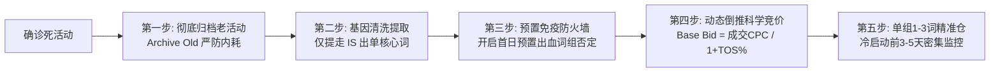

# 分析框架（产品匹配优先）

不要把“ACOS 高 = 否定、ACOS 低 = 加码”当主规则。广告要服务三件事，优先级是：

1. **相关搜索上的转化**（喂 Listing 搜索权重）
2. **自然流量 / 小类 BSR**
3. ACOS 作为成本约束，不是目的

不要把上述机制称为“A9”或“亚马逊最新官方算法”。亚马逊没有对外公布可引用的最新公式。对用户说明：这是可观察的工作假设——相关 query 转化好、错品点击少、核心大词出单稳，自然位和小类才更容易往前。

## 1. 产品画像

从 Listing/属性表抽出，写进报告开头：

- 品类与**小类 BSR 节点**（权重落在这个节点，不是大类）
- 形态与规格：有线 vs 无线、材质、容量、尺寸/兼容型号、家用 vs 商用…
- 真实核心功能 / 明确没有或不兼容的功能
- 价格、评分、评分数（决定商品页对比能不能赢）
- 日均销量走势、广告单占比、可售天数、库龄

然后列两张表（适用于任何品类与商品）：

- **IS**：应该花钱并追求 TOS 的 query 家族（本品的核心形态、主功能、目标人群）
- **IS NOT**：即使用户搜索量高、甚至偶然出单，也要坚决否定或暂停（错品类、不兼容型号、做不到的功能）

**多品类示例参考**：
- **3C数码配件（如 iPhone 16 磁吸手机壳）**：IS = magnetic case for iphone 16 / slim clear case；IS NOT = iphone 15 / wallet case / screen protector / otterbox。
- **家居小家电（如便携搅拌机）**：IS = portable blender / personal smoothie maker / usb rechargeable；IS NOT = commercial blender / food processor / glass pitcher / ninja。
- **运动户外（如 32oz 不锈钢保温水杯）**：IS = 32oz insulated water bottle / stainless steel flask；IS NOT = plastic bottle / 1 gallon jug / stanley tumbler with straw。

## 2. 意图桶

把每条搜索词、关键词分进：

| 桶 | 处理 |
|---|---|
| 核心相关 | 独立精准，抬有效 TOS 竞价 |
| 品牌 | 单独品牌仓，允许较高 TOS |
| 功能卖点（静音、大容量、定时） | 出精准，中等 TOS |
| 相邻能转（标题覆盖但不是小类主粮） | 保留低预算，不扩、不冲 TOS |
| 错品 / 本品做不到 | 否定或暂停，即使 ACOS 低 |
| 竞品品牌词 | 默认否；个别高转化再单独评估 |
| ASIN 对比 | 只留价格或功能能赢的竞品页 |

“相邻能转”常见于：刀片机打 espresso、吸尘器打蒸汽拖把同义词、配件打整机。能出单，但会把 Listing 推到错误人群，差评风险更高，对目标小类的自然流量帮助有限。

## 2.1 强相关功能词保护原则（禁止因短期数据差而误伤核心词）

理解产品功能点是广告诊断的第一前提。
强相关词（与产品核心卖点、关键参数、主要用途直接相关的词，如便携研磨机的 timer、conical burr、espresso grinder）：
- **深层原因剖析**：强相关词在报表中如果花费较高但出单差，**绝大多数时候并不是词本身错误，而是没有打到转化点上**：
  1. **位置跑偏**：展示和点击大多流失在转化极低的商品页（PP）或搜索其余位（ROS），没有抢到真正促成购买决断的搜索结果顶部（TOS）；
  2. **Listing 承接不足**：Listing 主图、五点没有在首屏突出买家搜索该功能词时所期望的视觉证据；
  3. **活动结构混乱**：混杂在宽泛或受众活动中，竞价被稀释，缺少针对性出价。
- **保护铁律**：
  - **严禁全仓否定**：强相关词一旦被否定，将直接斩断该 Listing 在该维度的自然搜索收录与关键词加权；
  - **整改方向**：原活动降低基础竞价以止血控费，开辟独立精准仓以可控预算测试 TOS 溢价与转化，同时排查页面首屏卖点呼应。

## 2.2 竞品功能与竞争力对标决策树（打不过时的降竞价 vs 否定）

投放竞品 ASIN 或触发竞品流量时，必须先对标双方的产品功能、声量壁垒与价格梯队，严禁仅凭短期亏损一刀切否定：
- **第一步：多维对标**：
  1. **价格带**：我品价格 vs 竞品售价；
  2. **声量壁垒**：我品评价数/星级 vs 竞品（是否有 3-5 倍以上的断层评价壁垒或知名大牌认知）；
  3. **功能点/规格对标**：我品在档位数量、功率、材质、便携性、智能化等具体功能点上是否存在平替或优势。
- **第二步：分流决策**：
  - **Case A（存在评价/品牌压倒性壁垒，打不过）**：竞品评分数是我们的数倍（如数千上万条 vs 我品数百条），且星级平齐或更高，或者知名大牌压制。我品在竞品详情页被无情比下。**决策：果断否定/暂停该 ASIN 投放，止血保预算**。
  - **Case B（价格相当或竞品更贵，我品具备功能点优势/平替价值）**：竞品价格与我品相当或竞品更贵，我品功能点不输甚至更强（如材质更优、可拆洗等），但当前 ACOS 偏高。原因多是基础竞价过高或 PP 溢价虚高导致实际 CPC 昂贵。**决策：严禁盲目否定！调价基准必须是当前基础竞价（阶梯下调 8-15%，底价保护 $0.36/$0.42）或剔除 PP 溢价后的目标 CPC 反推，严禁直接拿含高溢价的 CPC 算作基础竞价导致反向涨价；若投产仍超标，优先微调活动商品页溢价 (PP) 控费，转为低成本捡漏防守收割**。
  - **Case C（错形态/错品类竞品）**：竞品虽同在同类目但为非本品形态（如手动磨豆机或刀片机），买家需求本质不匹配。**决策：坚决否定**。

## 2.3 ABA 搜索量与排名梯队体系（大词看位置与竞争，长尾看转化）

通过领星 API 接入的亚马逊官方 ABA 搜索频率排名（`searchrank`），构建精细化分层策略：
- **MEGA_HEAD（全美 Top 5K 超级大词）**：全类目顶流词。竞争极其惨烈，顶部 CPC 极高。如果给的竞价低或没有位置溢价，展示必然被挤压到页面底部或第二页以后，点击多为逛街无效流量。**决策：绝不能盲目否定！如果要打，必须开独立精准仓控制顶部预算；如果不想争，压低基础竞价在其余位低成本捡漏**。
- **CORE_HEAD（Top 30K 头部主粮词）**：类目核心大词。搜索量大、相关性强。若表现差，先看 TOS 占有率与 CPC，通过调价与词流隔离优化，绝不一刀切否定。
- **MID_TAIL（Top 150K 腰部特征词）**：精准功能词、使用场景词。转化主力。
- **LONG_TAIL（Top 150K 外或无排名）**：长尾精准词。竞争小、转化率高。若长尾词持续高花费 0 转化，则基本确认为真实无效词，可果断降价或否定。

## 3. 位置与基础竞价

用户可见文本一律写**基础竞价**，不要写 BID。

```
搜索顶部实际竞价 ≈ 基础竞价 × (1 + TOS%/100)
```

若 CPC 是基础竞价的 2–3 倍，说明几乎只在顶部成交。此时：

- 发现/收割/自动：先把 TOS 从 200–300 降到 50–80
- 核心大词：提高 **基础竞价**，同时把 TOS% 降下来，让有效顶部竞价略升或持平，ROS 才有钱
- **禁止**在 TOS 300% 时把基础竞价从 0.30 提到 0.50（顶部会翻到 $2）

商品页溢价（PP）只对**能赢的 ASIN 对比**有意义，对搜索权重帮助有限。

**位置溢价一致性：** 手册里先写总表。后文每个活动的 TOS/PP/ROS「改成」必须与总表同一行完全相同。不允许总表写 80/30/50、详情里又写 120/60/80。

## 4. 活动角色

先给每个活动定性，再改：

| 角色 | 典型名字 | TOS | 预算 |
|---|---|---|---|
| 核心精准 | 大词 exact 单活动 | 中高，但靠抬基础竞价不靠 250%+ | 保证花得动 |
| 品牌精准 | 品牌词 | 可偏高 | 中 |
| 功能精准 | 卖点 exact | 中 | 中 |
| 收割 exact | “出单词” | ≤80 | 中，稳定赢家要迁走 |
| 发现广泛 | 手动广泛 | ≤70 | 中，核心 exact 要否定防抢量 |
| 自动紧密 | close match | ≤80 | 小 |
| 自动宽泛/拣漏/同类 | loose / substitutes | 0 单或错品就暂停 | 0 |
| SBV | 视频 | 轻量，不当销量引擎 | 常远小于日预算，该降 |
| ASIN | 竞品页 | PP 可留，TOS 低 | 只留能赢的 |

日预算远高于日耗 = 瓶颈在基础竞价/相关性，不是加预算。

重复投放：同一 exact 既在收割仓又在独立高 TOS 仓时，留数据更好的那条，暂停另一条。

## 5. 加码 / 否定阈值（参考，必须叠加产品匹配）

窗口默认 **30 天**。否定要慎重：样本不够就写“观察/先暂停”，不要装成定论。

- **迁出独立精准**：30 天订单 ≥5、ACOS ≤ 目标上限、且属于 IS
- **加基础竞价**：核心 IS、ACOS 低于目标、TOS 份额很低、日预算没花满
- **降基础竞价 / 降 TOS**：ACOS 高于目标但仍是 IS
- **暂停关键词**：词本身相关，但 30 天花费高、点击 ≥25、0 单 → 先暂停 7 天，不立刻否定
- **否定**：优先 IS NOT（本品做不到的形态/功能）。相关词 0 单不要急着否：30 天点击 ≥20 且 0 单的错品/竞品品牌/做不到的功能才否；点击 8–19 先暂停观察
- **ASIN 暂停**：CVR 明显低于搜索广告，且竞品评分数/价格碾压
- **ASIN 保留**：同形态、我们更便宜或功能差异看得见、CVR 接近搜索水平

目标 ACOS 用户没说时：用近期健康核心词的 ACOS 或保本毛利率当锚。各品类根据客单价与毛利不同各异（如 3C 标品 15–20%、家居/家电 20–25%、高毛利配件/美妆/服饰可至 30–35%）。有明确利润目标就以用户指定的为准。记住：达标 ACOS 但核心大词订单掉、自然位掉，算失败。

库存可售天数 > 90 且销量在掉：多砍错品，少砍核心量。可售天数 < 30：不要扩发现。

## 6. N-Gram 词根分析（隐性出血点挖掘）

传统只看单条 Search Term 的阈值（如 $8 且 0 单）容易漏掉“长尾隐性出血”：大量的长尾词各自只花了 $1~$3，但它们都包含同一个无效词根（例如错品形态词、配件词、不兼容型号等），合计数百美金零产出。

- **1-Gram / 2-Gram 聚合**：通过 `ngrams.tsv` 查看词根累计花费、订单与 ACOS。
- **词组否定判定**：当一个 1-Gram 或 2-Gram 在 30 天内**累计花费 ≥ $10、点击 ≥ 8、订单为 0**，且涵盖 2 个以上搜索词时，直接判定为 `Bleeding Root Phrase`。
- **执行方式**：在广泛活动（Broad）和自动活动（Auto）中添加**词组否定（Negative Phrase）**，直接从源头阻断该词根衍生出的所有无效点击。

## 7. 跨活动流量竞蚀（Cannibalization）检测

当多个活动或不同匹配方式投放了相同的底层 Query 时，会导致“自己人和自己人抬价”或“低效活动蚕食高效活动流量”：

- **典型症状**：
  1. 同一 Query 同时出现在「精准活动」与「自动/广泛活动」中；
  2. 自动/广泛活动的实际 CPC 居然高于精准活动，或者掠夺了 80% 以上的展示份额，但转化率（CVR）更低；
- **整改原则（词流隔离）**：
  1. 只要该 Query 已经在独立精准仓稳定出单，必须立即在对应的自动仓和广泛仓中添加**精准否定（Negative Exact）**；
  2. 确保精准词由独立精准活动完全掌控位置溢价与基础竞价，避免被宽泛活动以更高的 CPC 截流。

## 8. 权重逻辑（工作假设，非官方公式）

自然搜索和 Listing 权重，看的是 **该 query 是否相关、是否转化**，不是店铺广告总单，更不是 ACOS 数字本身。

- 小类要往前：核心大词的订单和 CVR 必须稳住，TOS 份额过低就加有效顶部竞价
- 错品点击会打脏相关性和转化，即使偶尔出单也伤害自然流量
- 商品页跟卖几乎不喂搜索权重
- 广告占比 70%+ 时，有机位弱，更要清洁 query，而不是用无关词堆销量

## 9. 改动顺序与 AI 动态跟踪节奏

**第 0 天（止血与去毒）**：暂停明确亏损活动；降发现/收割/自动 TOS；否定证据确凿的物理错品（Negative Exact）与出血词根（Negative Phrase，**否定动作零冷静期**）；在广泛/自动仓中精准否定已被独立精准收割的词（防竞蚀）。核心大词基础竞价不动。

**第 1 天（竞价与迁词）**：核心/品牌/功能词抬基础竞价，同步降低 TOS%。把收割仓稳定赢家迁到对应精准仓，并在发现仓 exact 否定。

**第 2-3 天（AI 熔断扫描与探底回踩）**：
- **失血熔断检查**：扫描是否有活动出现预算提前秒空、CPC 异常暴涨超预期 >40% 或高花费零出单。若触发，**立即打破观察期，紧急限价/下调溢价止血**！
- **休克断流检查**：扫描是否有活动曝光量断崖下跌 >75% 且点击停摆。若核心大词订单掉 >30%，**绝不可死等 7 天**，立即启动「梯级微调回踩探底（Step-up Bid Probe）」：基础竞价小幅回提 10%~15%（或 +$0.05~$0.08），拉回基本曝光流速，保护自然销售速度（Sales Velocity）与小类 BSR。

**第 7 天（全域稳态验收与死活动裁决）**：
- 观察期满，综合评估核心大词订单、小类 BSR、自然单占比与全店 TACOS；
- 针对多次调整后依然处于“高出价无曝光”或“负向数据饱和”的活动，依照第 13 节执行**死活动归档与净水器式重生**。

不要同一天改完所有东西。配套使用 `bulk_adjustments.tsv` 逐项对照核对。

## 10. AI 动态弹性观察期与异常熔断纠偏体系（AI-Driven Dynamic Observation & Circuit Breakers）

广告运营最大的陷阱之一是**“过度优化 / 频繁调价 (Hyper-adjustment)”**。每天拉取一段累加数据，如果不识别历史操作，算法就会每天重复给出调价建议。
然而，将观察期生硬地规定为“绝对不可触动的 7 天死规则”，同样是在商业实战中极其危险的教条主义！

### 10.1 为什么必须依据“自变量控制值”而非“因变量 CPC”
- **CPC 是被动结果变量**：受竞争对手出价、大促节点、展示位分布（TOS 溢价位 vs PP 基础位）多重干扰。若更多点击落在无溢价的商品页，CPC 自然下跌，但运营并未改动竞价；若竞价调低后恰逢大促竞价暴涨，CPC 反而可能上升。
- **基础竞价与位置溢价是主动控制变量**：基础竞价（Base Bid）、位置溢价百分比（TOS/PP/ROS%）、日预算与状态，才是运营真正亲手调整的参数。判断“某天有没有做调整”，必须以**直接调整值（自变量）是否发生改变**为唯一事实依据。

### 10.2 亚马逊 API 限制与快照差分解法
- 亚马逊广告 Reporting API 的机制是：**指标按天留存，但配置字段（bid、placement% 等）永远只返回当前实时快照**，不会返回历史每天的竞价切片。
- **解法**：系统在每次运行时自动保存控制变量快照（`snapshots/{portfolio_id_or_asin}_snapshot.json`）。下次运行时自动比对两次快照：
  - `当前 TOS%` vs `上次 TOS%`
  - `当前 基础竞价` vs `上次 基础竞价`
  - `当前 状态` vs `上次 状态`

### 10.3 告别“死等 7 天”：AI 动态理想出入判别与三级熔断机制
系统设定 **3 - 7 天为基准观察期**，但**绝对不是死规则**。每次分析时，AI 模型自动将「调整后实际运行轨迹」与「预期理想基准」进行多维差分对标：

#### 10.3.1 基准观察期防的是什么？（何时必须管住手）
- **防 24-48 小时归因滞后**：买家加购考虑与系统订单回补需要时间，前一天的数据往往在后两天回补单量；
- **防小样本泊松分布噪音**：单日 5-10 次点击 0 单属于纯统计学波动（$P > 35\%$），不可轻判死刑；
- **给算法拍卖稳态时间**：竞价变动后，系统底层胜出率计算需要 48-72 小时收敛。
- **【正常公差动作】**：指标在正常波动公差内，标记为 `[NORMAL_OBSERVATION]` 保持锁定，严禁日常手痒频繁微调。

#### 10.3.2 为什么必须具备即时熔断？（何时绝不可死等）
若调整后出现剧烈的“理想出入”，死等 7 天会导致预算被掏空或 Listing 自然权重发生毁灭性猝死。AI 模型一旦检测到以下异常指纹，**强制穿透冷静期锁定，即刻输出紧急纠偏动作**：

| 熔断类型 | 触发指纹（理想出入特征） | 底层病因 | AI 紧急纠偏决策与动作 |
|---|---|---|---|
| **1. 失血暴冲熔断 (`CIRCUIT_BREAKER_BLEED`)** | ① 调整后日预算在半天内秒光；<br>② 实际扣费 CPC 异常暴涨超预期 >40%；<br>③ 单日花费击穿保本且零出单（如花 $20+ 0 单）。 | 竞价与 TOS 溢价叠加失算，或宽泛匹配误踩超级大词（Top 1K）。 | **立即打破观察期！**<br>在 `bulk_adjustments.tsv` 输出 `Emergency_Placement_Throttle`：将 TOS 溢价砍半或降低基础竞价 25%，关闭失血阀门。 |
| **2. 休克断流熔断 (`CIRCUIT_BREAKER_SHOCK`)** | ① 调整后曝光量断崖下跌 >75%~80%；<br>② 点击量几乎归零，连续 24-48h 停摆；<br>③ 核心主粮词自然搜索排位濒临跌出前页。 | 基础竞价降破当前类目竞价准入门槛，广告彻底休克。销售速度（Sales Velocity）中断将重创自然排名。 | **绝不可死等 7 天！**<br>于第 2-3 天启动**阶梯微调回踩探底 (Step-up Bid Probe)**：基础竞价小幅回升 10%~15%（或 +$0.05~$0.08），将有效竞价拉回展示临界线之上。 |
| **3. 毒性错品泄漏熔断 (`CIRCUIT_BREAKER_TOXIC`)** | 报表中迅速涌入确凿的 IS NOT 物理冲突词或出血词根。 | 匹配方式或竞价变动放开了不相关流量。 | **否定操作零冷静期 (Zero-Cooldown Rule)！**<br>无需任何观察期，抓到毒词立即精准否定（Negative Exact）或词组否定（Negative Phrase）。 |

### 10.4 长短双轨制与调后动态差分纠偏引擎 (Dual-Window Framework & Dynamic Delta Engine)

针对“拿过去一段时间平均数据指导调后动作”的行业通病，本系统强制实施**长短周期双轨制分工与调后动态差分判定**：

#### 10.4.1 为什么绝对不能用 30 天平均数据指导调后动作？
- **滞后均值稀释陷阱**：假设某活动前 25 天因虚高 TOS 导致 CPC 高达 \$1.20，运营 3 天前大幅下调了溢价，近 3 天实际 CPC 已成功降至 \$0.55；
- **若只看 30 天累积报表**：前 25 天的权重高达 89%，算出来的 30 天平均 CPC 依然高达 \$1.07！
- **灾难性误判**：死板工具会误以为“当前 CPC 依然虚高”，建议运营“再次砍价”，导致已经调到位的活动被**二次腰斩直接休克猝死**！
- **因此：对于已经调整过的活动，必须以调整后的最新走向（近 7 天 / 近 3 天）为依据动态纠偏！**

#### 10.4.2 长短双轨制的分工职责
- **长周期（30 天宏观基线 `macro_30d`）**：
  - **核心职责**：提供大样本置信度。用于本品 IS / IS NOT 属性分桶、N-Gram 词根累计耗损挖掘（高置信度词组否定）、全美 ABA 搜索量梯队拆解、全账户移词漏斗审计。
- **短周期（近 7 天走向 `recent_7d` & 近 3 天调后切片 `recent_3d`）**：
  - **核心职责**：捕捉最鲜活的真实成本、即时流速与调后变化。用于有效 CPC 裁定、调后见效判定、断流休克排查与即时纠偏。

#### 10.4.3 调后四大差分判定算法（Delta Metrics）
系统自动计算 $\Delta \text{CPC} = \frac{CPC_{\text{近3天}} - CPC_{\text{30天}}}{CPC_{\text{30天}}}$ 与 $\Delta \text{Imp} = \frac{Imp_{\text{近3天日均}} - Imp_{\text{30天日均}}}{Imp_{\text{30天日均}}}$：

1. **【调后生效·见效保持 (`ADJUSTMENT_EFFECTIVE`)】**：
   - **条件**：活动处于观察期，$\Delta \text{CPC} \le -15\%$ 且曝光流速稳定（$\Delta \text{Imp} > -60\%$）。
   - **裁决**：**调整已达预期，严禁二次砍价！** 保持当前参数稳态运行，杜绝过度优化。
2. **【调后休克断流·立即回踩探底 (`CIRCUIT_BREAKER_SHOCK`)】**：
   - **条件**：活动处于观察期，近 3 天日均曝光断崖下跌 $\Delta \text{Imp} \le -70\%$（基线日均曝光 $\ge 50$）。
   - **裁决**：**调价降破大盘门槛导致休克！** 立即打破观察期，在 `bulk_adjustments.tsv` 输出 `Probe_Bid_Recovery`（基础竞价回提 10%-15% 或 +$0.05）拉回展示池。
3. **【调后持续失血·紧急纠偏 (`CIRCUIT_BREAKER_BLEED`)】**：
   - **条件**：调整后近 3 天花费 $\ge \$15$ 仍为 0 单，或近 3 天 ACOS 仍超出目标 2 倍。
   - **裁决**：上次调整幅度不足或未阻断核心漏水点，打破观察期，立即输出 `Emergency_Placement_Throttle` 二次限价。
4. **【正常公差监控 (`NORMAL_MONITORING`)】**：
   - **条件**：指标变动在正常统计波动范围内（小样本、归因滞后）。
   - **裁决**：保持 `IN_OBSERVATION` 锁定，静待算法稳态。

## 11. 否定关键词全生命周期决策与排名保护模型（4-Tier Negative Lifecycle & Rank Protection Framework）

广告否定是亚马逊运营中“杀伤力最大、且最具不可逆性”的动作。严禁将否定当成唯一的降本手段。

### 11.1 否定词的底层机制与不可逆风险
- **广告匹配的永久切断**：在广告活动/广告组层级添加否定词后，亚马逊广告算法会立即**永久阻断**该广告单元对该搜索词的竞价匹配。
- **流量彻底消失**：该词从此在该广告活动中绝迹。如果广泛/自动仓被词组否定（Negative Phrase），则包含该词根衍生出的数以百计的长尾词也将全部被阻断。
- **自然搜索连带伤害**：亚马逊的飞轮效应依赖“广告出单 -> 增加关键词出单频次与销售速度 -> 提升自然搜索排位（BSR）”。若将核心品类大词或强相关词盲目否定，会导致广告不再喂养该词的转化权重，连带拉低自然位和小类排名！
- **恢复成本极高**：一旦误伤核心词，必须人工到后台（领星或亚马逊 Seller Central）找到该否定记录并归档（Archive）。算法重新识别和学习需要数天到数周。

### 11.2 前期表现不好 vs 以后会表现好：5大维度判别准则

| 判别维度 | 表现特征 | 根本原因剖析 | 决策动作 |
|---|---|---|---|
| **1. 物理与功能矛盾 (IS NOT)** | `burr`、`cordless`、`manual`、`220v`、`espresso machine`、`weed` | 买家期望与产品客观物理属性完全冲突。转化差是必然的，偶尔误买也会招致差评与退货。 | **永久硬否定 (Permanent Hard Negative)**：精准/词组否定，绝不手软。 |
| **2. 核心主粮与强相关 (IS / BSR)** | `coffee grinder electric`、`spice grinder`、`grinder for kitchen` | 产品主粮词，ABA 排名极高。前期表现差多是**竞价过高、落入低效 ROS/PP 位、或处于蓄水期**。 | **严禁全仓否定！** 调低基础竞价（$0.35-$0.45）、削减 PP 溢价、或移入独立精准仓低价收割。 |
| **3. 临近需求与季节性 (Adjacent)** | `kitchen appliances`、`christmas coffee gift`、`espresso grinder` | 淡季非刚需，或当时 Review 较少。在 Q4 假日季或大促期可能爆发转化。 | **软性抑制 (Soft Suppression)**：降低出价或暂停 7-14 天，**严禁词组否定**，保留旺季复活机会。 |
| **4. 小样本统计学偏差** | 花费 $10-$15，点击 10-15 次，0 订单 | 类目平均转化率 10% 左右。在 10 次点击下 0 订单的纯随机发生概率高达 35%，纯属统计学波动。 | **观察观察再观察**：不轻判死刑，设置更严格的置信度阈值（≥20-25 点击）。 |
| **5. Listing 竞争力演进** | 早期表现平平的词，随产品成熟爆发 | Listing 积累了 1500+ 评价、评分 4.5 星、且有秒杀大促时，转化能力脱胎换骨。 | **动态召回重测**：随 Listing 竞争力提升逐步释放原本被压制的词。 |

### 11.3 已有生效否定词的反向体检与漏斗审计（Negative Recovery Audit）
传统广告工具的致命缺陷是**“只管新增否定，不管历史误否，且反复推荐已否定的词”**。本技能建立闭环反向纠偏机制：
1. **全量解析已有否定状态**：从 `search_terms.json` 的 `st_negative`（"广告组精准否定"、"广告组已否定"）与 `kw_negative` 提取全量已有否定词库；
2. **输出 `active_negatives.tsv`**：沉淀当前所有正在生效的否定词与其历史表现；
3. **全账户投放状态穿透核验**：绝不孤立看待单活动否定记录，必须全量交叉比对整个广告组合（Portfolio）中所有关键词的投放与暂停状态；
4. **新动作 100% 去重**：已生效的否定词绝不再出现在新否定建议中，杜绝运营重复无用功。

### 11.4 跨广告活动联动与移词漏斗审计（Keyword Migration Funnel Audit）
在成熟的精细化运营中，卖家往往在领星等 ERP 中配置了**“移词规则（Keyword Migration / Harvesting Rule）”**：
- 当广泛/自动仓（Discovery Campaign）中的搜索词出单或达到转化门槛时，系统会自动将其提升至独立精准活动（Exact-Prove 或专用 Exact 活动）进行定向放大；
- 同时，为了**防止同账号下广泛与精准相互竞价、内耗夺流（Anti-Cannibalization）**，系统会在原广泛仓自动添加该词的精准否定（Negative Exact）。

**审计铁律：严禁孤立看待否定词库，必须穿透整个广告组合（Portfolio）核验全账户投放状态！**

| 否定词审计状态 | 判定条件 | 业务本质 | 处理建议与动作 |
| :--- | :--- | :--- | :--- |
| **已移词受保护 (`PROMOTED_MIGRATED_PROTECTED`)** | 在广泛仓已否定，但在精准仓处于 `enabled` 正常投放（且有出单） | **正常移词漏斗**：精准仓在高效承接流量，广泛否定用于防内耗 | **保持否定（Keep_Negated_Migrated）**。严禁在广泛仓解否！否则会引发广泛与精准内耗、拉高 CPC、破坏漏斗层级。 |
| **移词后断流误杀 (`MIGRATED_BUT_PAUSED_IN_EXACT`)** | 在广泛仓已否定，精准仓有此词但处于 `paused` 暂停状态 | **全账户完全断流**：广泛被否 + 精准被停，导致该转化核心词在全账户彻底死亡 | **在精准仓重新开启（Unpause_Keyword，基础竞价 $0.50-$0.65）**；广泛仓继续保持否定防内耗。严禁在广泛仓解否！ |
| **全账户未投放孤儿词 (`TRUE_ORPHAN_NEGATIVE`)** | 在广泛/自动仓被否定，但全账户任何广告活动均未投放，且属于强相关/历史出单/高排名词 | **真正误杀的核心资产**：人工误操作否定或移词漏斗遗漏 | **收割进精准仓（Harvest_To_Exact，基础竞价 $0.50）** 或在广泛仓恢复。优先推荐移入 `exact-prove` 精准仓干净承接。 |
| **物理硬伤与竞品排除 (`SAFE_HARD_NEGATIVE`)** | 包含 IS NOT 物理冲突词（如 `burr`、`cordless`）或竞品品牌 | **永久性结构止血**：规避客诉、差评与退货 | **保持永久否定（Keep_Negated）**。若在精准仓误投放，同步执行 `Pause_Keyword`。 |
| **自身 ASIN 自动仓防御 (`SAFE_ASIN_DEFENSE`)** | 自动仓中否定了自身主推 ASIN | **防自我抢量**：避免自动仓吃自身自然流量 | **保持否定（Keep_Negated）**。正常防御架构。 |
| **低意图边缘监控 (`SOFT_MONITOR`)** | 低意图/低点击/0出单词，处于观察期 | **淡季低频词** | **保持否定/监控（Keep_Negated_Offpeak）**，旺季再行评估。 |

### 11.5 跨活动移词与复活基础竞价动态倒推测算模型（Dynamic Inverted Bid Model）
很多运营在移词时习惯**“拍脑袋设个 $0.80 或直接沿用原词出价”**，这往往导致灾难性的后果：
- **致命陷阱（CPC 膨胀与误暂停恶性循环）**：
  若原广泛仓转化时的实际 CPC 是 $0.75，而目标精准活动（如 `exact-prove`）配置了 **TOS 50% 溢价**。如果运营直接给新词设置基础竞价 $0.85，那么该词在搜索结果顶部的最高出价将变成 $\$0.85 \times (1 + 0.50) = \$1.275$！实际点击 CPC 迅速飙升至 $1.10~$1.30。由于单次点击过贵导致 ACOS 爆表，运营或规则随后直接将该词 **PAUSE 暂停**；而原活动的否定又未解开，导致**核心词全账户断流**。

- **科学解法：动态倒推测算公式 (Dynamic Inverted Bid Formula)**：
  在将词移入或复活到新广告活动时，必须以**原活动出单 CPC（Anchor Converting CPC）**为锚点，结合目标活动的 **TOS / PP 位置溢价**反推基础竞价：
  $$\text{建议基础竞价 (Base Bid)} = \text{round}\left(\frac{CPC_{\text{历史出单}}}{1 + \frac{TOS_{\text{目标}}}{100}}, 2\right)$$
  - **TOS 顶部精准咬合**：经此公式计算后，该词在目标精准仓经过 TOS 溢价加成后的实际顶部出价为：
    $$\text{有效顶部竞价} = \text{基础竞价} \times \left(1 + \frac{TOS_{\text{目标}}}{100}\right) \approx CPC_{\text{历史出单}}$$
    既保证了新词在精准活动顶部有充足的竞价竞争力，又将实际点击成本牢牢锚定在历史上证明能赚钱的 CPC 水平，彻底杜绝 CPC 膨胀与二次误暂停！
  - **零出单探索词折扣机制**：若原活动中该词有点击但尚未出单（如孤儿测试词），基准 CPC 自动打 85% 试错折扣后再行倒推，确保探索成本可控。

## 12. 搜索词多维广告位指纹诊断与动态调整决策树 (Multi-Dimensional Placement Fingerprint & Dynamic Action Tree)

传统粗暴规则（如“点击 ≥ 15 且 0 单即否定”）是亚马逊精细化广告运营的最大误区之一。

### 12.1 为什么不能看“点击多未出单就否定”？
- **流量质量与广告位高度绑定**：
  - **搜索结果顶部 (Top of Search / TOS)**：买家输入具体意图后第一时间看到，注意力最集中，CTR 通常在 1.5%~5%+，转化率（CVR）通常在 12%~25%+。
  - **商品详情页 (Product Pages / PP)**：广告展示在竞品详情页的轮播栏（Carousels: "Products related to this item"），买家处于逛街或比价状态，容易被其他竞品分流或误触，CTR 极低（0.15%~0.40%），CVR 往往低至 2%~5%。
  - **其余搜索位置 (Rest of Search / ROS)**：第 2 页以后或搜索页底部，意图较弱。
- **好词被困在垃圾位的悲剧**：
  一个高相关度、有巨大潜力的主粮词（如 `coffee grinder electric`），在广泛活动中累积了 14 次点击 0 订单。如果只看点击和出单，运营会认为“这是个无效亏损词，赶紧否定！”
  但如果看**广告位指纹**：其曝光量高达 2422 次，CTR 仅 0.58%，扣费 CPC 仅 $0.68。
  这表明：**这 14 次点击 100% 耗散在转化极差的商品详情页轮播位，该词根本没有机会在转化率最高的首页顶部获得哪怕一次曝光！**
  一旦粗暴否定，该词在全账户彻底断流，Listing 永远失去了这一核心主粮维度的自然搜索加权机会！

### 12.2 四维位置指纹反推算法 (Four-Dimensional Placement Fingerprint Model)

虽然亚马逊 API 的搜索词报表不直接提供 placement 列，但我们可以通过以下四个维度实现极高精度的位置反推：

#### 维度一：CTR 行为指纹 (CTR Fingerprint)
- **$CTR \ge 1.5\% \sim 3\%+$**：强烈指向**首页顶部 (TOS)**。首屏大图高意图搜索下点击率显著高于其他位置。
- **$CTR \le 0.40\%$ 且曝光高（$\ge 500$）**：强烈指向**商品详情页轮播位 (PP Carousel)**。买家滑动浏览大量产品，产生数千曝光但极少点击。
- **$0.40\% < CTR < 1.2\%$**：偏向**搜索结果底部位或其余位置 (ROS)**。

#### 维度二：扣费 CPC 与竞价天花板的数学断言 (Mathematical CPC Ceiling)
在动态竞价-仅降低（Dynamic Down）或固定竞价下：
- **商品页最高竞价上限**：$MaxBid_{PP} = 基础竞价 \times (1 + PP\%)$
- **其余位置最高竞价上限**：$MaxBid_{ROS} = 基础竞价 \times (1 + ROS\%)$
- **非 TOS 最高竞价天花板**：$MaxBid_{\text{non-tos}} = \max(MaxBid_{PP},\ MaxBid_{ROS})$
- **【数学必然判定】**：若实际 $CPC > MaxBid_{\text{non-tos}} \times 1.02$，则该次扣费**在数学上 100% 必然来自于首页顶部 (TOS)**！因为其他位置的竞价上限根本无法产生如此高的扣费。

#### 维度三：曝光点击流速比（Grazing Index / 浏览指纹）
- 数千次曝光、极低 CTR、低 CPC：典型详情页“逛街草料位”（Grazing placement）。

#### 维度四：广告活动宏观大盘位置交叉验证
- 结合广告活动层级的 `placement_product_page` vs `placement_top` 实际出单率与 `top_of_search_impression_share`。若活动 80% 点击集中在 PP 且 CVR 极低，则该活动内低 CTR 词受害于商品页的概率极大。

---

### 12.3 四大核心决策场景与丰富动态调整动作

| 场景代码 | 诊断条件 | 本质原因 | 核心调整决策与建议 |
| :--- | :--- | :--- | :--- |
| **1. 困在商品页的潜质核心词 (`TRAPPED_CORE_HERO`)** | 属于 IS/核心功能词/高 ABA 排名；<br>CTR 低（≤0.65%），CPC 偏低（≤非TOS上限）；<br>曝光高（≥500），点击累积（≥8）但 0 订单。 | 词本身极好，但出价或溢价结构导致其被困在详情页轮播位，从未在首页顶部充分曝光。 | **绝对禁止盲目一刀切否定！**<br>执行**动态提权拯救 (`Elevate_To_TOS`)**：<br>① **方案 A（原活动提权）**：提高该活动 TOS 溢价至 60%-80%，将商品页溢价降至 0%-10%，基础竞价微涨 15%，强行将流量抽调至首页顶部，观察 7 天 TOS 真实转化；<br>② **方案 B（精准仓独立收割）**：提取至独立精准仓（如 `*-exact-prove`），配置高 TOS 溢价，以独立预算专打首屏黄金位。 |
| **2. 首页顶部已获高意图曝光但无法转化词 (`FAILED_AT_TOS`)** | CTR 高（≥1.5%），CPC 高（超过非TOS上限）；<br>已累积较多点击（≥12-15）但 0 订单。 | 已经享受了最顶级的黄金首屏流量，买家带着强烈意图点击依然拒绝购买。说明首屏存在价格、评分数壁垒，或与买家核心期望存在差异。 | **严禁继续盲目加价或推高 TOS（会加速失血）！**<br>① **若为边缘弱相关/非核心词**：果断执行**精准否定 (`Negative_Exact`)** 彻底止血；<br>② **若为不可放弃的品类主粮词**：执行**防守降竞价 (`Throttle_TOS_Bid`)**，基础竞价下调 25%-30% 退守其余位捡漏，同时重点排查 Listing 首屏视觉、主图痛点与价格对比竞争力（如挂 Coupon 提升首屏点击购买意愿）。 |
| **3. 虚高 TOS 溢价导致其余位置窒息 (`HIGH_TOS_ASPHYXIATION`)** | 基础竞价极低（≤$0.30），TOS 溢价虚高（≥150%-300%）；<br>除偶尔高价顶部点击外，其余位置几乎零曝光。 | 竞价结构畸形，基础竞价过低压制了其余搜索位的自然收割，而超高 TOS 又导致单次点击成本过高。 | **执行结构拉平重塑 (`Rebalance_Placement_Structure`)**：<br>将 TOS 溢价下调至 50%-70%，基础竞价回升至 $0.45-$0.55，释放其余位置（ROS）的平价转化空间。 |
| **4. 物理硬伤与竞品品牌词 (`HARD_MISFIT`)** | 包含 IS NOT 物理冲突（如刀片机搜索 burr 锥磨）或竞品品牌词。 | 买家期望与产品客观物理属性完全冲突。 | **坚决精准否定 (`Negative_Exact`) 或词组否定 (`Negative_Phrase`)**，无论在何种位置展示都坚决剔除。 |

---

## 13. 死活动判定标准与净水器式重生矩阵 (Dead Campaign Rebirth Protocol)

在亚马逊广告实战中，很多运营常遇到一种绝境：“某个广告活动无论怎么加竞价、抬溢价，就是不给曝光，或者稍微给点曝光就全是不转化的垃圾流量”，俗称**“活动跑死了/被算法打入冷宫”**。此时，如果继续在原活动里死磕微调，往往是事倍功半。

### 13.1 亚马逊广告质量得分（Ad Quality Score）与冷启动探索期真相
- **老活动的长期负向记忆**：亚马逊广告系统的核心目标是“单位展示期望收益最大化（$eCPM = Bid \times CTR \times CVR$）”。若一个老活动在过去 30-90 天内跑了数千次无转化点击、CTR 极低（如 ≤0.2%），系统算法会给该活动打上极低的相关性质量得分。即使你现在把竞价提到天花板，系统也认定该单元转化概率极低，拒绝分配优质展示位。
- **新建活动的冷启动红利 (Cold Start Exploration)**：新建一个广告活动时，**历史负向数据包袱全部清零**；同时亚马逊算法会赋予新活动 3-7 天的探索期加权，给予更多首屏或相关展示以测试其真实潜力。

### 13.2 判定“死活动”的三大确诊指纹（满足以下条件判定已无原位抢救价值）
只有在经过冷静期干预与探底测试后，同时符合以下特征时，系统才正式下达 `CAMPAIGN_DEAD_ARCHIVE_AND_REBIRTH` 裁决：
1. **展示死锁（算法冷宫）**：基础竞价已高于市场建议上限、TOS 溢价已给到 60%-80%，但在 5-7 天内日均曝光依然停留在两位数甚至个位数，活动彻底丧失流动性；
2. **负向沉淀饱和**：老活动历史累计花费数百美金、累计点击 ≥100 次但整体 CVR < 3%，当期微调预算已无法稀释庞大的历史负向得分；
3. **架构基因污染不可逆**：早期创建的杂货铺式活动（一个广告组混入 30-50 个不同层级词、广泛与精准混跑），内部流量竞蚀严重，系统意图标签彻底混乱。

### 13.3 净水器式重生 5 步标准操作规程 (SOP)
严禁“不加清洗地盲目重开一个一模一样的新活动（那只会迅速重新跑死）”！重生必须执行“净水器式过滤”：



1. **第一步：彻底归档老活动（Archive Old Campaign）**：
   - 坚决归档（Archive）原死活动，严禁新老活动同时开启造成自己和自己顶价。
2. **第二步：基因清洗与资产提取（Purified Asset Extraction）**：
   - 从老活动的搜索词报表中，**仅提取已被验证出过单、且属于 `IS`（强相关主粮词/卖点词）的高价值词**；所有历史 0 单的泛词、边缘词彻底丢弃。
3. **第三步：开启前预置免疫防火墙（Pre-emptive Negative Phrase Firewall）**：
   - **关键避坑点**：在新活动创建的第 0 秒，直接将历史 `bleeding_ngrams.txt` 中挖掘出的出血词根与 `IS NOT` 错品形态词，添加为**词组否定（Negative Phrase）**，从根源切断新活动再次跑偏的可能！
4. **第四步：动态倒推科学起步竞价（Inverted Anchor Bid Calculation）**：
   - 严禁拍脑袋出价。依照公式 $\text{建议基础竞价} = \text{round}\left(\frac{CPC_{\text{历史出单}}}{1 + \frac{TOS_{\text{目标}}}{100}}, 2\right)$ 设定，保证新活动加成后在首屏顶部有充足竞争力，同时单次点击成本牢牢咬合历史出单水平。
5. **第五步：单组 1-3 词架构与前 3-5 天密集监控**：
   - 新活动采用极窄架构（单词单组或 1-3 个高度同义词），便于完全掌控预算与展示位；
   - 充分利用新活动前 3-5 天的冷启动探索红利，紧密跟踪首屏 TOS 占有率与 CTR。

---

## 14. 本地持久化数据库台账与调后效果归因模型 (Persistent DB Ledger & Effect Attribution Algorithm)

### 14.1 架构设计：会话瞬态与业务记忆解耦
- **核心认知**：AI 对话窗口（Chat Context）是展示终端，绝不可作为业务记忆的数据库。将调价记录留存在聊天窗口中会导致三大必然失效：Token 截断遗忘、上下文模仿惯性、换新窗口彻底失忆。
- **持久化分层解耦**：系统在项目根目录维护物理 `db/` 数据库，所有调控事件、基线指标与每日截面全部落地到文件，实现跨会话、跨窗口的无限期追溯。

### 14.2 数据库目录结构规范
```
db/
├── daily_records/       # 每日数据截面库（JSON 归档，记录每天取数时的完整大盘、Listing与活动指标）
│   └── {KEY}_{YYYYMMDD}.json
├── ledger/              # 调控历史台账与效果归因库（JSON 与 TSV 双轨持久化）
│   ├── {KEY}_ledger.json
│   └── {KEY}_ledger.tsv
└── snapshots/           # 自变量状态快照库（记录活动当前最新 TOS/PP/ROS/竞价/状态）
    └── {KEY}_snapshot.json
```

### 14.3 动态效果归因模型 (Effect Attribution Engine)
当在任何新旧窗口运行分析脚本时，系统自动调取 `db/ledger/{KEY}_ledger.json` 中记录的历史事件，并以**调整发生时的基线指标**与**调后今日最新微观切片（近 3 天）**进行逐行对账：

1. **变动率计算公式**：
   $$\Delta \text{CPC}\% = \frac{\text{CPC}_{\text{近3天}} - \text{CPC}_{\text{调前基线}}}{\text{CPC}_{\text{调前基线}}} \times 100\%$$
   $$\Delta \text{Imp}\% = \frac{\text{DailyImp}_{\text{近3天}} - \text{DailyImp}_{\text{调前基线}}}{\text{DailyImp}_{\text{调前基线}}} \times 100\%$$

2. **四大归因状态裁决标准**：
   - **【调后生效·见效保持】(`ADJUSTMENT_EFFECTIVE`)**：
     - 判定条件：$\Delta \text{CPC} \le -15.0\%$ 且 $\Delta \text{Imp} > -70.0\%$。
     - 业务含义：证明前序降价/降溢价动作极为成功，成本显著下降且未伤及曝光流速。
     - 运营指令：**见效保持，严禁二次砍价！**
   - **【调后休克断流】(`CIRCUIT_BREAKER_SHOCK`)**：
     - 判定条件：$\Delta \text{Imp} \le -70.0\%$ 且近 3 天订单为 0。
     - 业务含义：降价用力过猛导致跌破竞价门槛，面临自然权重滑落风险。
     - 运营指令：**立即回踩探底 (+10%~+15%) 激活曝光！**
   - **【调后失血暴冲】(`CIRCUIT_BREAKER_BLEED`)**：
     - 判定条件：$\Delta \text{CPC} \ge +40.0\%$ 或近 3 天花费严重超标无单。
     - 业务含义：调控引发广告位恶性竞价或跑偏失血。
     - 运营指令：**紧急切断溢价 / 下调竞价控费！**
   - **【动态观察期(重敛中)】(`IN_OBSERVATION`)**：
     - 判定条件：改动天数 $\le 3$ 天，且指标在正常统计公差内波动。
     - 业务含义：处于算法稳态重敛期，避免过早主观干预。
     - 运营指令：**数据重敛中，保持观察。**

### 14.4 跨会话零摩擦报告交付
每次新开对话窗口时，生成的广告调整手册第 2 节强制完整输出《历史调控台账与调后效果复盘对账总表》，使每一次复盘都建立在真实客观的历史演进证据链之上。

---

## 15. 真实数据复盘经验库与典型案例教训（以实际效果反哺框架）

本框架拒绝停留在纸面理论，其所有判定阈值与执行 SOP 均历经多款真实产品多期调价数据的严苛检验与迭代修正。以下为典型真实案例的成败复盘与核心启发：

### 15.1 成功典范：成熟飞轮品（MODEL-A / B0SAMPLE01）的大盘搜索飞轮与利润倍增
- **调前痛点**：月销近 9 万美金的头部大单品，但广泛活动与受众活动存在部分 CPC 虚高（$0.78-$0.82）和长尾词分散内耗。
- **调控策略**：
  1. 巩固核心收割仓 `SP-AT-EXACT-PROVE` 首屏顶部位（TOS 60%），确保主粮词绝对霸屏；
  2. 对广泛活动中已验证的大词添加精准否定，阻断竞蚀，倒逼流量沉淀进精准仓；
  3. 将普通广泛仓与自动仓的有效 CPC 通过降竞价由 $0.72 压降至 $0.40-$0.42，转为低成本全网探索。
- **实际数据走向验证（第1周 -> 第2周 -> 第3周 -> 第4周）**：
  - **总销售额**：从 $87,692 稳步扩张至 **$90,804**（净增 +$3,112）；
  - **净利润 (Gross Profit)**：从 $4,014 飙升至 **$5,140**（**净利润激增 +28.0%**，毛利率由 4.6% 提升至 5.7%）；
  - **自然转化率 (Nature CVR)**：由 6.44% 连续攀升至 6.69%、**7.28%**（**自然搜索转化提升 +13.0%**）；
  - **广告单量占比**：由 73.0% 压降至 71.6%、**69.9%**，全店 TACOS 由 18.9% 压降至 **17.9%**！
- **启发**：当核心精准仓权重足够坚固时，压低探索仓 CPC 并不会伤及总盘，反而能清洗掉无效点击，释放更多的自然搜索权重。

### 15.2 扭亏为盈典范：重构品（MODEL-B / B0SAMPLE02）毛利率由负转正
- **调前痛点**：基线显示，30 天账面净亏损 **-$1,233.33**，毛利率为 **-6.8%**，广告流血严重。
- **调控策略**：阻断 1-gram 高损耗词根，削减高损耗商品页溢价，借力高投产 SBV 视频仓（ACOS 27%）和精准出单词，稳固核心基本盘。
- **实际数据走向验证**：
  - **毛利翻红**：中期实现净毛利 **+$101.77 (+0.6%)**，随后稳定在 **+$23.99 (+0.1%)**，彻底摆脱严重亏损泥潭；
  - **投产稳定**：广告 ACOS 锁定在 26.5%~26.9%，TACOS 由 22.7% 压降至 22.1%。
- **启发**：及时切断结构性流血词根是商品扭亏为盈的最快杠杆。

### 15.3 深刻教训与反面案例：脆弱依赖品（MODEL-C / B0SAMPLE03）的“双重抑制断流休克”
- **调前背景**：全组合存在大量畸形位置溢价（TOS 250%~270%），且分散开设了 13 个活动（其中大量单个活动仅放 1 个关键词）。
- **出现的问题**：
  - 在第 1 期调控中，建议将所有活动的 TOS 从 250% 一刀切砍至 60%，**同时**建议对关键词基础竞价下调 20%-30%（双重抑制 Double-Damping）；
  - **实际后果**：
    - 核心精准仓 `SP-EXACT-PROVE` 表现优异（CPC 由 $1.04 降至 $0.91，近 3 天 ACOS 降至 27.4%）；
    - **但 6 个外围活动遭遇毁灭性断流休克**：核心大词活动日曝光由 996 次暴跌至 6 次（**-99.4%**），次核心词曝光跌 **-98.7%**，细分卖点词跌 **-96.8%**，`自动-紧密匹配` 日曝光暴跌 **-79.6%**；
    - **全盘失速**：由于全网探索与词流入口瞬间被掐断，30 天总订单从 143 单下滑至 130 单，净销售额从 $12,885 下滑至 $11,574（损失 $1,311），毛利亏损扩大到 -$853。
- **框架优化反哺规则**：
  1. **铁律 3 防双重抑制 (Anti-Double-Damping)**：绝不同步大砍溢价和大砍竞价。先拉平 TOS（基础竞价微上浮 10% 托底），观察 3 天后再决定是否动基础竞价；
  2. **铁律 5 拒绝一刀切拉平溢价**：精准仓、探索仓、竞品仓必须采用分层溢价矩阵；
  3. **铁律 25 守护大盘飞轮**：全组合曝光降幅 >50% 且大盘失速时，立即对自动仓微调回踩 (+10%~+15%) 补充血线；
  4. **铁律 26 碎片化单词活动合并**：单词孤岛活动不予无休止微调，直接并入主仓并归档老活动。

### 15.4 效率逆转与展位漂移教训：高溢价品（MODEL-D / B0SAMPLE04）
- **调前痛点**：30 天广告 ACOS 达 76.1%，TACOS 达 57.7%，账面亏损 -$4,284 (-61.5%)。存在多活动超高 TOS (230%-310%)。
- **调控成效**：
  - **营收与效率双丰收**：销售额从 $6,969 增长至 **$8,409 (+20.7%)**，广告花费从 $4,019 压降至 $3,606 (-10.3%)；
  - **ACOS 与 TACOS 断崖改善**：广告 ACOS 由 76.1% 暴跌至 **61.1% (-15.0 pts)**，全店 TACOS 由 57.7% 压降至 **42.9% (-14.8 pts)**，毛损收窄 $413。
- **并发副作用（展位漂移引发的失血暴冲）**：
  - 在削减自动活动 TOS（310% -> 40%）时，未同步锁死商品页（PP）与其余位（ROS），导致系统底层算法将充沛预算全量倾泻至商品详情页（PP），触发大量高单价竞品 ASIN 乱入；
  - `自动-同类商品` 实际 CPC 由 $0.22 暴涨至 **$0.38 (+72.7%)**，日曝光激增 +269.6% 且无单，触发 `CIRCUIT_BREAKER_BLEED`。
- **反哺规则**：确立 **铁律 28 自动广告展位漂移与防失血暴冲机制**，下调自动 TOS 必须同步将 PP 与 ROS 约束在 <=15%~20%，并联动下调广告组默认基础竞价 20%~25%。

### 15.5 细分卖点逆势爆发与自然底盘脆弱性：Niche 特征词现象
- **核心发现**：
  - 在整体陷入双重抑制休克的背景下，唯独细分特征词精准活动（如 `SP-EXACT-SINGLE-DOSE`）逆势爆发：日曝光激增 **+255.1%**，30天 ACOS 压低至 **15.6%**，CPC 压至 $0.24；
  - **机理解析**：本品为具备特定细分功能的产品。行业大词竞争白热化、全网大牌林立，缺乏自然位时硬抗必定失血；但买家搜索具体特征卖点词时，本品具备 100% 卖点咬合度，较低 TOS 即可在首屏获得高点击与高转化。
- **反哺规则**：确立 **铁律 27 Listing 流量底盘承接力分级**。脆弱型 Listing 必须将有限预算全量向细分卖点词收拢，规避大词消耗。

---

## 16. Listing 流量底盘承接力与自然位缓冲厚度模型 (Listing Organic Readiness Index)

### 16.1 评级矩阵
| 指标等级 | 判定门槛 | Listing 特征 | 调价策略与容忍度 |
|---|---|---|---|
| **成熟飞轮型 (`ORGANIC_FLYWHEEL`)** | Nature CVR >= 5.0% 且 Adv Share <= 75% 且 Rating >= 4.2 | BSR 靠前，自然订单占比高，评价护城河深厚 (如成熟飞轮产品) | 允许果断削减外围泛流与高 TOS，以核心精准仓托底，大盘飞轮能自发承接并扩展自然位 |
| **脆弱失速型 (`ORGANIC_FRAGILE`)** | Nature CVR <= 1.0% 或 Adv Share >= 90%~130% 或 Rating < 4.0 | 几乎无自然搜索流量，全靠广告续命，存在退款或星级硬伤 (如脆弱失速产品) | **严禁双重抑制！** 严禁全仓大幅砍 TOS；必须单变量微调 (每次 TOS 降幅 <= 25%)，预算向细分卖点词收敛 |
| **标准稳态型 (`ORGANIC_BALANCED`)** | 介于上述两者之间 | 流量架构平稳，处在自然权重积累期 | 执行标准单变量阶梯调控与 3 天鲜活切片跟踪 |

---

## 18. 移词漏斗气密性与高产词软过渡观察机制 (Keyword Migration Hermeticity & Soft Transition SOP)

在将广泛/自动仓出单词迁移到精准活动时，过去常发生“广泛已否、精准未开或竞价过低导致全账户彻底断流”的悲剧。必须执行以下标准规范：

### 18.1 前置气密性检查 (Pre-Migration Hermeticity Check)
在向广泛/自动仓写入精准否定（`Negative_Exact`）前，必须穿透核验：
1. **活动状态**：目标精准活动处于 `state == "enabled"`，且目标广告组处于启用状态；
2. **关键词有效出价**：目标精准关键词的基础竞价必须按照倒推公式 $\text{Base Bid} = \text{round}\left(\frac{\text{Anchor CPC}}{1 + \frac{\text{Target TOS}}{100}}, 2\right)$ 设定，确保其加成后的顶部出价与原出单成本无缝咬合；
3. **活动预算充沛度**：目标精准仓日预算未被打满（利用率 $< 90\%$），确保新词进入后能够获得充分竞价机会。

### 18.2 高产大词 3 天软过渡机制 (3-Day Soft Transition Window)
对于历史出单 $\ge 5$ 单的核心出单词：
- **禁止动作**：严禁在收割首日立即在原广泛仓执行精准否定；
- **标准 SOP**：
  1. 第 0 天：在目标精准仓录入关键词并启动投放，原广泛仓保持不变；
  2. 第 1-3 天：密切跟踪精准仓是否录得首次展示与出单；
  3. 第 3 天后：确认精准仓流量稳定接管后，再在原广泛仓执行精准否定（`Negative_Exact`），实现核心搜索权重与单量速度的 100% 平滑交接。

---

## 19. 分时调价预算早竭防御与跨时区平权模型 (Dayparting Budget Pacing & Coastal Alignment)

### 19.1 预算早竭陷阱 (Budget Exhaustion Trap)
在日预算偏小（$\le \$30$）的成长型活动中，若在美西早晨 06:00-09:00 高峰期盲目加价 +20%~+25%，往往导致日预算在上午 11:00 前被提前打光，使下午与傍晚 16:00-19:00 的第二个黄金出单高峰因“预算耗尽 (Out of Budget)”而彻底归零。

### 19.2 预算利用率自适应调度逻辑
- **若日预算利用率 $\ge 80\%$**：
  - 严禁在高峰期叠加竞价溢价；
  - 必须采用**“削峰填谷以延展续航”策略**：保持日间基准竞价，仅在凌晨 00:00-05:00 压低出价 30%~35%，将有限预算平摊至全天黄金时段；
- **若日预算利用率 $< 60\%$（预算花不完）**：
  - 允许在出单高峰窗口设置 +15%~+25% 溢价，强行拉升首屏转化速度。

### 19.3 跨时区平权机制 (Coastal Time-Zone Offset)
美国横跨美东（EST）、中部（CST）、山地（MST）与美西（PST）四大时区，东西海岸时差达 3 小时：
- 美西时间（PST）凌晨 03:00 时，美东（EST）已经是早晨 06:00，已有早起通勤买家开始购物；
- 因此：凌晨降竞价策略必须设置保护底线（降幅 $\le 35\%$，基础竞价保底 $\ge \$0.25$），严禁做极端窒息式出价，防止误伤东海岸晨间高转化客群。

---

## 20. 供应链退款率与产品单位经济模型硬约束模型 (Supply Chain Refund Rate Unit Economics Hard Ceiling)

### 20.1 广告与供应链的边界认知
广告优化的核心作用是“流量匹配与转化增效”，但绝不能替代产品本身的质量与供应链经济模型。当产品退款率畸高时，无论广告端如何精细调参，都无法从数学上实现盈利：
- 单均退款损耗 = 退款处理费 + FBA配送费（不退）+ 往返头程运费 + 包装报废折损；
- 在退款率达到 15%~22% 时（如高退款率脆弱产品），每一笔成交的隐性退款成本高达销售额的 20%~30%，导致真实保本 ACOS 跌入负数或极低区间（$< 10\%$）。

### 20.2 退款率危机联动 SOP
- **当 `refund_rate >= 12.0%` 时**：
  1. 报告首页强制触发 `[CRITICAL_REFUND_ALERT]` 红字警报；
  2. 目标 ACOS 上限自动下调 20%（如原目标 25% 自动压至 20%）；
  3. 彻底停止一切自动宽泛、同类品与模糊探索活动，将 100% 预算收敛至退款率较低的核心精准主粮词；
  4. 强制输出“Listing 描述预期偏差与产品硬件质量专项排查建议”（如排查主图尺寸误导、容量虚标、漏水/异味等导致买家到手退货的核心根因）。

---

## 21. 双重抑制代码级互斥锁体系 (Automated Anti-Double-Damping Mutex Lock)

### 21.1 痛点机理解析
在多期调优实战中，17 个广告活动（如 `UL-BZ02-BK-DL2507US-竞品`、`UL-SP-7437-2-SR-DL202509US-发现`）曾遭遇严重的“双重抑制断流休克”：
- **致命并发**：系统建议将畸形 TOS 从 170%~270% 大幅削减至 40%~60%，**同时**在同一份调整表中建议将基础竞价从 `$0.33` 砍至 `$0.20`（-40%）；
- **数学打穿**：有效顶部出价从 $\$0.33 \times (1 + 1.70) = \$0.89$ 暴跌至 $\$0.20 \times (1 + 0.60) = \$0.32$（**有效出价暴跌 -64%**）；
- **实战恶果**：有效竞价瞬间跌穿亚马逊底层拍卖门槛，日均曝光从 600+ 断崖跌至 8 次（**-98.5%**），导致活动多周陷入展示死锁。

### 21.2 代码级互斥锁执行 SOP (`Anti_Double_Damping_Hold`)
在 `analyze_ads_bundle.py` 内部建立代码级状态互斥：
1. **活动级溢价变更感知**：脚本扫描当期所有调整指令，凡包含 `TOS / PP / ROS` 位置溢价变动的活动，自动打上 `campaigns_with_placement_change` 互斥标记；
2. **阻断所有下调竞价指令**：若该活动下有任何关键词、投放目标或广告组被判定为需要下调基础竞价（如 `Lower_Bid`, `Throttle_TOS_Bid`, `Throttle_Cannibalization_Bid`），互斥锁**立即强行拦截**该下调动作；
3. **输出保持观察标记**：将该指令转换为 `Anti_Double_Damping_Hold`（双重抑制拦截·保持当前出价观察）；
4. **单变量分步释放**：第一期仅调整位置溢价并给予科学托底；在 3-7 天微观切片观察后，若曝光流速稳定且实际扣费 CPC 仍显著高于保本目标，才在下一期允许微调基础竞价。

---

## 22. 自动广告展位漂移联动防失血机制 (Auto Placement Drift Linked Base Bid Co-Regulation)

### 22.1 展位漂移漏水机理
实战数据显示，当运营仅对自动广告或广泛探索广告下调首屏 TOS 溢价（例如从 310% 砍至 40%）而未联动调控广告组默认出价时：
- 亚马逊底层竞价调度算法会将原先被 TOS 消耗的大量未消耗预算，瞬间倾泻至无溢价的商品详情页（PP）或其余位（ROS）；
- 自动广告底层瞬间触发海量高单价竞品 ASIN 的狂暴抓取，导致实际扣费 CPC 不降反升（从 `$0.22` 暴涨至 `$0.38`，暴涨 **+72.7%**），引发严重的“调后失血暴冲”。

### 22.2 自动联动调控指令 (`Anti_Drift_Base_Bid_Throttle`)
在 `analyze_ads_bundle.py` 汇编批量调整表时实施自动化联动保护：
1. **自动/广泛仓 TOS 削减识别**：凡 `Auto Discovery` 或 `Broad Expansion` 活动发生 TOS 下调；
2. **硬性封顶 PP/ROS 溢价**：将商品页（PP）与其余位（ROS）溢价严格封顶在 $\le 15\%$；
3. **自动追加广告组默认竞价下调**：脚本在 TSV 中自动追加一条 `Anti_Drift_Base_Bid_Throttle` 指令，同步将该活动广告组默认基础竞价下调 20%（若无显式设置则基于基线 CPC 下调 20%）；
4. **双管齐下闭环止血**：既压平了首屏畸形溢价，又锁死了详情页预算溢出，杜绝资金漂移漏水。

---

## 23. 实体级高精台账归因与科学倒推探底回踩 (Entity-Level Precision Ledger & Inverted Probe Recovery)

### 23.1 活动级宏观 vs 实体级微观归因错位
过去的历史台账对账采用“活动级宏观对比（Campaign-level）”，导致了严重的对账误判：
- **典型误判场景**：某活动包含 5 个词，其中词 A 上周调低了竞价，但词 B（未调价大词）本周因季节性流量大涨，导致该活动整体曝光和花费上升；
- **错误对账**：活动级宏观指标显示“花费增加、CPC 上升”，对账系统错误将词 A 判定为“调后失血”，甚至二次误杀；
- **实体级对账解法**：系统升级为 `_entity_baseline` 高精架构，永久记录每个被调关键词/投放目标的 `entity_id`、`target_name`、`entity_type` 以及该实体独立的 3d/7d/30d CPC 与曝光切片。对账时精准对比该词自身的 $\Delta \text{CPC}$ 与 $\Delta \text{Imp}$，彻底隔离活动其他词条带来的噪音。

### 23.2 科学倒推探底咬合公式 (Inverted Probe Bid Formula)
当实体因降价或 TOS 削减跌入休克断流（$\Delta \text{Imp} \le -70\%$）时，严禁使用盲目的机械固定回踩（如只加 $0.05 或 +10%）：
- 在原出单 CPC 较高的活动中，微弱探底依然无法跨过拍卖准入门槛；
- **倒推底价咬合公式**：
  $$\text{Probe Bid} = \max\left(\text{Current Bid} \times 1.15,\ \text{round}\left(\frac{\text{Baseline CPC}}{1 + \frac{\text{Current TOS}}{100}}, 2\right)\right)$$
- 结合原基线出单 CPC 与当前生效 TOS 倒推市场有效展示底价，确保一次性将关键词拉回展示池。

---

## 24. 多店铺空间隔离与大盘流量降级重试韧性机制 (Multi-Shop Isolation & Traffic Resilience)

### 24.1 多店铺快照命名空间隔离
当多个店铺使用相同的 Portfolio ID 或在同一环境维护时，历史快照与台账极易发生相互覆盖污染：
- **命名规范**：统一采用 `{shop_alias}_portfolio_{portfolio_id}` 作为本地快照与台账的文件名前缀（如 `dilu_portfolio_1234567_ledger.json`）；
- **平滑兼容**：系统自动探测并优先读取带店铺前缀的文件，若不存在则回退至无前缀历史文件，确保无缝迁移升级。

### 24.2 大盘流量降级重试与多源财务对齐
针对领星 API 业务报告偶发的接口数据波动（如 Sessions 返回空 `{}` 或 0）：
1. **优雅回退降级 (Graceful Fallback)**：系统自动检索本地 `db/daily_records/` 目录，回退提取最近一次有效历史快照中的 Sessions 与流量数据，避免由于单日 API 闪退导致 TACOS 被误算为 0 或报告渲染断层；
2. **真实财务对齐**：系统自动调用真实财务利润表，以 `(广告总花费 / 真实销售额) * 100` 计算交叉验证的真实 TACOS，确保大盘漏斗指标绝对可信。

---

## 25. 脆弱型 Listing 基础竞价地板硬保护 (Fragile Listing $0.30 Base Bid Floor)

### 25.1 脆弱型 Listing 的拍卖临界线
对于标记为 `ORGANIC_FRAGILE`（自然转化率 $< 1.5\%$，广告销量占比 $\ge 85\%$）或退款率 $\ge 12.0\%$ 的脆弱依赖型单品：
- 广告出价一旦低于类目基础展示线，曝光将呈断崖式消失；由于缺乏自然位支撑，单量停摆会导致 Listing 权重不可逆溃败。
- **底层保护机制**：
  - 普通活动基础竞价保底为 `$0.25`；
  - **脆弱型 Listing 强制硬性保底 `$0.30`**；
  - 脚本内部所有下调出价计算（包括 20%-30% 的降价建议），最终均通过 `max(0.30, new_bid)` 截断；
  - 坚决杜绝脆弱单品因过度优化出价而被打入亚马逊底层拍卖冷宫。

---

## 26. 秒杀与促销活动全景识别与流量异动归因消除 (Deal & Promotion Transition De-biasing SOP)

### 26.1 秒杀周期对广告数据的扭曲机理
在亚马逊运营中，秒杀（Lightning Deal / 7-Day Deal）、Prime 专享折扣与大额 Coupon 促销期间：
- **爆发期（Deal In-flight）**：商品详情页与搜索结果带有醒目的红色 Deal Badge（Limited time deal），且被亚马逊秒杀聚合页推荐，买家下单冲动极大，CTR 翻倍、CVR 提升 50%~100%，广告的展示量与出单量呈爆发性增长，人为推高了历史 30 天或 7 天的平均基线；
- **回落期（Post-Deal Transition）**：秒杀一旦结束，促销标消失、价格恢复原价、秒杀页专属流量切断，商品曝光量与点击量自然回归到平销稳态水平（曝光通常较秒杀高峰骤降 -50%~-80%）；
- **虚假休克陷阱**：若广告算法仅根据 `近3天日均曝光 / 历史30天日均曝光` 进行纯数学比对，会将这种促销结束后的**自然降温**误判为“广告出价跌破拍卖门槛的断流休克（`CIRCUIT_BREAKER_SHOCK`）”，进而错误发出加价指令，引发“秒杀刚结束、转化已回落，广告却在大幅加价”的灾难性失血！

### 26.2 双 MCP 交叉核验与去偏机制
系统在启动分析与对账时，强制执行双 MCP 促销穿透核验：
1. **西柚洞察 (`xydc-mcp`)**：调用 `get_asin_info_trends`，全景扫描商品每日的价格构成字典 `priceDistribution`：
   - 提取每日 `deal`（Deal 秒杀价与活动标记）、`coupon`（优惠券）、`prime`（Prime 专享折）与 `promotion`（促销）；
   - 精准定位秒杀活动的开始日期与结束日期；
2. **领星 ERP (`LingXing-MCP`)**：
   - 调用 `sales_detail_sec_kill` 与 `sales_detail_prime_discount`，拉取店铺后台已申报并执行的秒杀明细；
   - 交叉调取订单财务真实折让 `promotion_discount`；
3. **判定与去偏流转**：
   - 若检测到活动在近 10 天内刚结束秒杀（`is_deal_transition == True`），系统自动将曝光回落判定为 `【秒杀后常态冷却】(DEAL_TRANSITION_COOLDOWN)`；
   - **绝对阻断** `Probe_Bid_Recovery` 提价回踩建议，保持当前基准竞价稳态运行。

---

## 27. 广告位首屏黄金位真实核验与防过度抬价硬约束 (Top-of-Search Rank Verification & Anti-Overbidding SOP)

### 27.1 广告位是出价上限的客观物理边界
广告竞价的物理本质是“购买拍卖展位”。
- 当某个投放词在目标站点的广告排名已经处于 **SP Rank #1 ~ #3（首屏顶部绝对顶展）** 时：
  - 该词在亚马逊底层 A9/拍卖展示池中已经获得了最高级别的展示优先级；
  - **在物理和数学上，继续提高基础竞价不可能带来更高的展示位**；
  - 若此时该词的曝光出现下跌，其根因 100% 来源于外部大盘因素（如品类搜索大盘淡季回落、节假日效应、竞争对手退场导致大盘总流量收窄、或秒杀结束），绝非因为该词出价过低而被挤出展示池！

### 27.2 广告位前置核验与保护 SOP
在任何判定“调后休克断流（`CIRCUIT_BREAKER_SHOCK`）”并准备触发加价探底之前，代码底层强制执行广告位前置核验：
1. **核心词广告位穿透**：从 `xydc_ranks.json`（西柚洞察广告排名数据）检索该活动下核心投放词的 `sp_rank`（Sponsored Product Rank）与 `sp_page`；
2. **首屏黄金位拦截**：
   - 若核心词 `sp_rank <= 3`（或 `sp_rank <= 5` 且活动 TOS 展现份额 `tos_share >= 50%`）；
   - **立即拦截 `CIRCUIT_BREAKER_SHOCK`**，改判为 `TOP_POSITION_MARKET_COOLDOWN`（首屏黄金位·大盘常态冷却）；
   - 强制生成 `Top_Rank_Cooldown_Hold` 指令，锁定当前出价，严禁上调基础竞价；
3. **SP #1 顶展防内耗限价**：
   - 在双轨协同评估中，凡西柚洞察显示该词广告排名已为 `sp_rank == 1`（全网第一顶展），禁止执行任何追加提价操作（如 `Boost_Ascender_TOS` 自动转为 `Defensive_Dominance_Maintain`），牢牢锁死单次点击成本（CPC），坚决防止在首屏顶部无意义抬高广告花费。

---

## 28. 意图与状态闭环修复——彻底终结“暂停/否定实体误判休克断流”的死循环 (Intentional State & Negative Transition De-biasing SOP)

### 28.1 核心痛点与数据实证
在跨会话历史调优对账中，当广告活动、广告组、关键词或商品投放被运营或系统主动设置为 `state == "paused"`（例如 `B00004S9CY`、`B0G2RHVLSH`、`flax seed grinder`），或针对流血搜索词添加了精准否定词时，其曝光在调后自然断崖暴跌 `-70%~-100%`。
旧版逻辑未做前置状态意图过滤，直接触发 `CIRCUIT_BREAKER_SHOCK`，输出“立即科学倒推回踩探底至 $0.67 激活展示池”，引发“暂停 -> 误判断流 -> 提价复活 -> 亏损再次暂停”的恶性死循环！

### 28.2 规范治理机制
历史对账与动态熔断审计必须前置核验实体的意图类型：
1. **合规意向暂停**：凡实体 `field == "state"` 且 `new_val == "paused"`，或当前后台处于 `paused`，统一判定为 `【合规意向暂停·阻断流血】`；
2. **否定拦截生效**：凡调整属于 `Negative_Exact` / `Negative_Phrase`，统一判定为 `【否定拦截生效·预期归零】` (`INTENTIONAL_STOP_BLEED`)；
3. **强制锁定**：代码底层绝对禁止触发休克熔断，绝对禁止输出 `Probe_Bid_Recovery`（回踩探底），坚决维持停运与否定状态。

---

## 29. 动态保本竞价锚定与柔性渐进阶梯调控 (Dynamic Break-Even Bid Anchoring & Soft-Tier Step Down SOP)

### 29.1 核心痛点与数据实证
实战数据统计显示，在 174 次下调基础竞价操作中，多达 141 次（81.0%）引发了曝光断崖跌 >= 70% 的断流休克！一刀切的 `-25%` 暴力砍价直接打穿了亚马逊底层拍卖竞价门槛，导致关键词跌出搜索首屏与次屏，流量瞬间冰封。

### 29.2 科学调控机制
严禁对所有高耗词一刀切降价 25%：
1. **有单词动态保本锚定**：对历史有出单（`orders >= 1`，有基准 CVR）的词条，建议基础竞价必须严格基于客单价、目标 ACOS、实际转化率与当前 TOS 倒推：
   $$\text{Target Base Bid} = \max\left(\text{Bid Floor},\ \text{round}\left(\frac{\text{Target ACOS} \times \text{Avg Price} \times \text{CVR}}{1 + \frac{\text{TOS}}{100}}, 2\right)\right)$$
   单次降幅严格限制在 `-10% ~ -20%` 之间，精准咬合盈亏平衡点，坚决杜绝超砍断流；
2. **无单词两阶柔性渐降**：
   - 中度流血（近3天花费 `< $10.0` 或总花费 `< 1.5` 倍客单价）：首期柔性微降 `-15%`，给算法重新咬合展示池留出缓冲；
   - 重度流血（近3天花费 `>=$10.0` 或总花费 `> 1.5` 倍客单价）：降价 `-20%`；
3. **硬性底价保护**：普通 Listing 底价保底 `$0.25`，脆弱依赖型（`ORGANIC_FRAGILE`）或高退款率（`refund_rate >= 12%`）单品底价绝对硬保底 `$0.30`，严禁任何建议将基础竞价击穿至 `$0.22`。

---

## 30. 负向词根排查与多维广告位指纹优先级 (Bleeding N-Gram Exclusion Priority over Placement Diagnosis)

### 30.1 核心痛点与数据实证
实战案例教训：西班牙语长尾词 `moledor de cafe de grano` 累积 82 点击、花费 `$70.14`、**0 订单**，已命中流血词根 `grano`（累积流血 $70.86）。然而在旧版广告位指纹诊断中，因其 CTR 偏低（0.45%），被程序错误归类为“受抑核心词 (`TRAPPED_CORE_HERO`)”，并在批量表中推荐 `Elevate_To_TOS` 加价 15% 提权至 `$0.94`！与报告正文的词根否定建议直接严重自相矛盾！

### 30.2 准入与优先级铁律
广告位提权救赎（`Elevate_To_TOS` / `TRAPPED_CORE_HERO`）享有严格准入条件：
1. **负向词根最高前置否决权**：凡命中已识别流血词根（Bleeding N-Grams）或物理冲突（IS NOT）的搜索词，一票否决，绝对禁止标记为 `TRAPPED_CORE_HERO`，严禁提权加价；
2. **大样本高耗未转化硬刹车**：凡搜索词已累积 `clicks >= 25` 或 `spend >= $20.0` 且 `orders == 0`，大样本已充分证实该流量在本品无法有效转化，强制判定为 `FAILED_EXTENDED_TEST`，自动执行降竞价防守或精准否定，严禁盲目加价提权！

---

## 31. 碎片化单活动自动收敛合并协议 (Automated Fragmented Campaign Sunsetting & Merging Protocol)

### 31.1 核心痛点与数据实证
在多款单品（如 `US-CG618B-D`、`US-OK2075B`）中，存在大量历史上为单个单词设立的孤岛活动（如 `coffee grinder electric`、`spice grinder electric` 等 7 个活动），各占用 $15-$50/天日预算，总计冻结超 $200/天预算，且 30 天出单仅 0-2 单，导致预算碎片化与严重的内部自我竞蚀。

### 31.2 自动代码化落地
系统在输出批量调整表（`bulk_adjustments.tsv`）时，自动扫描并识别孤岛活动：凡投放词数 $\le 2$ 个、30 天出单 $\le 2$ 单且花费 $\le \$35.0$ 的启用活动：
1. 若有出单词，自动输出 `Converge_Harvest_To_Exact` 指令，将词条按历史成交 CPC 倒推基准竞价迁移至核心精准主仓（`*-exact-prove`）；
2. 自动输出 `Archive_Fragmented_Campaign` 归档指令，彻底归档老活动，释放被锁定的日预算，将权重与预算聚合至主仓。

---

## 32. 移词精准收割 3-5 天软交接与气密性防护 (Keyword Harvest 3-Day Soft Handoff & Hermeticity SOP)

### 32.1 核心痛点与数据实证
移词收割（`Harvest_To_Exact`）若在精准仓开启的当日就在广泛仓执行精准否定，会导致在精准仓尚未跑通拍卖门槛的 3-5 天冷启动期内，全账户流量瞬间断流，出现严重“流量空窗期”。

### 32.2 两阶段软交接规范
移词收割实行两阶段软交接：
- **第 1 阶段（精准仓启动）**：精准仓以科学倒推竞价（`Base Bid = 历史出单 CPC / (1 + TOS%)`）开启投放，原广泛仓**暂不执行否定**，保持 3-5 天软交接观察期；
- **第 2 阶段（稳态后交接否定）**：仅当精准仓在后台跑出第一笔成交且日曝光稳定后，再在广泛仓执行精准否定，杜绝大盘流量断流。

---

## 33. 北极星总览预期闭环对账与外部混杂变量剥离模型 (Macro North-Star Outcome Scorecard & Confounder Isolation)

### 33.1 为什么必须建立北极星总览闭环
多期历史实战回溯证实：若仅以广告报表局部的 ACOS 涨跌作为衡量标准，极易走入“通过持续降竞价/砍溢价换取广告 ACOS 下降，却导致全店总订单与自然搜索飞轮慢性萎缩”的误区。
因此，`evaluate_macro_scorecard` 每次运行均从 `product_performance_daily.json`（逐日美元口径，自动剔除最近 1-2 天业务报告 `0-session` 归因延迟尾部）提取 `T-7~T-1`（近 7 天）与 `T-14~T-8`（前 7 天）两个等长窗口，并与 `db/expectations/{KEY}_expectations.json` 中上期持久化的量化预期做闭环核验：
- **核心对账指标**：日均全店净销售额（USD）、日均总销量（Units）、日均自然单量（`nature_order_items`）及自然单占比、真实全店 TACOS（财务全渠道广告费 / 全店净销售额）、日均有效 Sessions、Buy Box 赢得率、小类目 BSR 均值。
- **缩量萎缩硬刹车 (`VELOCITY_SHRINKAGE_ALERT`)**：若广告花费环比下降的同时，全店日均总单量环比下跌 `>= 15%`（且非断货或秒杀结束所致），系统立即置位 `velocity_shrinkage_guard = True`，自动阻止对核心有出单活动继续大砍 TOS 溢价或基础竞价，强制转向守住流量底盘与精准拓词补量。

### 33.2 六大非广告外部干扰源前置剥离
在给广告调优打分前，代码自动检测并标记外部混杂因子：
1. `CONF_STOCKOUT`：`fulfillable == 0` 断货停推；
2. `CONF_LOW_INVENTORY`：`days_of_supply <= 7` 天极低库存控流；
3. `CONF_BUY_BOX_LOSS`：近 7 天平均购物车赢得率 `< 85%`；
4. `CONF_PRICE_HIKE`：西柚 `get_asin_info_trends` 监测到近 7 天挂牌均价较前 7 天上调 `>= +8%`；
5. `CONF_DEAL_COOLDOWN`：前序窗口含 LD/7DD 秒杀而近期结束进入 10 天常态回落期；
6. `CONF_LISTING_CONTENT_CHANGE`：领星 `sales_operate_log_list` 记录近期发生标题、五点、主图或类目节点变更。

---

## 34. 真实三广告位报表穿透与「提高和降低」2x 顶展放大审计 (Real 3-Slot Placement Report & `Up & Down` 2x Ceiling Audit)

### 34.1 真实三广告位盈利保护 (`get_sp_campaign_placement_report`)
活动汇总表中的 `tos_share` 只能反映首页顶部曝光份额，无法揭示商品页（PP）与其余搜索位（ROS）究竟是流血黑洞还是高投产利润仓。
`load_real_placement_report` 直接解析 30 天与近 7 天各活动在 `TOS / PP / ROS` 三大展位的真实花费占比、订单与 ACOS（输出 `real_placement_performance.tsv`）：
- 当某活动真实 `PP` 或 `ROS` 展位 30 天出单 `>= 2` 单且 `ACOS <= 目标 ACOS × 1.15` 时，`_refine_pp_ros_from_real_placements` 自动保留其有效溢价，严禁机械套用模板将其清零。

### 34.2 「动态竞价 - 提高和降低」2x 顶展扣费天花板公式
在亚马逊 SP 拍卖底层：
- `仅降低 (Down Only)` / `固定竞价 (Fixed)` 的顶展最高出价上限为：
  $$\text{Max TOS Bid}_{\text{down/fixed}} = \text{Base Bid} \times \left(1 + \frac{\text{TOS}\%}{100}\right)$$
- `提高和降低 (Up & Down / autoForSales)` 的顶展最高出价上限会被额外乘以 **`2.0`**（非顶展位乘以 `1.5`）：
  $$\text{Max TOS Bid}_{\text{up\&down}} = \text{Base Bid} \times \left(1 + \frac{\text{TOS}\%}{100}\right) \times 2.0$$
当活动同时开启 `提高和降低` 与较高 `TOS%` 且 ACOS 超标时，系统优先生成 `Update_Bidding_Strategy` 将竞价策略切回 `动态竞价 - 仅降低`，从根源消除双倍溢价失血。

---

## 35. 西柚洞察 (`xydc-mcp`) 六接口全域情报架构、真实流量占比算法与 Tier 5 自然盲区拓词

### 35.1 六接口协同数据流
`fetch_ads_bundle.py` 与 `xydc_client.py` 自动拉取并融合西柚洞察 6 大接口：
1. **`get_asin_keywords` (`xydc_ranks.json`)**：拉取收录关键词的自然位 `OR` (`totalRank`)、SP 广告位 `SP` (`totalRank`)、SB 品牌广告位 `SB` (`totalRank`，严格读取 `totalRank` 而非 `page`)、自然/广告流量得分及环比增速；
2. **`get_asin_traffic` (`xydc_traffic.json`)**：单次批量拉取本品 + Top 8 投放竞品 ASIN 近 7 天自然流量得分、广告流量得分、自然占比、自然收录词数与增速，生成 `xydc_competitor_benchmark.tsv` 支撑第 `0.2` 节竞品流量护城河对标；
3. **`get_parent_asin_ad_overview`**：解析父体变体在投覆盖度与 `Organic / SP / SB / SBV` 四渠道流量得分结构及头腰尾词占比；
4. **`get_asin_keyword_count_trends`**：按日期升序解析近 14 天每日自然收录词数、广告词数及 `OR / SP / SB / SBV / AC` 展位趋势；
5. **`get_asin_bsr_trends`**：按日期升序解析叶子小类与一级大类近 14 天每日 BSR 排名轨迹；
6. **`get_asin_info_trends` (`deal_info.json`)**：按日期升序解析近 30 天挂牌价、秒杀价、Coupon 与 Prime 专享折生命周期。

### 35.2 词级真实自然/广告流量构成比 (`0~100%`) vs 类目流量获取率
西柚 `get_asin_keywords` 返回的 `organicTrafficAcquisitionRate` 与 `advertisingTrafficAcquisitionRate` 是相对于该词类目流量上限的获取效率（两者相加可大于 `100%`）。
在 `evaluate_rank_synergy` 与 `rank_synergy.tsv` 中：
- **本品在该词下的真实自然/广告流量占比 (`organic_share` / `ad_share`)** 严格采用流量得分构成比：
  $$\text{Organic Share} = \frac{\text{organicTrafficScore}}{\text{totalTrafficScore}} \times 100\%, \quad \text{Ad Share} = \frac{\text{advertisingTrafficScore}}{\text{totalTrafficScore}} \times 100\%$$
  确保两者始终处于 `0.0% ~ 100.0%` 且相加恒等于 `100.0%`，而类目获取率单独输出于 `org_acq_rate` / `ad_acq_rate` 列。

### 35.3 Tier 5 自然流量盲区潜力词自动挖掘 (`xydc_blindspot_opportunities.tsv`)
若某关键词在西柚洞察中已具备优质自然排位（`1 <= OR <= 45`，或 `OR <= 60` 且自然流量得分 `>= 120`），经 `classify_query` 判定属于本品强相关核心词（排除一切 `IS NOT` 物理冲突词、竞品品牌词与泛相邻词），且当前在全广告组合中没有任何启用状态的投放词覆盖，系统自动将其标记为 **`Tier 5: 盲区潜力词` (`【自然盲区·高潜未投】`)**，并按目标精准主仓 TOS 溢价倒推安全起步基础竞价输出至 `xydc_blindspot_opportunities.tsv`。

---

## 36. 实体全量跨期记忆、自然位滑坡保护锁与防左右横跳机制 (`db/entity_memory/`)

### 36.1 拒绝单期失忆
`sync_and_write_entity_full_context` 将每个关键词与投放实体的跨期西柚自然位、广告位、ABA 排名与历次建议动作持久化写入 `db/entity_memory/{KEY}_memory.json`，并导出 `entity_full_context.tsv`。每次生成新建议时，`reason` 字段自动附带 `【全量追踪: 自然位#prev→#curr(↑/↓Δ) | 广告位#prev→#curr(↑/↓Δ) | 前次实调/建议】`。

### 36.2 自然位滑坡保护锁 (`Rank_Slide_Protection_Hold`) 与冷却期防反手
1. **滑坡保护锁**：当历史有成交出单（`orders >= 1`）且自然排名处于前 20 名的核心词，跨期自然排名出现 `>= 4` 名下滑（`ΔOR <= -4`）时，任何试图继续下调该词基础竞价的指令（`Lower_Bid` / `Throttle_TOS_Bid` / `Throttle_Cannibalization_Bid`）均被自动拦截并转为 `Rank_Slide_Protection_Hold` 维持出价护盘，防止在自然位滑坡期抽走广告推力引发排名崩塌。
2. **冷却期防左右横跳**：在观察冷却期内，若上期刚执行降竞价而本期无显著增量爆发（近 7 天未达 `>=2` 单高投产），禁止反手提价；若上期刚提价冲刺而近 3 天未触及高耗 0 单流血线，禁止反手砍价。

---

## 37. 两阶段移词源仓隔离闭环与单实体唯一胜出无冲突仲裁 (`resolve_entity_action_conflicts`)

### 37.1 两阶段移词完整闭环与防自碰撞规则清洗
- **自相矛盾 `IS NOT` 规则前置隔离 (`sanitize_product_rules`)**：加载自定义 `product_rules.json` 时，自动剥离与本品自身标题正向核心名词重合的错误 `is_not_patterns`（同时保留标题中 `plastic free` / `no burr` 等否定声明对应的正向排他拦截），从源头杜绝误把本品核心大词整批暂停的灾难。
- **两阶段移词闭环**：第 1 阶段在精准主仓启用（若精准仓已启用同词则跳过重复收割；若已存在但暂停则输出 `Unpause_Keyword`）；第 2 阶段当精准仓该词已跑出真实订单（`orders >= 1`）而原广泛/自动仓仍在无单耗血或高 ACOS 竞蚀时，自动在源仓生成 `Negative_Exact` 完成物理隔离闭环。

### 37.2 单实体唯一胜出仲裁矩阵
`resolve_entity_action_conflicts` 在导出 `bulk_adjustments.tsv` 前执行三道确定性消解：
1. **跨仓错品一票否决**：凡被 `Pause_Keyword` 判定为物理冲突或命中 `Negative_Phrase` 流血词根的词条，全组合一票否决一切 `Harvest_To_Exact` / `Elevate_To_TOS` / `Unpause_Keyword` 提权收割动作；
2. **归档活动净空**：凡命中 `Archive_Fragmented_Campaign` 归档收敛的孤岛活动，自动清除其内部冗余的改溢价或调价行；
3. **同 `(campaign, target_entity)` 最高优先级唯一胜出**：按安全优先级权重（断货/低库存保护 > 物理冲突暂停 > 自然位滑坡保护/双重抑制锁 > 竞价策略与位置溢价校准 > 精准/词组否定 > 动态降竞价/收割提权 > 分时微调）严格保留唯一一条胜出指令，确保交付的 TSV 100% 零冲突、零重复。

---

## 38. 历史实战反向验证增补规则（301份报告 × 4,064条调控台账实证归因闭环）

### 38.1 API 0单 `99999999.0%` 极值清洗与 ROAS / 直接间接单 / 顶展份额全量补齐
- **问题实证**：领星 API 在活动/关键词/投放项有花费但 `orders == 0` 时返回 `acos = 99999999.0`，此前直接流入 TSV 与历史台账 `baseline_acos`/`current_acos`；同时 `keywords.tsv` 缺失 `direct_ord`、`indirect_ord`、`tos_share`、`roas`，`targets.tsv` 缺失 `7d/3d` 近期切片。
- **规则固化**：
  1. `clean_api_acos` 统一将 0 单有花费行的数值 ACOS 规范化为 `999.0`（报告正文格式化为 `-- (0单)`），并在加载历史台账时自动清洗遗留极值；
  2. `campaigns.tsv` 新增 `roas_30d/7d/3d`；`keywords.tsv` 新增 `direct_ord`、`indirect_ord`、`tos_share`、`roas`；`targets.tsv` 新增 `spend_7d`、`ord_7d`、`acos_7d`、`spend_3d`、`ord_3d`、`acos_3d`。

### 38.2 历史台账跨命名空间自动归并、被覆盖动作归档与暂停活动假曝光清零
- **问题实证**：同一组合先后使用 `portfolio_{id}` 与 `{shop}_portfolio_{id}` 运行会导致台账分裂；同一实体多次调价后旧记录仍滞留 `IN_OBSERVATION` 或 `CIRCUIT_BREAKER_SHOCK`；且暂停活动或调后满 3 天但近 3 天 `0` 曝光时，`curr_imp` 错误回退至 `daily_imp_30d`，产生假曝光与 `-100%` 假降 CPC。
- **规则固化**：
  1. `load_and_sync_ledger` 自动扫描并去重合并同目录全部 `*portfolio_{id}_ledger.json`；
  2. 同一 `(campaign, norm_entity, field)` 存在后续新调优记录时，旧记录自动归档为 `【历史动作已由后续调优覆盖·归档】(SUPERSEDED_ARCHIVED, days_remaining = 0)`；超 14 天陈旧休克记录自动归档为 `【超期历史断流记录·归档】`；
  3. 活动暂停或调后满 3 天且近 3 天 0 曝光时，`curr_imp = 0.0`，且 `curr_cpc <= 0` 时 `delta_cpc = 0.0`；
  4. `locked_campaigns` 与 `observation_status.tsv` 严格同步台账对账后仍在冷却观察期的记录。

### 38.3 北极星对账半日残缺剔除、前 7 天大促基线去偏与量效双降防线 (`VOLUME_AND_EFFICIENCY_DRIFT`)
- **问题实证**：拉取当日未完结的半天数据或 `sec_kill_records` 跨期大促落在 `prior_7d (T-14~T-8)` 会虚假拉低近 7 天环比；而日均销额跌 `-10%~-14%` 且 TACOS 恶化时此前被判为 `NEUTRAL_STABLE`。
- **规则固化**：
  1. 北极星对账自动剔除 `date >= today` 的未完结当日残缺切片；
  2. 全量展开 `sec_kill_records` 起止日期，凡 `prior_7d` 命中大促日，自动追加 `DEAL_POST_COOLDOWN` 混杂因子并豁免虚假缩量告警；
  3. 新增 `VOLUME_AND_EFFICIENCY_DRIFT`：当非大促回落期日均销额下跌 `<= -10%` 且 TACOS 上升（或自然单跌幅 `<= -25%`）时，激活 `velocity_shrinkage_guard = True`。

### 38.4 财务仓储费全口径穿透、COGS 畸变防爆与自然单负值修正
- **问题实证**：领星 `milan_profit_statistics` 将仓储费存放于 `total_stock_fee`（及分摊仓储费），仅读 `fba_storage_fee` 会漏记仓储费；部分新品 ERP 采购成本误填人民币或整箱价导致保本 ACOS 与目标 TACOS 算出负值；跨期广告归因超总单量时 `nature_order_items` 出现负值，微基数新品易被误判为 `ORGANIC_FLYWHEEL`。
- **规则固化**：
  1. 仓储费穿透读取 `abs(total_stock_fee)` 与分摊仓储费；
  2. 当 `cogs_per_unit > avg_price * 1.05` 时标记 `cogs_anomaly_warning = True`，安全回退保本 ACOS 至 `30.0%`、目标 TACOS 保底 `>= 8.0%`；
  3. `nature_order_items < 0` 时优先用 `order_items - ad_direct_order_quantity` 还原并执行非负截断；`ORGANIC_FLYWHEEL` 必须同时满足 `30天自然单 >= 45 单且总访客 >= 1500`。

### 38.5 观察期冷却锁双向防连加（含 ASIN 投放）与脆弱品出单支柱词限幅降价
- **问题实证**：竞品 ASIN（如 `B00CT9XZMA`）在 7 天冷却期内被连续 4 次叠加提价（因台账键 `asin="b00ct9xzma"` 未与纯 ASIN 匹配且冷却锁未拦截同向连加）；同时脆弱品出单支柱词单次降价过深易引发断流。
- **规则固化**：
  1. 台账与 `entity_memory` 自动提取正则 `b0[0-9a-z]{8}` 双向索引纯 ASIN 与表达式，并将 `target` 实体完整纳入 `entity_full_context.tsv`；
  2. 7 天冷却期内，已执行提价（`UPWARD_BID_ACTIONS` 或台账 `new_val > old_val`）的关键词与 ASIN 投放自动锁定观察，严禁重复叠加提价；
  3. 对 `ORGANIC_FRAGILE` 脆弱品上 `30d orders >= 6`（或 `7d orders >= 2`）的核心出单支柱词，温和控价单次降幅封顶 `<= 10%` 且调后有效顶展竞价不低于近期成交 CPC 的 `85%`。
