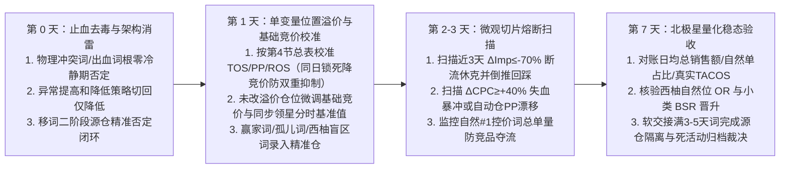
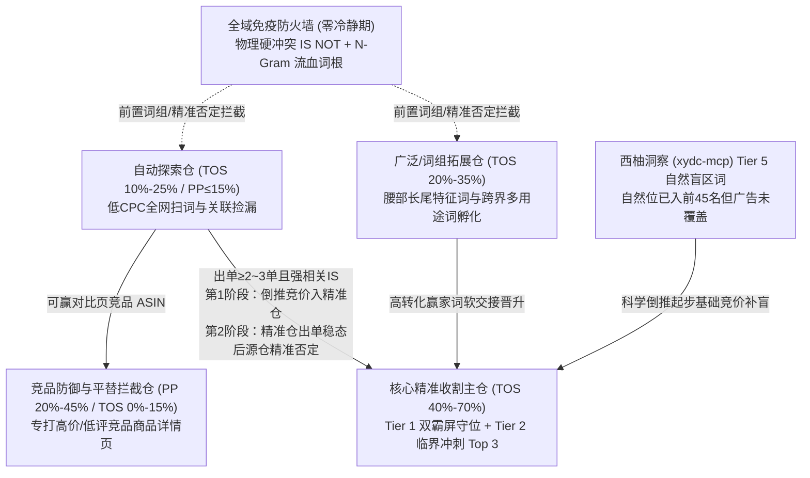

# 报告模板（v2 阶段驱动 · 13 节全量深度操盘版）

写到 `outputs/{ASIN}-{country}-ads-playbook-{YYYYMMDD-HHmmss}.md`。配套导出 `outputs/{ASIN}-{country}-bulk-adjustments-{YYYYMMDD-HHmmss}.tsv`（严格 7 列）、`outputs/{ASIN}-{country}-action-plan-details-{YYYYMMDD-HHmmss}.tsv`、`outputs/{ASIN}-{country}-next-cycle-queue-{YYYYMMDD-HHmmss}.tsv`、`outputs/{ASIN}-{country}-core-keyword-battlecard-{YYYYMMDD-HHmmss}.tsv`、`outputs/{ASIN}-{country}-budget-reallocation-{YYYYMMDD-HHmmss}.tsv`、`outputs/{ASIN}-{country}-brand-display-health-{YYYYMMDD-HHmmss}.tsv`、`outputs/{ASIN}-{country}-rank-synergy-{YYYYMMDD-HHmmss}.tsv`、`outputs/{ASIN}-{country}-macro-scorecard-{YYYYMMDD-HHmmss}.json`（以及存在盲区词/竞品对标时的 `xydc-blindspot-opportunities` 与 `xydc-competitor-benchmark` 表）。严禁覆盖历史旧报告，保留全部带时间戳的历史文件便于多期纵向对比。聊天窗口中同步交付 5 段式核心诊断摘要 + 今日执行清单，绝不只丢文件路径。

**全局排版与数据铁律**：
- 用户使用中文则整份报告全程中文；所有指标必须标明时间窗口（30 天 / 近 7 天 / 近 3 天 / 近 14 天）。
- 所有调整建议必须写清：**现在值 → 改成 → 为什么（含因果链条、排名与历史上下文）**。
- 对外一律写「基础竞价」与「默认基础竞价」，严禁出现 BID/bid。
- **零 KaTeX 渲染报错与零转义乱码**：全文所有美元金额统一使用反引号包裹（如 `` `$0.37` ``），负数金额负号置于反引号内或紧贴（如 `` `-$113.96` ``，严禁写成 `- $113.96` 断裂格式），严禁裸写 `$0.37` 与 `#29` 混排触发 KaTeX 崩溃；箭头统一使用 Unicode `→` / `↑` / `↓`，严禁书写 LaTeX 转义箭头（如反斜杠 `to` 或 `rightarrow`）。0 订单有花费行的 ACOS 统一展示为 `-- (0单)`，严禁在报告正文出现 `99999999.0%` 或 `999.0%`。
- **一套数唯一真相**：第 4 节《位置溢价、竞价策略与真实全广告位动态差分总表》是全账户活动层参数的唯一标准；第 5 节每个活动的竞价策略、TOS/PP/ROS、基础竞价及词级动作必须与第 4 节及 `bulk_adjustments.tsv` 100% 逐字逐数对齐，严禁前后打架。
- **西柚洞察 (`xydc-mcp`) 深度必选**：必须在第 `0.2` 节（竞品自然/广告流量护城河）、第 `1.4` 节（秒杀与日常价格波动）、第 `1.9` 节（本品全域自然 vs 广告流量得分、父体四渠道拆解、14 天收录词与 BSR 趋势、五阶双轨排名协同大表 `rank_synergy.tsv` 及 Tier 5 自然盲区高潜拓词表 `xydc_blindspot_opportunities.tsv`）以及第 `5` 节每个关键词四行卡片中完整呈现西柚洞察活数据；若接口异常未返回，必须显式标注 `DATA_MISSING (xydc-mcp)`，严禁静默删减章节。

---

# {ASIN} {国家} 广告深度诊断与调整手册（{YYYY-MM-DD HH:mm:ss} 版）

- **数据时效与多窗口鲜活切片（截至 T-1 最新完整日，修正归因滞后，绝不拿单一历史均值或近 3 天 0 单误杀）**：
  - **30 天宏观全量基线**：`{macro_start} 至 {macro_end}`（用于产品属性 IS/IS NOT 分桶、N-Gram 词根累积损耗挖掘、ABA 搜索排名梯队、全账户移词漏斗气密性审计）
  - **近 14 天 / 近 7 天转化主窗口**：`{recent_14d_or_7d_start} 至 {recent_7d_end}`（用于北极星总览环比对账、核心词作战表、转化类 ACOS/CVR 判别、跨活动预算再分配及西柚近 7 天流量结构；历史包无 14d 切片时自动以 7d/30d 衔接）
  - **近 3 天调后微观切片**：`{recent_3d_start} 至 {recent_3d_end}`（**仅用于无归因滞后的曝光、点击、CPC 与调后 `ΔCPC%`/`ΔImp%` 轨迹及极端失血熔断 `≥ 3×TCPA`**；SP 归因最长 7 天、SB/SD 为 14 天，严禁仅凭近 3 天 0 单判失败）
- **归属定位**：店铺 `{shop_alias}` ｜ `sid`: `{sid}` ｜ `profile_id`: `{profile_id}` ｜ 广告组合：`{portfolio_name}` (ID: `{portfolio_id}`)

> [!NOTE]
> **首屏复核速览卡（Executive Quick-Reference Card）**
> - **阶段模式与大促叠加**：`{stage_mode}`（叠加 `PEAK: {peak_phase_or_NONE}` ｜ 判别依据：`{stage_reason}`）
> - **北极星总览裁决**：`{verdict_cn}`（缩量保护锁 `velocity_shrinkage_guard`: `{True/False}` ｜ 外部干扰源：`{confounders_or_NONE}`）
> - **7d 经营大盘环比**：日均销额 `` `${r7_sales}/d` `` (`{sales_delta_pct}`) ｜ 日均总单 `{r7_units}/d` (`{units_delta_pct}`) ｜ 自然单占比 `{org_share_pct}%` ｜ 真实 TACOS `{real_tacos_pct}%` (`{tacos_delta_pp}pp`)
> - **财务双口径、TCPA 与库存**：真实毛利率 `{adjusted_gross_margin}%` ｜ 单件贡献 `CM_unit` `` `${cm_unit}` `` (`CM%` `{cm_pct}%`) ｜ 乐观保本 `{marginal_break_even_acos}%` / 决策保本 `{true_all_in_break_even_tacos}%` → 目标 ACOS `{target_acos}%` / 目标 TACOS `{target_tacos}%` / `TCPA` `` `${tcpa}` ``（广告不可持续区：`{ad_unsustainable_zone}` ｜ COGS 缺失/估算：`{cogs_data_missing}`）｜ 可售库存 `{fulfillable}` (`{days_of_supply}`天，>180天库龄 `{inv_age_181_plus}` 件)
> - **上期调控闭环对账**：追踪动作 `{tracked_cnt}` 笔（生效稳态 `{effective_cnt}` 笔 / 休克熔断 `{shock_cnt}` 笔 / 失血纠偏 `{bleed_cnt}` 笔 / 冷却锁定活动 `{locked_cnt}` 个 ｜ §10 阈值校准预警：`{calibration_alerts_or_NONE}`）
> - **本期执行与全局变更预算**：`bulk_adjustments.tsv` 共 `{bulk_cnt}` 条零冲突指令（P0 `{p0_cnt}` ｜ P1 `{p1_cnt}` ｜ P2 `{p2_cnt}`）｜ 全局变更预算占用 `` `${used_usd}/d` `` / `` `${cap_usd}/d` `` (`{used_pct}%` vs 上限 `{limit_pct}%`，顺延下期队列 `{deferred_cnt}` 条)

---

## 0. 阶段目标、产品对标与财务保本底线

### 0.0 阶段模式判定与本期目标卡 (`db/expectations/` 持久化锚点)

| 目标卡维度 | 本期设定 / 判定值 | 推导依据与允许动作边界 |
|---|---|---|
| **阶段模式 (`stage_mode`)** | `{LAUNCH / GROWTH / PROFIT / DEFEND / STOP_LOSS / CLEARANCE}` | 注明自动判定条件或 `--mode` / `rules.json` 显式覆盖依据 |
| **大促叠加态 (`PEAK`)** | `{NONE / PRE_HEAT / PEAK_DAY / POST_COOLDOWN}` | 注明数据窗口锚定日与促销检测结果；`PEAK_DAY` 放宽 ACOS ×1.2 且禁非 P0 砍价，`POST_COOLDOWN` 屏蔽休克回踩 |
| **目标 ACOS / 目标 TACOS** | `ACOS ≤ {target_acos}%` ｜ `TACOS ≤ {target_tacos}%` | 由阶段公式 + 财务决策口径 `CM%` 推导；若处于 `STOP_LOSS` 明确宣告“广告不可持续区，优先修价/修成本/修退货” |
| **阈值缩放基准 (`TCPA` & `CVR_base`)** | `TCPA` = `` `${tcpa}` `` ｜ 组合基准 `CVR_base` = `{cvr_base_pct}%` | 失败测试：`≥ {fail_clicks}` 点击或 `` `${fail_spend}` `` 0单；失血熔断：7d `` `${cb_7d}` `` / 3d `` `${cb_3d}` `` 0单；平滑先验 `k={cvr_prior_k}` |
| **北极星量化底线（下期必对账）** | 日均销额 `≥` `` `${sales_min}/d` ``（地板 `` `${sales_floor}/d` ``）｜ 日均贡献利润目标 `` `${gp_target}/d` `` | 核心词作战表目标 OR 同步写入 `db/expectations/{KEY}_expectations.json` |
| **全局变更预算上限 (`§5.4`)** | 占在跑 30d 日均花费 `` `${daily_spend}/d` `` 的 `{35% / 20%}` = `` `${cap_usd}/d` `` | 本期实际占用 `` `${used_usd}/d` `` (`{used_pct}%`)，超额 `{deferred_cnt}` 条排入 `next_cycle_queue.tsv`（P0/P1 豁免） |

### 0.1 Listing 流量底盘脆弱度分级与本品 IS / IS NOT 核心画像
- **Listing 流量底盘脆弱度分级 (`Organic Readiness Index`)**：
  - **评级结果**：`ORGANIC_FLYWHEEL`（成熟自然飞轮型） / `ORGANIC_BALANCED`（稳态均衡演进型） / `ORGANIC_FRAGILE`（脆弱纯广告依赖型）
  - **底盘调控边界**：写明该评级对应的调控铁律（如脆弱型强制启用基础竞价硬保底 `` `$0.30` `` / ASIN `` `$0.42` ``、单次 TOS 下调幅度硬封顶 `≤ 30%`（推荐温和阶梯 `-20%~-25%`）、出单支柱词单次降幅 `≤ 10%`、严禁双重抑制，采取高转化细分卖点词等量流量置换；成熟飞轮型果断压缩外围畸形溢价与泛流，重兵护航核心精准仓释放自然单红利）。
- **本品核心画像（它是什么 `IS`）**：
  - 完整提取 Listing 标题核心规格、材质/容量/功率/结构形态、差异化核心卖点（USP）、跨界多用途高转化场景（如香料/冷萃/礼品等）、当前页面售价、星级评分、评论数、大类与小类 BSR 节点。
- **物理与场景排他边界（它不是什么 `IS NOT`）**：
  - 明确列出与本品存在物理硬伤冲突的形态、容量、材质、供电方式、错配配件及不可企及的竞品品牌词（确立零冷静期硬否定底线）。
- **FBA 库存与供应链续航**：
  - 可售库存 (`fulfillable`)、总库存、短期历史可售天数 (`days_of_supply`)、91-180 天与 `> 180` 天库龄占比 (`inv_age_181_plus`)；明确库存是否支持扩量冲刺，或需触发 `CLEARANCE` 清仓 / `STOCKOUT_SUSPENDED` / `LOW_INVENTORY_THROTTLE` 控流保护。

### 0.2 核心对标竞品竞争力与西柚洞察 (`xydc-mcp`) 流量护城河评估表
结合领星商品投放报表 (`targets.tsv`) 与西柚洞察 `get_asin_traffic` 竞品流量穿透表 (`xydc_competitor_benchmark.tsv`)，对核心投放/交锋竞品逐一建立攻防裁决：

| 对标竞品 ASIN | 品牌与核心规格差异 | 竞品售价 vs 本品 | 评分 / 评论数壁垒 | 西柚近7天自然流量得分 (自然占比 / 收录词数) | 西柚近7天广告流量得分 (自然环比增速) | 流量护城河对比 | 30天投放表现 (花费 / 单量 / ACOS) | 攻防策略裁决 |
|---|---|---|---|---|---|---|---|---|
| `B0XXXXXXXX` | 竞品品牌 / 规格卖点对比 | `` `$XX.XX` `` vs `` `$XX.XX` `` | `4.X★` / `X,XXX` vs `X,XXX` | `XXXX.X` (`XX.X%` / `XXX`词) | `XXXX.X` (`+XX.X%`) | 流量霸主碾压 / 势均力敌 / 本品压制 | `` `$XX.XX` `` / `X`单 / `XX.X%` | 【收割放量 / 降价防守捡漏 / 坚决暂停否定】+ 具体理由 |

### 0.3 真实财务利润核算、退款率危机排查与双层保本锚定 (`financial_profile.json` & `shared_brand_campaigns.tsv`)
- **30 天单店真实订单财务拆解（精准匹配当前店铺 `sid`）**：
  - 净销售额、总销量（含领星实发量 `afn_volume` 对照）、实际成交均价（ASP）、账面实现毛利润 (`gross_profit`) 与修正后真实经营毛利润 (`adjusted_gross_profit` / `adjusted_gross_margin`，保留正负号，严禁掩盖亏损；若触发 COGS 录入异常已按 `afn_volume` 实发采购成本修正，在此显式注明）；
  - 单位经济成本与全口径扣项拆解：单均采购成本 (`effective_cogs_per_unit`)、单均头程运费 (`Freight`)、单均 FBA 配送费、单均平台佣金、月度与长期仓储费合计 (`storage_fee_total`)、**退款金额 (`refund_amount`)、件数退货量 (`fba_return_goods_count`) 与件数退货率 (`unit_return_rate_pct`)、退货不可售采购损耗 (`return_unsellable_purchase_costs`)、促销折让 (`promotion_discount`) 与促销手续费 (`promotion_fee`)、FBA 销毁与库存调整费 (`shared_fba_disposal_fee` / `adjustments_fee`)**；
  - 全渠道广告总投入拆解：总广告费（含 `SP` + `SB/SBV` + `SD` 分摊）与基于财务美元口径核算的**真实全店 TACOS**。
- **跨组合共享品牌广告说明（`shared_brand_campaigns.tsv`，如有）**：
  - 若当前店铺存在 `creative_asins` 包含本品 ASIN 但归属于其他广告组合的跨组合共享 SB / SBV / SD 品牌广告活动（`is_shared_multi_asin_campaign == True`），在此列出活动名称、所属组合、共享 ASIN 数量及 30 天花费/销售额，明确提醒运营**该活动为多品共享品牌声量池，切勿仅凭单品视角误关停**。
- **跨店铺共享 ASIN 全盘说明（如 `is_cross_shop_asin == True`）**：
  - 若同一 ASIN 在多店铺共同销售，单独列出 `omni_shop_summary` 全盘跨店合计销售额、总毛利与综合 `omni_tacos`，并与当前店铺广告组合严格区分核算口径。
- **退款率与件数退货率危机排查 (`refund_rate` & `unit_return_rate_pct`)**：
  - 同时披露金额退款率 (`refund_rate`) 与件数退货率 (`unit_return_rate_pct`)；若 `refund_rate ≥ 12.0%`（或 `≥ 15.0%` 极限制冷线），触发醒目 `[CRITICAL_REFUND_ALERT]` 预警，说明目标 ACOS 自动收紧比例、泛流预算截流动作及供应链/Listing 预期管理整改方向。
- **双口径保本核算锚点（乐观口径 vs 决策口径）与广告不可持续区判定（`§2.1`）**：
  - **乐观口径·单件边际保本 ACOS (`marginal_break_even_acos`)**：`(客单价 - 单均COGS - 单均头程 - 单均FBA - 单均佣金) / 客单价 × 100%`（不含退货/仓储/促销摊销的理想单件毛利空间）；
  - **决策口径·单件全口径贡献毛利 `CM_unit` 与全口径保本 (`true_all_in_break_even_tacos`)**：严格遵循会计恒等式 `(adjusted_gross_profit + total_ad_cost) / total_sales × 100%`（扣除全部退款、退货损耗、促销折让、仓储销毁费后的广告前净贡献率）；
  - **COGS 缺失/异常治理**：若 ERP 采购成本缺失（`` `$0` ``）或畸高（`> 客单价 × 1.05`），先尝试领星实发采购成本 `afn_cogs_per_unit` 修正；仍不可用时显式标注 **`DATA_MISSING: COGS`** 并以临时估算口径冻结全部加码/扩量动作；
  - **目标 ACOS / 目标 TACOS / `TCPA` 与 `STOP_LOSS` 止损区**：若 `pre_ad_net_contribution ≤ 0` 或 `true_all_in_break_even_tacos < 8.0%`，直接判定 **`ad_unsustainable_zone = True`（广告不可持续区 → `STOP_LOSS`）**，既不硬压无意义的 `3%` 地板也不虚设 `12%` 目标，冻结一切扩量并明确把重心转向售价/成本/退货端治理。

### 0.4 北极星总览预期闭环对账卡 (`macro_scorecard.tsv`)、外部干扰剥离与本次战略目标
> [!IMPORTANT]
> **北极星总览导向原则（铁律 6 & 7）**：广告调优绝不允许以牺牲大盘真实销售额、自然单增速与总毛利为代价去换取表面的低 ACOS！每次出报告必须先对账大盘北极星结果是否达成上期预期，并剥离非广告外部干扰。

| 北极星核心指标 | 30天日均基线 | 前7天日均 (`T-14~T-8`) | 近7天最新日均 (`T-7~T-1`) | 7天环比变化 (`Δ%`) | 上期设定预期目标 | 达成裁决 |
|---|---|---|---|---|---|---|
| 全店真实日均销售额 (USD) | `` `$XXX.XX` `` | `` `$XXX.XX` `` | `` `$XXX.XX` `` | `+X.X%` | `≥` `` `$XXX.XX` ``/天 | 达标 / 预警 |
| 近7d日均预估毛利 (`predict_gross_profit`) | `` `$XX.XX` `` | `` `$XX.XX` `` | `` `$XX.XX` `` | `+X.X%` | 毛利稳步改善 | 盈利扩张 / 减亏向好 / 承压 |
| 全店日均总单量 (Units) | `XX.X` 单 | `XX.X` 单 | `XX.X` 单 | `+X.X%` | 稳中有升 | 达标 / 缩量预警 |
| 日均自然单量与自然单占比 | `XX.X` 单 (`XX.X%`) | `XX.X` 单 (`XX.X%`) | `XX.X` 单 (`XX.X%`) | `+X.X%` | 自然占比持续抬升 | 飞轮扩张 / 承压 |
| 自然转化率 (`Nature CVR`) vs 广告 `Ad CVR` | `X.XX%` / `XX.X%` | `X.XX%` / `XX.X%` | `X.XX%` / `XX.X%` | `+X.XX pp` | 自然承接稳步提升 | 承接增强 / 波动 |
| 真实全店 TACOS (财务/跨店综合口径) | `XX.X%` | `XX.X%` | `XX.X%` | `-X.X pp` | `≤ XX.X%` | 达标 / 超标 |
| 日均访客 Sessions / 购物车率 | `XXX.X` / `XX.X%` | `XXX.X` / `XX.X%` | `XXX.X` / `XX.X%` | `+X.X%` | 流量底盘稳固 | 正常 / 异常 |
| 小类目 BSR 排名均值 | `#XXX` | `#XXX` | `#XXX` | `↑/↓ XX 名` | 稳步向前 | 晋升 / 滑坡 |

- **北极星总览裁决与缩量保护开关**：写明 `macro_scorecard` 裁决（如 `【飞轮健康扩张】` / `【提效降本达标】` / `【砍毒增利正轨 PROFIT_OPTIMIZATION_ON_TRACK】` / `【大盘缩量萎缩预警 VELOCITY_SHRINKAGE_ALERT】`）。若触发 `velocity_shrinkage_guard == True`，明确宣布本轮锁定核心出单仓顶展与基础竞价，严禁顺周期继续大砍流量。
- **外部非广告干扰源前置剥离 (`confounders`)**：逐项交代是否存在断货 (`CONF_STOCKOUT`)、低库存 (`CONF_LOW_INVENTORY`)、购物车丢失 (`CONF_BUY_BOX_LOSS`)、日常涨价超 8% (`CONF_PRICE_HIKE`)、秒杀结束自然回落 (`CONF_DEAL_COOLDOWN`)、大促后 10~14 天流量自然回落 (`CONF_PEAK_POST_COOLDOWN`) 或近期 Listing 标题/图片/五点改动 (`CONF_LISTING_CONTENT_CHANGE`)，严防把外部异动错怪到广告出价上。
- **本次调整核心战略目标**：写清主攻与加码的核心 query 家族、需要补齐的西柚自然盲区词、坚决止血隔离的错品/低效流量节点。

---

## 1. 广告大盘盘点与多窗口动态走势

### 1.1 长短周期双轨比对（全组合口径 vs 在跑活动口径）
同时列出**全组合汇总（含历史已暂停活动沉淀）**与**当前在跑启用活动 (`enabled`)** 的 30 天 / 近 14 天（若已拉取 `*_14d.json`）/ 近 7 天 / 近 3 天切片，彻底消除已停活动造成的均值假象：

| 统计口径与时间切片 | 总花费 | 广告销售额 | 综合 ACOS | 广告订单数 | 转化率 (CVR) | 单次点击 (CPC) | 日均曝光量 | 动态差分 (`ΔCPC` / `ΔImp` vs 30d) |
|---|---|---|---|---|---|---|---|---|
| 30天宏观基线（全组合 / 在跑） | `` `$XXXX.XX` `` / `` `$XXXX.XX` `` | `` `$XXXX.XX` `` / `` `$XXXX.XX` `` | `XX.X%` / `XX.X%` | `XXX` / `XXX` | `XX.X%` | `` `$0.XX` `` | `XX,XXX` | 基线参照 |
| 近14天转化主窗口（全组合 / 在跑） | `` `$XXX.XX` `` / `` `$XXX.XX` `` | `` `$XXXX.XX` `` / `` `$XXXX.XX` `` | `XX.X%` / `XX.X%` | `XX` / `XX` | `XX.X%` | `` `$0.XX` `` | `XX,XXX` | 14d 主转化参考（无14d包标 `--`） |
| 近7天中期走向（全组合 / 在跑） | `` `$XXX.XX` `` / `` `$XXX.XX` `` | `` `$XXXX.XX` `` / `` `$XXXX.XX` `` | `XX.X%` / `XX.X%` | `XX` / `XX` | `XX.X%` | `` `$0.XX` `` | `XX,XXX` | `±X.X%` / `±X.X%` |
| 近3天调后切片（全组合 / 在跑） | `` `$XXX.XX` `` / `` `$XXX.XX` `` | `` `$XXX.XX` `` / `` `$XXX.XX` `` | `XX.X%` / `XX.X%` | `XX` / `XX` | `XX.X%` | `` `$0.XX` `` | `XX,XXX` | `±X.X%` / `±X.X%` |

### 1.2 Listing 全域流量大盘与自然承接力 (`traffic_profile.json`)
- **全域流量漏斗**：30 天总访客 (`Sessions`)、总浏览量 (`Pageviews`)、移动端流量占比 (`Mobile Share`)、Buy Box 赢得率。
- **广告 vs 自然转化承接力深度比对**：对比 **广告转化率 (`Ad CVR`) vs 自然转化率 (`Nature CVR`)**、广告销售占比 (`Adv Sales Share`) 与全店 `TACOS`（如存在跨期归因滞后 `attribution_lag == True`，在此明示修正说明）。

### 1.3 24 小时与周度分时转化画像、近 4 周趋势演进及领星多层级分时策略对账 (`dayparting_analysis.tsv` & `weekly_trends.tsv`)
- **分时 60 单样本门槛核验 (`daypart_min_orders_30d`)**：交代全组合近 30d 在跑广告订单总数是否达到 `≥ 60` 单门槛（样本不足时显式标注“跳过分时调价，避免低样本噪声误调”）。
- **领星多层级分时落地穿透核验**：逐层核查活动层、关键词层 (`dayparting_keywords_active`)、商品投放层 (`dayparting_targets_active`) 已绑定的领星分时模板名称、`is_apply_time` 状态与 `timing_base_value` 分时基准值（强调所有分时实体改价必须锚定并同步更新 `timing_base_value`，绝不误拿高峰瞬时出价算降价；分时良性豁免须同时满足 `ord_7d > 0` 且 `acos_7d ≤ 目标 × 1.35`）。
- **黄金出单高峰窗口 (`PEAK_GOLDEN_HOUR`) vs 流血低效耗散窗口 (`BLEEDING_OFFPEAK_HOUR`)**：用真实分时花费、单量、CVR、ACOS、CPC 数据说话；结合活动**日预算利用率与日内超预算时间 (`avg_over_budget_time`)** 执行早竭防御（利用率 `≥ 80%` 或存在日内早竭断流时严禁早间盲加溢价，优先压低凌晨低效期并将火力留给晚间超级高峰），兼顾美东/美西 3 小时跨时区平权与日均加权 CPC 良性上浮去偏。
- **周度星期转化走势与近 4 周趋势演进 (`weekly_trends.tsv`)**：对比近 4 个自然周的花费、广告销售额、订单数、CPC、CVR 与 ACOS 周度演进轨迹，同时指出周内（周一至周日）高投产日与低效日差异及预算节奏建议。

### 1.4 秒杀、优惠券与日常价格异动全景排查 (`deal_info.json` — 西柚 `get_asin_info_trends` + 领星促销交叉核验)
- 基于西柚洞察 `get_asin_info_trends` 每日价格/促销快照与领星 `sales_detail_sec_kill` / `sales_detail_prime_discount`：
  - 完整交代近 30 天日常挂牌价区间、近 7 天最新均价 vs 前 7 天均价涨幅 (`price_delta_7d_pct`)、秒杀价 (`deal`)、优惠券 (`coupon`)、Prime 专享折 (`prime`) 的生效起止日期；
  - 明确当前是否处于 `ACTIVE_DEAL` 或秒杀结束 10 天内的 `DEAL_TRANSITION_COOLDOWN`（防止将秒杀后正常流量均值回归误判为出价断流休克）。

### 1.5 ABA 搜索量排名梯队、买家搜索词意图分桶与核心词作战表 (`buckets.tsv` & `core_keyword_battlecard.tsv`)
- **全美 ABA 搜索排名四级梯队分布**：拆解 `MEGA_HEAD`（Top 5K 超大词）、`CORE_HEAD`（Top 30K 头部主粮词）、`MID_TAIL`（Top 150K 腰部特征词）、`LONG_TAIL`（长尾精准词）的展现、点击与转化效率。
- **买家搜索词意图分桶统计表 (`buckets.tsv`)**：按核心强相关、品牌词、核心功能/跨界多用途词、相邻可转化词、错品物理冲突词 (`is_not`)、竞品品牌词、ASIN 详情页流量汇总花费、销售额、ACOS、订单数与 CVR，直指预算错配病灶。
- **核心词作战表 (`core_keyword_battlecard.tsv`，5~15 个核心词，自然排名北极星具体落点)**：

| 核心词 | ABA 梯队 | 自然位 `OR` (`ΔOR`) | 广告位 `SP` (`ΔSP`) | 近期转化 (`14d/7d` 花费/单量/ACOS) | 贝叶斯平滑 `CVR_adj` | 所在活动 (专属仓?) | 角色 | 目标 `OR` (验收期) | 上期目标对账 |
|---|---|---|---|---|---|---|---|---|---|
| `core keyword` | `CORE_HEAD` | `#8` (`↑2`) | `#5` (`↑1`) | `` `$XX.X` `` / `X`单 / `XX.X%` | `XX.X%` | `*-exact-prove` (`是/否`) | 冲刺 / 守位 / 补盲 / 防守 | `≤ #3` (`14d`) | 首期建档 / 达标 / 未达标 |

### 1.6 跨活动流量竞蚀与移词漏斗气密性 (`cannibalization.tsv` & `active_negatives_audit.tsv`)
- 列出 `cannibalization.tsv` 中跨 2 个及以上活动重复触发、尤其是自动/广泛仓以更高 CPC 抢夺精准仓流量的高风险内耗词 (`HIGH_INTERNAL_COMPETITION`)，以及两阶段软交接移词漏斗的气密性体检结论。

### 1.7 N-Gram 隐性高损耗词根挖掘 (`ngrams.tsv` & `bleeding_ngrams.txt`)
- 列出 `bleeding_ngrams.txt` 中单次点击分散但跨多词累计高花费 0 转化的 1-gram / 2-gram 流血词根（区分本次需新增词组否定的词根 vs 已被核心词免疫保护 `PROTECTED` 或后台已否定 `ALREADY_NEGATED` 的词根）。

### 1.8 多维广告位指纹诊断与真实全广告位（含 `OFF AMAZON` 站外）交叉验证 (`search_term_placement_diagnosis.tsv` & `real_placement_performance.tsv`)
- **真实全广告位表现总览 (`get_sp_campaign_placement_report`，单活动内部花费占比 100% 归一化）**：用真实的 `搜索结果顶部 (首页) TOS`、`商品页面 PP`、`其余搜索位置 ROS` 及 **`OFF AMAZON`（亚马逊站外）** 花费占比、订单量、CPC、CVR 与 ACOS 揭示全组合及单活动流量究竟花在哪个展位、赚在哪个展位；对单活动高耗低效 `OFF AMAZON` 站外失血点名止血，对单活动投产达标的 `OFF AMAZON` 站外流量予以保护（铁律 16 & 17）。
- **搜索词展位指纹分类（绑定真实 `ad_groups`/`targets` 默认竞价）**：
  - **困在商品页/低效位的潜质核心词 (`TRAPPED_CORE_HERO`)**：低 CTR、低 CPC 被困详情页的核心词（严禁盲目否定，执行提权或移入精准仓测试顶展）；
  - **首页顶部已饱和耗散词 (`FAILED_AT_TOS`) / 大样本测试未转化词 (`FAILED_EXTENDED_TEST`)**：高 CTR/高 CPC 已拿顶展仍不转化的词（边缘词精准否定，核心主粮词退守降竞价并联动第 9 节排查 Listing 承接）。

### 1.9 西柚洞察 (`xydc-mcp`) 全域流量结构、父体四渠道占比、收录词/BSR 趋势与自然位 vs 广告位双轨协同五阶矩阵

> [!TIP]
> **西柚洞察 (`xydc-mcp`) 六维全域联动铁律（铁律 38 & 39）**：
> 绝不允许脱离自然搜索排位与全域流量结构孤立谈论广告 ACOS！本节完整融通西柚洞察 6 大接口数据，从宏观「本品 vs 竞品流量盘 + 父体四渠道结构 + 14 天收录词/BSR 走势」穿透到微观「每个核心词的自然排名 `OR`（含跨期 `ΔOR`）vs 广告排名 `SP`（含跨期 `ΔSP`）五阶协同矩阵」与「Tier 5 自然流量盲区拓词清单」。

#### 1.9.1 本品近 7 天自然 vs 广告流量得分、父体四渠道拆解与 14 天收录词/BSR 趋势 (`xydc_traffic_overview.json`)
- **本品近 7 天流量结构快照 (`get_asin_traffic`)**：
  - 总流量得分 (`total_traffic_score`) 及环比前 7 天增速 (`total_growth_pct`)；
  - 自然流量得分 (`organic_traffic_score`)、**自然流量占比 (`organic_share_pct`)**、环比增速 (`organic_growth_pct`)、自然收录搜索词总数 (`organic_keyword_count`)；
  - 广告流量得分 (`ad_traffic_score`)、**广告流量占比 (`ad_share_pct`)**、环比增速 (`ad_growth_pct`)、广告覆盖搜索词总数 (`ad_keyword_count`)。
- **父体变体广告结构与四渠道流量占比 (`get_parent_asin_ad_overview`)**：
  - 父体 ASIN (`parent_asin`)、在投变体数 / 总变体数 (`advertised_variation_count / total_variation_count`)、各主力子体广告流量贡献占比 (`top_variations`)；
  - 父体四渠道流量得分结构：`Organic` 自然流量占比 vs `SP` 商品推广占比 vs `SB` 品牌推广占比 vs `SBV` 视频广告占比；以及 `Head` 头部词 / `MidTail` 腰部词 / `LongTail` 长尾词流量分布。
- **近 14 天每日关键词收录趋势 (`get_asin_keyword_count_trends`) 与大小类 BSR 轨迹 (`get_asin_bsr_trends`)**：
  - 近 7 天日均自然收录词数 vs 前 7 天变化率 (`organic_keywords_delta_pct`)、日均广告词数变化率 (`ad_keywords_delta_pct`)，以及 `OR / SP / SB / SBV / AC (Amazon's Choice)` 展位词数最新快照；
  - 小类目与大类目 BSR 近 14 天最高排名、最新排名及近 7 天均值较前 7 天进退名次 (`rank_change_7d`)。

#### 1.9.2 自然排名 vs 广告排名双轨协同五阶战术矩阵 (`rank_synergy.tsv`，含跨期 `ΔOR`/`ΔSP` 轨迹)
- **五阶协同分布概览**：交代全量追踪词中 `Tier 1 王者双霸屏/防内耗 (OR 1~3)`、`Tier 2 临界冲刺期 (OR 4~15)`、`Tier 3 腰部攻坚期 (OR 16~50)`、`Tier 4 自然脱节/远距离 (OR >50 或未上榜但 SP ≤10)`、`Tier 5 自然盲区潜力词` 各占多少词，并展示核心流量词完整协同决策大表（注意：`自然流量占比 + 广告流量占比` 为该词下本品真实流量构成比 `0~100%`）：

| 关键词 / 搜索词 | ABA 排名 | 自然排名 `OR` (跨期 `ΔOR`) | 广告排名 `SP` (跨期 `ΔSP`) | 本品自然流量得分 (占比%) | 本品广告流量得分 (占比%) | 在跑关联活动 | 30天广告表现 (花费 / 销售额 / ACOS / 单量) | 协同层级 (Tier) | 核心诊断标签 | 基础竞价与 TOS 双轨协同策略 |
|---|---|---|---|---|---|---|---|---|---|---|
| `core keyword 1` | `#X,XXX` | `#1` (`—`) | `#2` (`↑1`) | `XXXX.X` (`68.5%`) | `XXXX.X` (`31.5%`) | `活动名` | `` `$XX.XX` `` / `` `$XXX.XX` `` / `16.9%` / `X`单 | Tier 1: 王者双霸屏 | 【自然#1·双霸屏稳流】 | 保持基础竞价 `` `$0.XX` `` 稳位守流，防竞品夺位 |
| `core keyword 2` | `#X,XXX` | `#1` (`—`) | `#1` (`—`) | `XXXX.X` (`52.0%`) | `XXXX.X` (`48.0%`) | `活动名` | `` `$XX.XX` `` / `` `$XX.XX` `` / `41.2%` / `X`单 | Tier 1: 防内耗控价 | 【自然#1·防内耗控价】 | 单杠杆推进：本期先降基础竞价 18% 至 `` `$0.XX` ``，观察 3~5 天总单量（跌 ≥15% 回调），下期再视专属仓情况压 TOS |
| `core keyword 3` | `#X,XXX` | `#8` (`↑3`) | `#6` (`↑2`) | `XXXX.X` (`44.2%`) | `XXXX.X` (`55.8%`) | `活动名` | `` `$XXX.XX` `` / `` `$XXXX.XX` `` / `18.4%` / `XX`单 | Tier 2: 临界冲刺 | 【临界冲刺·拉升自然位】 | 单杠杆推进：本期先上调基础竞价 15% 至 `` `$0.XX` ``，下期确认效果后再于专属仓加注 TOS 冲刺自然 Top 3 |
| `core keyword 4` | `#XX,XXX` | `#16` (`↓5`) | `#9` (`↓3`) | `XXX.X` (`39.0%`) | `XXX.X` (`61.0%`) | `活动名` | `` `$XX.XX` `` / `` `$XXX.XX` `` / `31.0%` / `X`单 | Tier 3: 滑坡保护 | 【自然位滑坡保护锁】 | 自然排名下滑 ≥4 位且有出单，触发 `Rank_Slide_Protection_Hold` 严禁叠砍竞价 |
| `core keyword 5` | `#X,XXX` | `#108` (`—`) | `#7` (`—`) | `XX.X` (`12.4%`) | `XXX.X` (`87.6%`) | `活动名` | `` `$XXX.XX` `` / `` `$XXX.XX` `` / `38.5%` / `X`单 | Tier 4: 自然脱节 | 【自然脱节·警惕虚火】 | 严禁盲目高溢价抢顶展，下调基础竞价控频防虚耗，联动第 9 节补齐埋词权重 |

#### 1.9.3 Tier 5 自然流量盲区高潜拓词清单 (`xydc_blindspot_opportunities.tsv`)
专门列出西柚洞察已捕捉到本品拥有优质自然排名（`OR ≤ 45` 或高自然流量得分）、经产品属性校验属于强相关 `IS` 核心词、但当前全广告组合无启用投放词覆盖的**自然盲区潜力词**（若当前全量核心词均已覆盖无盲区，明确写明“经穿透核验当前 Top 自然流量强相关词已 100% 建仓覆盖，无遗漏盲区”）：

| 盲区潜力关键词 | 西柚自然排名 `OR` | 当前广告位 `SP` | ABA 搜索排名 | 西柚自然流量得分 (自然占比 / 环比增速) | 词性意图分桶 | 推荐承接精准仓 | 倒推建议起步基础竞价 (折合顶展出价) | 拓词飞轮逻辑 |
|---|---|---|---|---|---|---|---|---|
| `blindspot keyword` | `#XX` | `--` (未投) | `#XX,XXX` | `XXX.X` (`100.0%` / `+XX.X%`) | `core_feature` | `*-exact-prove` | `` `$0.XX` `` (顶展 `` `$0.XX` ``) | 已凭自然相关性排入前两页，纳入精准仓低风险补推可加速冲进首页 |

---

## 2. 历史调控台账与调后效果复盘对账（跨会话自动调取本地数据库）

> [!NOTE]
> **本地持久化记忆双引擎 (`db/ledger/` & `db/entity_memory/`)**：
> 本节自动读取跨会话调控历史台账 (`historical_ledger.tsv`) 与实体全量上下文记忆表 (`entity_full_context.tsv`)，穿透核验每一笔历史改动的改前基线 vs 近 3 天实测 `ΔCPC%`、`ΔImp%` 以及跨期西柚自然位/广告位进退轨迹 (`ΔOR` / `ΔSP`)，彻底杜绝“改完忘前因、反复左右横跳、对已见效/已暂停实体二次误砍”。

### 2.1 跨期实调动作效果对账总表 (`historical_ledger.tsv` & `ledger_calibration.json`)

| 调整日期 | 广告活动 / 投放实体对象 | 杠杆与变动 (`改前 → 改后` / 多期路径 `planned_path`) | 调前基线 (CPC / 日均曝光 / ACOS) | 调后近3天现状 (CPC / 日均曝光 / ACOS) | 动态变动率 (`ΔCPC` / `ΔImp`) | 经过天数 (验证日) | 预期 vs 实测裁决与回滚/衔接指令 |
|---|---|---|---|---|---|---|---|
| `YYYY-MM-DD` | `活动名 / 实体名` | `TOS / 基础竞价 / 预算: X → Y` (`250%→175%→120%`) | `` `$0.XX` `` / `X,XXX` / `XX.X%` | `` `$0.XX` `` / `X,XXX` / `XX.X%` | `-XX.X%` / `+X.X%` | `X`天 (验`MM-DD`) | 【调后生效·见效保持 / 调后休克断流 / 触发回滚 / 首屏常态冷却 / 合规暂停】+ 衔接动作 |

- **§10 动作类型预期达成率校准统计 (`ledger_calibration.json`)**：按动作类型（降价 / 提价 / 溢价调整 / 预算调整 / 竞价策略 / 暂停状态）汇总已评估笔数与达成率；若某类累计 `≥ 3` 笔且达成率 `< 50%`，在此显式输出 `rules.json` 参数校准建议（需运营确认）。

### 2.2 核心实体全量历史记忆、上期未执行建议继承与数据反转销账复盘 (`entity_full_context.tsv` & `recommendation_inheritance.tsv`)
- **调后生效锁定 (`ADJUSTMENT_EFFECTIVE` / `EXECUTED_IN_COOLDOWN`)**：指明哪些实体后台已落地调整且降本增效显著，本期坚决维持稳态、严禁二次砍价（词级改动仅锁定该 `(campaign, match_type, entity)` 本身，绝不连坐封锁整组活动）；
- **上期未执行建议继承与数据反转销账表 (`recommendation_inheritance.tsv`，铁律 34 三态闭环）**：对上期已建议但运营尚未落地执行的条目，经五大维度动态复核后逐一交代闭环去向（`INHERITED_PENDING` 继续有效并附 `[待执行继承·连续N天]` 保留在 `bulk_adjustments.tsv` 中，或 `SUPERSEDED_BY_DATA` 因新出单转化/ACOS达标/自然位反转显式销账，杜绝假冷却静默吞单）：

| 上期建议日期 | 广告活动 / 实体对象 (`match_type`) | 原建议动作与目标值 | 连续待执行天数 | 本期 5 维动态复核依据 (排名 `ΔOR`/`ΔSP` + 30d/7d/3d 转化与保本底线) | 三态闭环裁决 (`INHERITED_PENDING` / `SUPERSEDED_BY_DATA`) |
|---|---|---|---|---|---|
| `YYYY-MM-DD` | `活动名 / 实体名 [exact/broad]` | `动作 → 建议值` | `N` 天 | 写明近期真实出单、ACOS/ROAS 变化或西柚自然位进退证据 | `【待执行继承·保留输出】` 或 `【数据好转反转·显式销账】` |

- **休克断流科学回踩 vs 假性断流甄别 (`CIRCUIT_BREAKER_SHOCK` vs `TOP_POSITION_MARKET_COOLDOWN` / `DEAL_TRANSITION_COOLDOWN` / `INTENTIONAL_PAUSE`)**：区分真正因跌穿拍卖门槛需要按倒推公式 `Probe Bid = min(max($2.50, Baseline CPC × 1.8), max(Bid Floor, 当前竞价×1.15, Baseline CPC / (1 + TOS%)))` 回踩激活的实体，与广告位已在 `SP #1~#3`、秒杀后降温或主动暂停/否定的正常回落实体；
- **自然位滑坡保护锁 (`Rank_Slide_Protection_Hold`) 与防左右横跳核验**：点名近期自然排名下滑 `≥ 4` 位被系统自动拦截降价的核心出单词，说明连续性护盘逻辑。

---

## 3. 操作顺序与动态跟踪（今日执行节奏）

使用 Mermaid 流程图清晰标示第 0 天至第 7 天单变量阶梯执行节奏，确保运营按序落地不踩双重抑制红线：



- **多期阶梯路径 (`planned_path`) 与下期顺延队列 (`next_cycle_queue.tsv`)**：列出大幅位置溢价回归的多期拆分路径（如 `TOS: 250% → 175% → 120% → 85% → 60%`，单期有效降幅 `≤ 30%`）以及因**双向单杠杆锁**或**全局变更预算上限（35%/脆弱 20%）**顺延至下期队列的动作清单。
- **今日坚决不要做什么（防手痒红线清单）**：明确列出当前处于观察期正常公差锁定、调后已生效保持、自然排名滑坡保护期、或本轮已调位置溢价/竞价策略触发 `Anti_Double_Damping_Hold` 严禁同日叠加改其他杠杆的具体活动与关键词。

---

## 4. 位置溢价、竞价策略与真实全广告位动态差分总表（分层级一套数唯一标准）

> [!IMPORTANT]
> **分层级位置溢价矩阵 + 真实展位/`OFF AMAZON` 差异化审计 + 日内超预算 (`OOB`) / 人群溢价 (`Cohort%`) + 竞价策略双倍天花板审计（铁律 16、17、18、19、20）**：
> 1. 按活动角色分层级定标：**精准收割仓**（TOS `40%-70%` / PP `0%-10%` / ROS `10%-30%`）、**自动探索仓**（TOS `10%-30%` / PP `0%-15%` / ROS `0%-20%`，高 ACOS 非缩量压 TOS 时锁定 PP/ROS `≤ 15%` 并联动 `Anti_Drift_Base_Bid_Throttle` 微降 `-15%` 防商品页泄洪）、**竞品防御仓**（TOS `0%-20%` / PP `20%-50%` / ROS `0%-10%`）、**广泛拓展仓**（TOS `20%-40%` / PP `0%-15%` / ROS `10%-30%`，高 ACOS 非缩量压 TOS 时同享 `-15%` 防泄洪联动）；
> 2. **真实展位保护与 `OFF AMAZON` 站外差异化裁决**：单活动各展位花费占比内部 100% 归一化；若 `PP`、`ROS` 或 `OFF AMAZON` 站外真实出单 `≥ 2` 单且 ACOS 达标，保留其有效溢价，严禁机械清零砍断盈利流量；若单活动 `OFF AMAZON` 站外花费占比 `≥ 20%`（或花费 `≥ max($15, 1×TCPA)`）且高耗低效，显式标注站外止血并联动竞价策略/基础竞价收紧！
> 3. **「提高和降低」2x 顶展放大与人群溢价 (`Cohort%`) / 日内超预算 (`OOB`) 审计**：对开启 `动态竞价 - 提高和降低 (Up & Down)` 或叠加高人群溢价 (`Cohort%`) 导致实际天花板失血的活动，优先切换为 `动态竞价 - 仅降低 (Down Only)`；同步标明日内超预算断流状态（`OOB` 时点与在预算内时长占比）；
> 4. **唯一真相约束**：本表覆盖全部启用活动。**第 5 节每个活动的竞价策略与改后 TOS/PP/ROS 必须与本表对应行 100% 逐字逐数一致！**

| 活动名称 | 活动层级与角色 | 当前 → 建议竞价策略 (含人群溢价 `Cohort%`) | 领星分时与日内超预算 (`OOB`) 状态 | 真实全展位主力产出 (`TOS / PP / ROS / OFF AMAZON` 单量与ACOS) | 30天均值 (CPC / ACOS) | 近3天最新 (CPC / ACOS) | 动态变化率 (`ΔCPC` / `ΔImp`) | 现在 TOS / PP / ROS | **改成 TOS / PP / ROS** | 状态裁决与诊断原因 |
|---|---|---|---|---|---|---|---|---|---|---|
| `活动全名（严禁缩写）` | 精准收割仓 / 广泛仓 / 竞品仓 / 自动仓 / SBV | `仅降低` (`Cohort 0%`) → `保持仅降低`（或 `提高和降低 → 仅降低`） | 分时运行 (`模板名`) ｜ `预算充沛 (100%在预算内)` 或 `OOB 早竭断流 (HH:MM)` | `TOS: X单(XX%) \| PP: X单(XX%) \| ROS: X单(XX%) \| OFF: X单(XX%)` | `` `$0.XX` `` / `XX.X%` | `` `$0.XX` `` / `XX.X%` | `-XX.X%` / `+X.X%` | `XX% / XX% / XX%` | **`XX% / XX% / XX%`**（或 **保持现状（锁定）**） | 写明单变量调控、托底补偿、站外止血/保护、观察期锁定、良性分时溢价或碎片化收敛原因 |

---

## 5. 活动级操作详情（全组合活动分仓逐个深度审计）

按活动战略仓位分节（`5.1 核心精准收割仓`、`5.2 品牌与多用途高产卖点仓`、`5.3 广泛与词组拓展仓`、`5.4 竞品 ASIN 防御与商品投放仓`、`5.5 自动探索仓`、`5.6 SBV/共享品牌广告、碎片化孤岛收敛归档与已暂停活动汇总`），**对每一个启用活动逐一完整展开**（严禁遗漏任何在跑活动，严禁用后缀模糊归类串流！）：

### 5.X {仓位类别名称}

#### 活动 `{序号}`：`{活动完整精确名称}`
- **活动结论与状态标签**：`【保留主推 / 控费防守 / 动态观察期第 X/7 天锁定 / 触发休克熔断回踩 / 触发失血熔断限价 / 站外失血止血 / 碎片化孤岛收敛归档】`
- **活动层核心参数（与第 4 节严格一致）**：
  - 日预算：`` `$XX.XX` `` → `` `$XX.XX` ``（预算利用率 `XX%` ｜ 日内超预算 `OOB` 状态：`全天在预算内 100%` 或 `平均超预算断流时间 avg_over_budget_time / 建议预算` `` `$XX.XX` ``）｜ 竞价策略：`{现在策略}` → `{建议策略}`（人群溢价 `Cohort%`: `{0% 或 XX%}`）
  - 位置溢价（TOS / PP / ROS）：`{现在 TOS/PP/ROS}` → **`{第 4 节完全相同的改后 TOS/PP/ROS}`**
  - 广告组默认基础竞价：`` `$0.XX` `` → `` `$0.XX` `` ｜ 领星分时状态：`{未应用 / 已绑定模板 'XXX'（分时基准值 $0.XX，改价时必须锚定并同步更新领星后台 timing_base_value）}`
  - 活动多窗口实绩：30天花费 `` `$XXX.XX` `` / `XX`单 / ACOS `XX.X%` / CPC `` `$0.XX` ``（直接单 `XX` + 间接单 `X`）｜ 近7天花费 `` `$XX.XX` `` / `X`单 / ACOS `XX.X%` ｜ 近3天花费 `` `$XX.XX` `` / `X`单 / `ΔCPC` `±X.X%` / `ΔImp` `±X.X%`
  - 真实全广告位拆解 (`real_placement_performance.tsv`，单活动花费占比 100% 归一化)：首页顶部 TOS 花费 `` `$XX.XX` `` (`XX%`, `X`单, ACOS `XX.X%`) ｜ 商品页 PP 花费 `` `$XX.XX` `` (`XX%`, `X`单, ACOS `XX.X%`) ｜ 其余搜索位 ROS 花费 `` `$XX.XX` `` (`XX%`, `X`单, ACOS `XX.X%`) ｜ **亚马逊站外 `OFF AMAZON` 花费 `` `$XX.XX` `` (`XX%`, `X`单, ACOS `XX.X%`，注明站外止血或达标保护裁决)**
- **核心投放词 / 商品投放 / 搜索词逐项执行卡片（严格遵循纯中文四行排版，隐藏内部英文代码标签，与 `bulk_adjustments.tsv` & `action_plan_details.tsv` 唯一胜出动作 100% 一致）**：
  - **实体对象**：`{关键词（精准/词组/广泛） 或 竞品 ASIN B0XXXXXXXX 或 自动四组紧密/宽泛/同类/关联}`（如启用领星分时，标明：`领星分时模板 'XXX' 运行中，当前分时基准值` `` `$0.XX` ``）
    - **当前排名**：西柚自然位 `#XX`（跨期 `ΔOR: ↑/↓X` 或 `首期建档`）｜ 西柚广告位 `#XX`（跨期 `ΔSP: ↑/↓X`）｜ 全美 ABA 搜索排名 `#X,XXX`（若为竞品 ASIN 则写：对标竞品售价 `` `$XX.XX` `` / `4.X★` / `X,XXX`评 / 西柚7d自然流量得分 `XXXX.X`）
    - **历史表现**：30天花费 `` `$XX.XX` ``，出单 `X` 单，ACOS `XX.X%`，CVR `XX.X%`（平滑 `CVR_adj XX.X%`），实际 CPC `` `$0.XX` `` ｜ 近7天花费 `` `$XX.XX` ``（`X`单）｜ 近3天花费 `` `$XX.XX` ``（`X`单，日均曝光 `XXX`）（若有前次调优记录，同步交代前次改价日期与调后效果）
    - **执行策略**：【纯中文策略名称（含法定例外 `E1~E5` 标记如有）】当前基础竞价 `` `$0.XX` `` → **建议基础竞价 `` `$0.XX` ``**（折合首页顶部有效出价 `` `$0.XX` ``，若开启分时须同步更新领星分时基准值 `timing_base_value`）。写明完整因果理由；**预期**：`{expected_effect}`；**验证**：`{verify_date}`；**回滚**：`{rollback_rule}`。
- **本活动搜索词清洗与移词隔离清单**：列明本活动内需立即添加精准否定/词组否定的出血买家搜索词（带 30 天花费、点击、0 单样本与产品冲突原因），以及需软交接迁出或严禁误否的核心功能词。

### 5.6 跨活动预算再分配、SB/SBV/SD 独立体检、碎片化孤岛收敛与已暂停活动汇总
- **跨活动预算再分配表 (`budget_reallocation.tsv`，`§7.5`)**：按 14d/7d/30d 边际效率列出低效非 OOB 回收活动（`Lower_Budget`，步长 `≤ -30%`、保底 `` `$10` ``）与高效 OOB 扩容活动（`Increase_Budget`，步长 `≤ +50%`），并注明因单杠杆/冷却/缩量锁保持不变的活动。
- **SB / SBV / SD 品牌与展示广告独立体检表 (`brand_display_health.tsv`，`§7.10`)**：按 **14 天归因窗口** 独立评估（绝不与 SP 7d ACOS 直接横比），逐项披露品牌词防守覆盖、SBV 对核心词作战表覆盖率、新客占比 `NTB`（未返回标 `DATA_MISSING: NTB`）及跨组合多品共享保护 (`is_shared_multi_asin_campaign`)；若组合暂无 SB/SBV/SD 在投活动，显式指出建仓建议。
- **碎片化孤岛收敛方案 (`§7.10`)**：仅对运行 `≥ 21` 天、非核心词作战表专属仓、非 `LAUNCH`/`PEAK`/缩量期的低效单词孤岛执行合并归档；若确诊死活动需五步重生，完整给出「归档 → 提纯 IS 词 → 预置词组否定防火墙 → 倒推起步基础竞价 → 1~3 词窄仓监控」SOP。
- **已暂停活动清单 (`state == paused`)**：以清晰表格列出后台已暂停活动的历史累计数据与暂停定性原因，明确提醒运营**保持停运、切勿盲目重开**（同时绝不对已暂停实体下达任何降竞价或重复暂停指令）。

---

## 6. 目标架构

用 Mermaid 架构图 + 仓位职责矩阵明确调优后的理想账户结构、各仓日预算配比及词流晋升闭环，防止日后再开一堆单关键词超高 TOS 孤岛活动：



---

## 7. 否定词全生命周期与移词漏斗管理：已生效否定穿透核验与去重新增否定

### 7.1 跨广告活动两阶段移词漏斗审计 (`active_negatives_audit.tsv` & `unnegative_recommendations.tsv`)
穿透全组合核验每一个历史已生效否定词在其他在跑活动中的真实承接状态：
- **正常移词防内耗保护 (`PROMOTED_MIGRATED_PROTECTED`)**：列出在广泛/自动仓已否定、且在启用精准仓正常跑量出单的核心词——**明确告知运营：广泛/自动仓保持否定防内耗，严禁解否！**
- **二阶段移词源仓隔离闭环 (`Stage-2 Source Isolation`)**：列出已在精准仓稳定出单、但原广泛/自动仓尚未隔离仍在低效重复耗费的词条，执行源仓精准否定完成闭环；对刚新建移入精准仓的高产大词（历史 `≥ 5` 单），严格保留 **3-5 天软过渡期** 暂不在源仓否定，防冷启动空窗断流。
- **移词后断流误杀修复 (`MIGRATED_BUT_PAUSED_IN_EXACT`)**：列出在广泛仓被否、在精准仓又处于 `paused` 暂停（且经 `IS NOT` 防火墙核验无物理冲突）导致全账户彻底断流的出单核心词——**原广泛仓保持否定，直接在目标精准仓按 `Base Bid = 历史出单 CPC / (1 + 目标TOS%)` 重新启用 (`Unpause_Keyword`)**！
- **全账户孤儿核心资产收割 (`TRUE_ORPHAN_NEGATIVE`)**：列出曾出单且强相关、被否定后全组合无任何活动承接的孤儿好词，按倒推基础竞价录入精准主仓 (`Harvest_To_Exact`)。

### 7.2 已生效正确硬否定与合规暂停确认 (`SAFE_HARD_NEGATIVE` & `INTENTIONAL_PAUSE_CONFLICT`)
- 确认后台已生效的物理属性冲突词、错品类词及断层碾压大牌竞品否定完全正确，永久维持，严禁误判为孤儿词或误建议解否/解暂停。

### 7.3 100% 去重后新增否定与“核心保护词绝不否定”红线清单
- **100% 去重承诺**：凡后台 `st_negative` / `kw_negative` / `known_negatives` 已存在的否定词，本清单已 100% 剔除，零重复推荐；
- **表 1：物理冲突在投关键词紧急暂停 (`Pause_Keyword`)**（写明活动名、投放词、匹配方式、30天花费/单量、物理硬伤原因；历史出单且 ACOS 健康的跨界多用途词依铁律 1 豁免保留，违禁高压词零豁免强制暂停）；
- **表 2：去重后新增精准否定词 (`Negative_Exact`) 与竞品商品否定 (`Negative_Target`)**（逐行写明目标活动、否定词/ASIN、30天花费、点击、单量、西柚排名核验与产品排他理由）；
- **表 3：去重后新增 N-Gram 出血词根词组否定 (`Negative_Phrase`)**（写明词根、覆盖搜索词数、累计花费、0单点击数、精确作用的目标自动/广泛活动名）；
- **表 4：强相关核心功能词“绝对禁止否定”保护红线清单**（列出虽暂时 ACOS 偏高或 0 单但属本品核心主粮/西柚有自然排位的词条，说明通过调竞价/调展位/优化页面承接解决，严禁运营手滑否定斩断自然搜索根基）。

---

## 8. 为什么这样改

用可观测、可复盘的商业与搜索转化逻辑把整套方案讲透（严禁只重复“因为 ACOS 高所以降、ACOS 低所以加”，也严禁编造“按亚马逊 A9 最新官方公式”）：
1. **北极星总盘与单位经济闭环**：为什么在当前毛利结构、库存可售天数与 `macro_scorecard` 走势下采取进攻扩量、结构置换或缩量护盘策略；
2. **西柚自然位与广告位双轨飞轮机理**：为什么 `Tier 1` 自然第一不能盲关广告、为什么 `Tier 2 (OR #4~#15)` 加码顶展拥有全店最高边际自然单杠杆、为什么 `Tier 4` 自然严重脱节词买顶展纯属虚火、以及 `Tier 5` 自然盲区词补投如何低成本拓宽自然流量入口；
3. **真实全广告位（TOS/PP/ROS/OFF AMAZON）效率与单变量拍卖门槛保护**：为什么依据真实 `TOS/PP/ROS/OFF AMAZON` 报表与竞价策略（`仅降低` vs `提高和降低` 2x 放大）重塑溢价，以及为什么砍虚高 TOS 时必须同步托底基础竞价并锁死同日降竞价（防双重抑制打穿拍卖底线）；
4. **对比页攻防胜率**：基于本品与核心竞品在价格、评分、评论壁垒及西柚自然流量体量上的真实差距，解释商品详情页预算的取舍。

---

## 9. Listing 配合与供应链协同建议

聚焦**广告已经在花钱买流量、但页面承接或供应链端正在漏水**的高杠杆协同点（据实撰写，无问题不凑字数）：
- **顶展高点击未转化词 (`FAILED_AT_TOS`) 与自然脱节词 (`Tier 4`) 页面承接修补**：针对首屏已拿到高 CTR 点击却不出单、或广告排前十但西柚自然位 >50 脱节的核心词，指出主图视觉卖点、价格锚点（Coupon/划线价）、标题前 65 字符核心词精确埋词、五点描述或对比表需要补齐的具体信息；
- **错品词防误导与高退款率 (`[CRITICAL_REFUND_ALERT]`) 预期管理**：若买家长尾搜索频繁出现某物理误解（如材质/尺寸/刀头类型/适用范围）或退款率偏高，给出主图角标、五点首条排他声明与包装说明的具体改进建议。

---

## 10. 2-3 天熔断扫描与 7 天北极星量化验收表

将本次持久化写入 `db/expectations/{KEY}_expectations.json` 的量化预期目标直接转化为运营可逐项打钩核验的巡检表：

### 10.1 第 2-3 天微观切片异常熔断扫描表
| 巡检维度 | 监控对象 | 异常熔断触发阈值 | 即时纠偏动作 |
|---|---|---|---|
| 休克断流扫描 | 本轮调低溢价/微调竞价的核心活动与出单词 | 近 3 天日均曝光骤降 `≥ 70%` 且近 3 天 `0` 单（排除 FBA 断货/低库存、主动暂停/否定、西柚 `SP #1~#3`、秒杀结束 10 天冷却、以及 `PEAK POST_COOLDOWN` 大促后 10~14 天冷却与全类目季节性回落五类假休克） | 立即按 `min(max($2.50, Baseline CPC × 1.8), max(Bid Floor, 当前竞价×1.15, 基线CPC/(1+TOS%)))` 科学倒推回踩基础竞价（分时词同步改 `timing_base_value`） |
| 失血暴冲与展位漂移扫描 | 自动仓、广泛仓及提权冲刺的 `Tier 2` 活动 | 近 3 天实际 CPC 暴涨 `≥ +40%` 或单日花费击穿保本线且 `0` 单，或自动仓商品页 PP 花费异常飙升 | 压制 PP/ROS 溢价至 `≤ 15%`，非分时良性溢价项回调基础竞价 `15%-20%` |
| 自然 #1 防内耗总单监控 | 执行 `Tier 1 防内耗控价` 的核心大词 | 该词关联 ASIN 近 3-5 天「自然单 + 广告单」总单量环比跌幅 `≥ 15%` 或西柚自然位跌出 `#1` | 立即恢复原基础竞价与 `35%-50%` TOS 溢价夺回首屏视觉统治权 |

### 10.2 第 7 天北极星稳态量化验收表
| 验收指标 | 本期调前基线 (近7天) | 第 7 天量化达标线 (`expected`) | 刚性熔断红线地板 (`floor`) | 数据核验口径与未达标预案 |
|---|---|---|---|---|
| 全店日均总销售额 (USD) | `` `$XXX.XX` ``/天 | `≥` `` `$XXX.XX` ``/天 | 绝不跌破 `` `$XXX.XX` ``/天 | 领星产品表现日报（USD）；若跌破红线立即启动缩量护盘回补核心仓出价 |
| 全店日均自然单量与占比 | `XX.X` 单 (`XX.X%`) | 自然单量与占比稳步抬升 | 自然单环比跌幅 `< 10%` | `nature_order_items / volume` |
| 真实全店 TACOS / 广告 ACOS | `XX.X%` / `XX.X%` | `TACOS ≤ XX.X%` ｜ `ACOS ≤ XX.X%` | `TACOS` 不恶化超 `+3.0 pp` | 领星财务利润表真实总广告费 / 净销售额 |
| 核心冲刺词西柚自然排名 (`OR`) | `#XX` / `#XX` | `Tier 2` 冲刺词前进 `3~5+` 名冲击首页前 3 | 核心出单词 `ΔOR` 不下滑 `≥ 4` 名 | 西柚洞察 `get_asin_keywords` & `get_asin_keyword_count_trends` |
| 小类目 BSR 与错品浪费占比 | `#XXX` ｜ 错品花费 `` `$XX.XX` `` | 小类 BSR 稳中有升 ｜ 错品词花费清零 | BSR 不持续倒退 | 西柚 `get_asin_bsr_trends` & 搜索词报表；满 3-5 天软交接词完成源仓二阶段精准否定 |

---

## 11. 今天就做的清单 (Action Checklist)

按执行先后顺序编号、提供 `- [ ]` 可勾选复选框，让运营照单逐条打钩 15 分钟内零疑问落地：
1. **【第 0 顺位·零冷静期止血与策略消雷】**
   - `- [ ]` 在具体活动中添加去重后的物理冲突精准否定词、词根词组否定与不可赢竞品 ASIN 否定，暂停混入的物理硬冲突投放词；
   - `- [ ]` 将高溢价失血活动的竞价策略由 `动态竞价 - 提高和降低` 切换为 `动态竞价 - 仅降低`；完成已稳定出单移词项的二阶段源仓精准否定。
2. **【第 1 顺位·活动层位置溢价与托底补偿（严格对照第 4 节总表）】**
   - `- [ ]` 逐条列出今天需要修改 `TOS / PP / ROS` 的活动名、`现在值 → 改后值`，以及需同步执行 `[例外 E3]` `Compensated_Base_Bid_Floor` 托底或 `[例外 E4]` / `[例外 E5]` `Anti_Drift_Base_Bid_Throttle` 防漂移/站外止血联动调价的广告组默认基础竞价（明确标注：凡本条改了溢价的活动，其下属关键词今日绝不叠砍基础竞价！）。
3. **【第 2 顺位·关键词与商品投放基础竞价精调 & 领星分时基准值同步】**
   - `- [ ]` 逐条列出需上调冲刺（`Tier 2` / `Elevate_To_TOS` / 休克回踩 `Probe_Bid_Recovery`）与柔性下调（`Tier 1` 防内耗 / 动态保本降价）的具体活动、实体名、匹配方式与 `现在基础竞价 → 建议基础竞价`；
   - `- [ ]` **领星 ERP 分时特别提醒**：点名所有 `is_apply_time == True` 的调价词条，提醒运营必须在领星后台同步修改分时模板基准值 (`timing_base_value`)，防止整点被旧基准值覆盖回弹！
4. **【第 3 顺位·赢家词收割、断流词复活、孤儿词归仓与西柚 Tier 5 自然盲区拓词】**
   - `- [ ]` 列出录入目标精准主仓的新增精准词（含赢家收割词、复活 `Unpause` 词、西柚 `Tier 5` 盲区潜力词）及倒推起步基础竞价；注明软交接第 1 阶段原仓保留观察 3-5 天后再否定。
5. **【今日锁定·坚决不碰清单】**
   - `- [ ]` 明确点名处于观察期正常公差锁定、调后见效保持、西柚首屏黄金位常态冷却 (`SP #1~#3`)、秒杀/大促后常态冷却、以及触发自然排名滑坡保护锁 (`Rank_Slide_Protection_Hold`) 或多品共享品牌广告今日严禁乱动的活动与核心词。
6. **【下期队列 (`next_cycle_queue.tsv`)】**
   - `- [ ]` 列出本期因**单杠杆锁**或**全局变更预算上限（35%/脆弱 20%）**顺延至下期执行的动作（已自动写入 `entity_memory`，下期复核后自动继承）。

---

## 12. 配套批量导入表与全套数据证据索引 (Bulk Upload & Evidence Files)

列出本次同步生成于该组合 `outputs/` 与 `work/lx-ads/analysis/` 目录下的全部带时间戳文件完整路径、动作分类统计及使用规范：
- **核心一键批量执行表与扩展计划表**：
  - `outputs/{ASIN}-{country}-bulk-adjustments-{YYYYMMDD-HHmmss}.tsv`（共 `XX` 条经过唯一胜出仲裁、双向单杠杆校验与全局变更预算限额的零冲突指令，严格 7 列纯绝对美元数值格式，0 文本占位符，0 同实体冲突行）；按动作类型汇总条数明细表。
  - `outputs/{ASIN}-{country}-action-plan-details-{YYYYMMDD-HHmmss}.tsv`（含 `lever_type`、`planned_path`、`expected_effect`、`verify_date`、`rollback_rule` 完整 12 列执行方案表）
  - `outputs/{ASIN}-{country}-next-cycle-queue-{YYYYMMDD-HHmmss}.tsv`（因单杠杆或全局变更预算顺延至下期的待执行队列）
- **阶段目标、作战表、预算再分配与 SB/SD 体检证据表**：
  - `outputs/{ASIN}-{country}-core-keyword-battlecard-{YYYYMMDD-HHmmss}.tsv`（5~15 词核心词作战表与目标 OR 对账）
  - `outputs/{ASIN}-{country}-budget-reallocation-{YYYYMMDD-HHmmss}.tsv`（跨活动边际效率排序与预算再分配表）
  - `outputs/{ASIN}-{country}-brand-display-health-{YYYYMMDD-HHmmss}.tsv`（SB/SBV/SD 14 天归因独立体检与共享保护表）
- **西柚洞察双轨协同与流量证据表**：
  - `outputs/{ASIN}-{country}-rank-synergy-{YYYYMMDD-HHmmss}.tsv`（全量西柚自然排名 vs 广告排名五阶协同与跨期 `ΔOR`/`ΔSP` 矩阵）
  - `outputs/{ASIN}-{country}-xydc-blindspot-opportunities-{YYYYMMDD-HHmmss}.tsv`（西柚 Tier 5 自然流量盲区高潜拓词清单，如有）
  - `outputs/{ASIN}-{country}-xydc-competitor-benchmark-{YYYYMMDD-HHmmss}.tsv`（对标竞品参数与西柚 7d 流量护城河对比表，如有）
  - `outputs/{ASIN}-{country}-xydc-traffic.json`（本品与竞品 7d 流量得分、父体四渠道占比、14d 收录词与 BSR 趋势原始档案）
- **北极星对账、分时周度、历史台账与持续校准档案**：
  - `outputs/{ASIN}-{country}-macro-scorecard-{YYYYMMDD-HHmmss}.json` & `work/lx-ads/analysis/macro_scorecard.tsv`（阶段目标卡 + 北极星总览 7d 环比与预期达成对账卡）
  - `outputs/{ASIN}-{country}-historical-ledger-{YYYYMMDD-HHmmss}.tsv` & `work/lx-ads/analysis/ledger_calibration.json`（跨会话持久化调控台账复盘表与 §10 动作类型预期达成率校准统计）
  - `outputs/{ASIN}-{country}-recommendation-inheritance-{YYYYMMDD-HHmmss}.tsv` & `work/lx-ads/analysis/recommendation_inheritance.tsv`（上期历史建议三态闭环：`EXECUTED_IN_COOLDOWN` / `INHERITED_PENDING` / `SUPERSEDED_BY_DATA` 对账表）
  - `work/lx-ads/analysis/weekly_trends.tsv`、`shared_brand_campaigns.tsv` & `hsa_placement_performance_7d.tsv`（近 4 周趋势演进表、跨组合共享品牌广告穿透清单及 HSA 7d 展位表现表，如有）

---

## 写完自检（交付前逐条核验 + 强制门禁脚本）

1. **强制运行交付硬门禁脚本（必跑，返回码必须为 `0`）**：
   ```bash
   python ~/.gemini/config/skills/lingxing-ads-playbook/scripts/validate_playbook_report.py \
       --report "<WORKSPACE_DIR>/<广告组合名>/outputs/{ASIN}-{country}-ads-playbook-{YYYYMMDD-HHmmss}.md" \
       --analysis-dir "<WORKSPACE_DIR>/<广告组合名>/work/lx-ads/analysis" \
       --bulk-tsv "<WORKSPACE_DIR>/<广告组合名>/outputs/{ASIN}-{country}-bulk-adjustments-{YYYYMMDD-HHmmss}.tsv" \
       [--rules "<WORKSPACE_DIR>/<广告组合名>/work/lx-ads/product_rules.json"]
   ```
   凡报出缺失章节（含必选 `0.0`）、外层代码围栏、裸 `$` 金额符号、`\to`/`\rightarrow`、裸词 `BID`/`bid`、严禁出现的极值哨兵（`99999999` / `9999%` / `9999.0%` / `999.0%`）、批量表列数/非纯美元数值/同实体冲突/单杠杆冲突 (`BULK_SINGLE_LEVER_CONFLICT`)/孤立配套例外 (`BULK_ORPHAN_EXEMPT_ACTION`)/溢价超步长跳变 (`BULK_PLACEMENT_STEP_EXCEEDED`)/正向动作违禁词或遗漏启用活动，必须立即修正并重跑校验直至输出 `[PASS]`！
2. **13 节 + 12 必选子节完整性核验**：是否完整包含 `## 0` 至 `## 12` 全部 13 个一级章节及全部 12 个必选子节（首屏复核速览卡、`0.0`、`0.2`、`0.3`、`0.4`、`1.3`、`1.4`、`1.8`、`1.9.1`、`1.9.2`、`1.9.3`、`2.1`、`2.2`），没有任何缩水、合并跳节或省略在跑活动？
3. **阶段目标、双口径保本、COGS 与单杠杆核验**：`0.0` 阶段目标卡与 `0.3` 双口径保本（含 `DATA_MISSING: COGS` 与 `<8%` `STOP_LOSS` 不可持续区）是否一致？同一活动是否严守单杠杆原则与统一步长上限（含多期 `planned_path` 与 `next_cycle_queue.tsv`）？分时词降价是否严格小于 `timing_base_value`？`2.1`/`2.2` 是否交代 §10 达成率校准与未执行建议三态继承？
4. **西柚洞察 (`xydc-mcp`) 全链路落地核验**：第 `0.2` 节竞品西柚自然流量护城河、第 `1.4` 节西柚每日价格/秒杀轨迹、第 `1.9` 节（`1.9.1` 本品流量得分+父体四渠道+14d 收录词/BSR 趋势、`1.9.2` 双轨五阶矩阵含 `0~100%` 真实流量占比与 `ΔOR`/`ΔSP`、`1.9.3` Tier 5 自然盲区拓词表）以及第 `5` 节四行卡片排名行是否全部真实填入？
5. **第 4 节总表、第 5 节活动详情与 `bulk_adjustments.tsv` 三方 100% 一致**：同一活动的竞价策略（含 `Cohort%`）、日内超预算（`OOB`）、`TOS/PP/ROS`、`OFF AMAZON` 站外表现、默认基础竞价及同一关键词的建议动作与金额是否三处完全一致？
6. **北极星总览与缩量防线核验**：第 `0.4` 节与第 `10.2` 节是否准确呈现 `macro_scorecard.tsv` 真实销售、日均预估毛利、自然单/自然 CVR 与真实 TACOS 走势，并在触发 `VELOCITY_SHRINKAGE_ALERT` 时严禁继续顺周期大砍核心出单仓？
7. **防名称后缀碰撞与真实继承出价对齐**：是否存在因粗糙后缀匹配导致的跨活动数据串流？关键词/投放项未单独设出价时是否准确继承所属广告组/投放项真实的 `default_bid`？
8. **单变量互斥锁与状态隔离**：当期修改了位置溢价的活动是否严格拦截了同日降基础竞价（`Anti_Double_Damping_Hold`）？是否 100% 排除了已暂停 (`paused`) 实体的降价/重复暂停建议？
9. **零 KaTeX 报错、零极值哨兵与零乱码**：全文是否无任何未加反引号包裹的裸 `$` 价格符号、无任何反斜杠 `to` 转义字符、无任何外层嵌套的三反引号 markdown 代码围栏、无任何对用户的 `` `BID` `` 字样，且 0 订单有花费行 ACOS 统一展示为 `-- (0单)`？

## 不合格红线

- 擅自删减或合并 `## 0` ~ `## 12` 章节、省略西柚洞察 (`xydc-mcp`) 专节与双轨排名协同表、或在活动级操作中只挑几个活动举例而不覆盖全部启用活动
- 无视大盘总销售额与自然单萎缩（`VELOCITY_SHRINKAGE_ALERT`），为了把广告 ACOS 做低而继续全盘大砍核心词流量
- 脱离真实全广告位报表 (`real_placement_performance.tsv`) 机械一刀切清零原本高转化盈利的 `PP`、`ROS` 或 `OFF AMAZON` 溢价，或漏审 `提高和降低` 2x 顶展放大隐患
- 调整某个关键词时遗忘前期历史调价记录与跨期自然位/广告位进退轨迹（如在自然排名大幅滑坡期叠砍核心出单词基础竞价）
- 第 4 节总表与第 5 节活动详情的 `TOS/PP/ROS` 打架，或与 `bulk_adjustments.tsv` 推荐动作矛盾，或 `bulk_adjustments.tsv` 同一实体出现多条冲突指令
- 把强相关核心功能词直接否定、对正常公差内的观察期活动频繁乱调、对已暂停实体提降价建议、或编造领星/西柚未返回的数字
